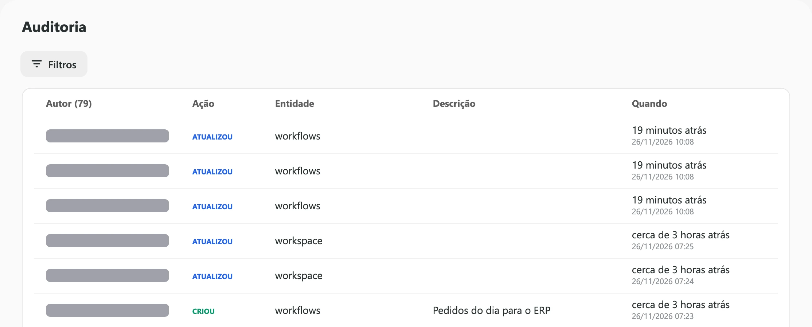

A **Auditoria** registra quem criou, alterou ou excluiu algo no seu workspace (na tela, **ambiente**) nos últimos 30 dias (algumas chamadas pelo MCP, como as de parceiro, ficam guardadas por mais tempo). Consultas feitas na tela (como abrir uma conversa ou buscar um contato) não aparecem; as chamadas feitas pelo [MCP](/docs/desenvolvedor/mcp) (da IA de um membro ou de um parceiro) aparecem, inclusive as de leitura.

<Note>
  Quem pode: você precisa da permissão **Auditoria** na seção **Gerenciamento do Ambiente** do papel (na tela, **Permissão**) ou ser o proprietário do workspace. Nos papéis prontos da Kinbox, apenas **Administrador** inclui essa permissão (veja [Criar papéis e permissões](/docs/configuracoes-no-workspace/configurar-permissoes-dos-usuarios) e [Referência de permissões](/docs/administracao/referencia-de-permissoes)).
</Note>

## Abrir a Auditoria

Vá em **Configurações** (ícone de engrenagem no menu lateral) → **Auditoria**. A tela mostra 20 registros por página, do mais recente para o mais antigo.

<Frame caption="Tela Auditoria com o botão Filtros e a lista de registros">
  
</Frame>

## O que cada coluna mostra

| Coluna | O que exibe |
| --- | --- |
| **Autor** | Nome e foto do membro (com o total de registros entre parênteses no cabeçalho). Mostra **Membro removido** quando a pessoa saiu do workspace ([Gerenciar membros](/docs/configuracoes-no-workspace/gerenciar-membros)), **Integração** quando a ação veio de uma integração, ou, em ações de parceiro pelo MCP, a palavra **Parceiro** seguida do nome do workspace do parceiro e do nome de quem fez a chamada. |
| **Ação** | **Criou**, **Atualizou** ou **Excluiu** (ou um rótulo específico da ação). Em ações de parceiro pelo MCP, exibe **Consultou**, **Alterou** ou **Falhou**. |
| **Entidade** | Tipo de item alterado, como **Tag**, **Assinatura**, **Bot**, **Permissão**, **Membro**, **Contato**, **Negociação**, **Frase Rápida** ou **MCP**. Alguns itens aparecem com o nome técnico em inglês (como `workspace`, `workflows`, `products`, `pipelines` ou `organizations`). |
| **Descrição** | Nome ou detalhe do item, quando disponível (como "Manual" ou "Automático: inatividade" em mudanças de disponibilidade, ou o motivo em tarefas). Clique na descrição para copiar o ID da entidade, quando disponível ("ID da entidade copiado"). |
| **Quando** | Tempo decorrido, data e hora, conforme o relógio do seu aparelho. |

## Filtrar registros

<Steps>
  <Step title="Abra o painel de filtros">
    Na tela **Auditoria**, clique em **Filtros**.
  </Step>
  <Step title="Escolha os critérios">
    Preencha os campos que quiser combinar: **Criado entre** (com os atalhos **Hoje** e **Ontem**), **Membro**, **Ação** (**Criou**, **Atualizou (Put)**, **Atualizou (Patch)**, **Excluiu** ou **Parceiro via MCP**), **Entidade** ou **ID da entidade**.
  </Step>
  <Step title="Aplique o filtro">
    Clique em **Filtrar**.
  </Step>
</Steps>

<Tip>
  Em **Ação**, **Atualizou (Put)** e **Atualizou (Patch)** são dois tipos de alteração e ambos aparecem como **Atualizou** na lista. Para ver todas as alterações de um período, filtre primeiro por um e depois pelo outro. Use **Entidade** ou **ID da entidade** um de cada vez, pois preencher um substitui o outro.
</Tip>

## Ações de parceiro pelo MCP

Se o seu workspace for ligado a um parceiro que pode inspecioná-lo, as chamadas feitas pelo parceiro pelo MCP aparecem na Auditoria com **Autor** **Parceiro** seguido do nome do workspace do parceiro e do nome de quem fez a chamada, **Entidade** como **MCP**, a ação (**Consultou**, **Alterou** ou **Falhou**) e o nome da ferramenta usada — sem exibir os dados consultados.

Para ver só esses registros, abra **Filtros**, selecione **Parceiro via MCP** em **Ação** e clique em **Filtrar**. Veja mais em [Controlar o que o parceiro vê no seu workspace](/docs/administracao/acesso-do-parceiro).

## Ações da IA pelo MCP

Cada chamada bem-sucedida de um assistente de IA conectado pelo MCP por um membro fica registrada em nome dele, inclusive as de leitura (veja [Conectar o Claude, o ChatGPT e outros agentes de IA (MCP)](/docs/desenvolvedor/mcp)).

## O que a Auditoria não mostra

- Consultas feitas na tela (quem abriu uma conversa, um contato ou um relatório). Chamadas pelo MCP aparecem, inclusive as de leitura.
- Tentativas que deram erro (exceto chamadas de parceiro pelo MCP, que aparecem como **Falhou**).
- Registros com mais de 30 dias (algumas chamadas pelo MCP, como as de parceiro, ficam guardadas por mais tempo).

## Problemas comuns

- **A ação que procuro não aparece.** Confira se ela foi feita nos últimos 30 dias e se não foi só uma consulta na tela. Em alterações, filtre **Atualizou (Put)** e depois **Atualizou (Patch)**. Itens que não estão entre as opções do filtro **Entidade** aparecem na lista: para achá-los, filtre por **Membro**, **Criado entre** ou **ID da entidade**.
- **O item Auditoria não aparece no menu.** Você precisa da permissão **Auditoria** no papel ou ser o proprietário do workspace. Peça a quem administra o workspace para liberar a permissão (veja [Criar papéis e permissões](/docs/configuracoes-no-workspace/configurar-permissoes-dos-usuarios)).
- **O filtro por ID da entidade não acha a criação de um item.** Ações de criar podem não aparecer na busca por **ID da entidade**. Filtre por **Criou** em **Ação**, junto com **Membro** ou **Criado entre**.

## Veja também

- [Controlar o que o parceiro vê no seu workspace](/docs/administracao/acesso-do-parceiro)
- [Excluir o workspace](/docs/administracao/excluir-workspace)
- [Referência de permissões](/docs/administracao/referencia-de-permissoes)
