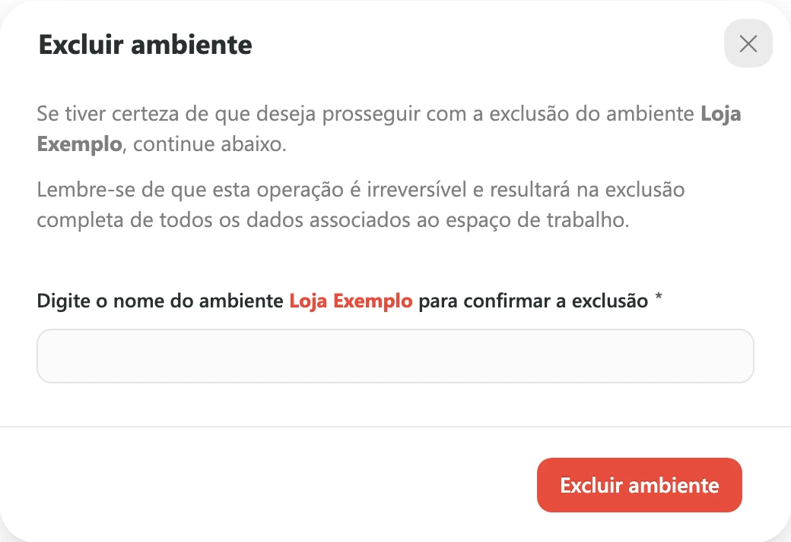

Você pode excluir o seu workspace (na tela, **ambiente**) pela tela de configurações gerais da Kinbox. Depois de confirmar, o workspace deixa de aparecer para todos os membros e a assinatura é cancelada.

<Note>
  Quem pode: **só o proprietário** do workspace. O cartão **Admin** só aparece para ele. Se você for outro membro e precisar excluir o workspace, peça ao proprietário ou solicite a transferência da propriedade (veja [Licenças, desativar membros e transferir a propriedade](/docs/administracao/licencas-e-propriedade)).
</Note>

## Antes de começar

- Exporte o que quiser guardar antes de excluir: [exportar contatos](/docs/clientes/exportar-contatos) e [exportar conversas](/docs/conversas/acoes-em-lote-e-exportar).
- Confira se há pendências em [Faturas](/docs/assinatura/faturas): excluir o workspace cancela a assinatura, mas não cancela faturas já em aberto.
- Se você quer apenas parar de pagar sem encerrar o workspace, veja [Cancelar a assinatura](/docs/assinatura/cancelar).
- Excluir o workspace não exclui a sua conta pessoal. Você continua com acesso aos outros workspaces dos quais participa ([Trocar de workspace ou criar outro](/docs/conta/trocar-de-workspace)). A exclusão da conta pessoal é outro processo, feito pelo aplicativo da Kinbox para celular.

## Passo a passo

<Steps>
  <Step title="Abra as configurações gerais">
    Vá em **Configurações** (ícone de engrenagem no menu lateral) → **Ambiente** → **Geral** (veja [Configurações gerais do workspace](/docs/configuracoes-no-workspace/configuracoes-gerais)).
  </Step>
  <Step title="Clique em Excluir ambiente">
    Role até o fim da tela, no cartão **Admin**, e clique no botão vermelho **Excluir ambiente**.
  </Step>
  <Step title="Digite o nome exato do workspace">
    Na janela **Excluir ambiente**, digite o nome do workspace exatamente como ele está cadastrado, respeitando maiúsculas, minúsculas, acentos e espaços. Se houver diferença, aparece "O nome do ambiente está incorreto" e nada acontece. Para cancelar, clique no **X** no canto superior direito.

    <Frame caption="Janela Excluir ambiente pedindo a confirmação do nome do workspace">
      
    </Frame>
  </Step>
  <Step title="Confirme a exclusão">
    Clique em **Excluir ambiente**.
  </Step>
</Steps>

<Warning>
  A tela avisa: "Lembre-se de que esta operação é irreversível e resultará na exclusão completa de todos os dados associados ao espaço de trabalho." Não há botão para desfazer; depois de confirmar, nenhum membro consegue mais entrar no workspace.
</Warning>

## O que acontece depois

- Aparece o aviso "Ambiente excluído com sucesso!" e, em seguida, você sai da sua conta na Kinbox.
- O workspace some da lista de workspaces de todos os membros. Quem participava apenas dele vê **Nenhum ambiente ativo** ao entrar novamente (veja [Não consigo entrar na Kinbox](/docs/conta/problemas-de-acesso)).
- A assinatura do workspace é cancelada (faturas já em aberto continuam em aberto).

## Apagar os dados de vez

Se você precisa que os dados do workspace sejam apagados de vez (por exemplo, para atender a uma solicitação de LGPD), fale com o suporte da Kinbox.
