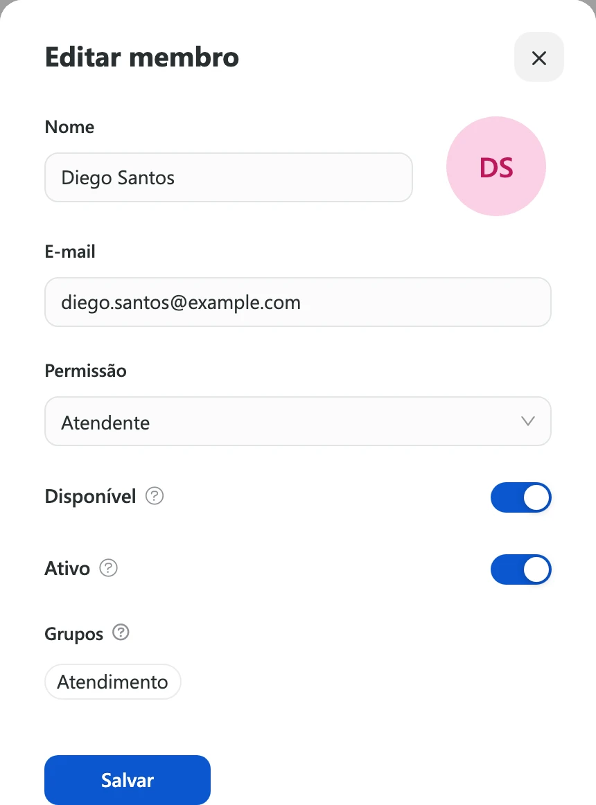

Entenda o que conta como licença de membro no workspace (na tela, **ambiente**), como liberar uma vaga desativando quem não usa mais a plataforma, como reativar um membro e como transferir a propriedade. Nesta central, **papel** é o conjunto de permissões dado a um membro. Na tela, esse conjunto se chama **Permissão**.

<Note>Quem pode: desativar e reativar membros exige a permissão **Membros** (em **Gerenciamento do Ambiente**) ou ser o proprietário; contratar mais licenças exige a permissão **Assinatura** ou ser o proprietário; transferir a propriedade é uma ação que **só o proprietário** pode fazer.</Note>

## O que é uma licença

Uma **licença** é uma vaga de membro ativo no plano do workspace.

- Conta como licença toda pessoa com acesso ativo ao workspace — **inclusive o proprietário e os convidados que ainda não aceitaram o convite**.
- Membros desativados (**Inativo**) não ocupam licença.
- Para ver quantas licenças o plano inclui, abra **Configurações** (engrenagem no menu lateral) → **Assinatura** e consulte a linha de licenças de membro (veja [Assinatura: como o plano é montado](/docs/assinatura/visao-geral)). Para ver quantas estão em uso, abra **Configurações** → **Ambiente** → **Membros** e conte os membros nos filtros **Ativo** e **Convite enviado** (todas as linhas que não estão como **Inativo**).

## Quando as licenças acabam

Quando todas as licenças do plano já estão ocupadas, aparece um aviso de que o limite foi atingido e o convite não é enviado.

Você pode liberar uma licença desativando um membro que não usa mais o workspace ou aumentar o número de licenças em **Configurações** → **Assinatura** → **Mudar plano**, no cartão **Membros**. Em teste grátis ou com a assinatura cancelada, o botão é **Assinar um plano**. Quando o plano é gerenciado por um parceiro, nenhum dos dois botões aparece: fale com o parceiro. Veja [Assinar ou mudar o plano](/docs/assinatura/assinar-ou-mudar-plano).

## Desativar um membro

Desativar impede o membro de entrar no workspace, libera a licença dele e preserva o histórico de quem atendeu cada conversa — diferente de excluir, que remove o membro do histórico de todas as sessões.

<Steps>
  <Step title="Abra a lista de membros">
    Vá em **Configurações** → **Ambiente** → **Membros**.
  </Step>
  <Step title="Escolha Desativar">
    Passe o mouse sobre a linha do membro, abra os três pontos e clique em **Desativar**. O proprietário não pode ser desativado.
  </Step>
  <Step title="Defina o que fazer com agendamentos e atribuições">
    Na janela **Desativar membro**, marque **Excluir agendamentos** se quiser apagar mensagens agendadas ainda não enviadas e **Transferir atribuições** se quiser distribuir as conversas e negociações abertas entre outros membros (deixar o campo de membros em branco apenas retira a atribuição). Clique em **Desativar**.

    Uma janela mostra o progresso. Se você cancelar no meio, o que já foi feito não volta: os agendamentos já excluídos e as atribuições já transferidas continuam assim, e o membro não é desativado.
  </Step>
  <Step title="Desconecte se o membro estiver online">
    Para encerrar na hora a sessão de um membro que você desativou, abra os três pontos da linha e clique em **Desconectar** se ele estiver **Online**.
  </Step>
</Steps>

Você também pode desativar abrindo **Editar membro**, desligando o interruptor **Ativo** e clicando em **Salvar**, mas esse caminho não oferece as opções de excluir agendamentos nem transferir atribuições.

<Frame caption="Painel Editar membro com o interruptor Ativo ligado">
  
</Frame>

Depois de desativado, o membro aparece riscado como **Inativo** na lista e não vê mais esse workspace ao entrar. Se ele não participar de nenhum outro workspace ativo, verá a tela **Nenhum ambiente ativo**.

## Reativar um membro

Em **Configurações** → **Ambiente** → **Membros**, abra os três pontos na linha de um membro **Inativo**, clique em **Reativar** e confirme em **Reativar**. O membro volta a entrar com a mesma senha e o mesmo papel e volta a ocupar uma licença do plano.

## Transferir a propriedade

<Note>Só o proprietário vê a opção **Tornar proprietário**, e ela só aparece na linha de um membro ativo que já aceitou o convite. Se a opção não aparecer, confirme que você está logado como proprietário e que a pessoa escolhida está ativa e não está mais como **Convidado**.</Note>

<Steps>
  <Step title="Inicie a transferência">
    Em **Configurações** → **Ambiente** → **Membros**, passe o mouse sobre o membro escolhido, abra os três pontos e clique em **Tornar proprietário**.
  </Step>
  <Step title="Confirme que está ciente">
    Na janela **Transferir propriedade**, marque a caixa declarando estar ciente de que a transferência é irreversível e clique em **Continuar**.
  </Step>
  <Step title="Confirme com sua senha atual">
    Na janela **Confirmar senha**, digite sua **Senha atual** e clique em **Transferir propriedade**. Se a senha estiver errada, a transferência não acontece.
  </Step>
</Steps>

Aparece o aviso "Propriedade transferida com sucesso!" e a página recarrega. Veja o que muda em seguida:

- O membro escolhido vira o **Proprietário** (sem papel).
- O antigo proprietário recebe automaticamente o papel que o novo proprietário tinha antes (por exemplo, se o novo proprietário usava o papel **Supervisor**, o antigo proprietário passa a usar **Supervisor**).
- Os dois são desconectados e precisam entrar novamente na Kinbox.

<Warning>Transferir a propriedade é uma ação irreversível. Não é possível desfazer pela tela: depois de confirmar, só o novo proprietário pode transferir a propriedade de volta.</Warning>

## O que só o proprietário faz

Cada workspace tem um único proprietário. Estas ações são exclusivas dele:

- Excluir o workspace (veja [Excluir o workspace](/docs/administracao/excluir-workspace)).
- Transferir a propriedade do workspace para outro membro ativo que já aceitou o convite.
- Marcar a permissão **Pode resetar senha de membros** em um papel.
- Além disso, o proprietário tem todas as permissões e não sofre restrições de papel, com duas exceções que valem também para ele quando o papel dele tem a opção: **Não mostrar sugestões de respostas** e **Não marca como lido ao abrir uma conversa** (veja a [Referência de permissões](/docs/administracao/referencia-de-permissoes)). Ele não pode ser desativado, desconectado nem excluído.

Veja também [Gerenciar membros](/docs/configuracoes-no-workspace/gerenciar-membros), [Workspace, membros e papéis](/docs/conceitos/workspace-membros-e-papeis) e [O convite não chegou ou o membro não consegue entrar](/docs/administracao/problemas-com-membros).
