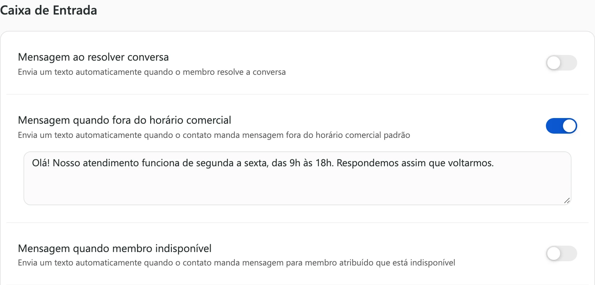

O cartão **Caixa de Entrada** em **Configurações** → **Ambiente** → **Geral** reúne as mensagens automáticas e as regras de atendimento do seu workspace (na tela, **ambiente**). Todas as opções valem para o workspace inteiro. A mensagem de boas-vindas (saudação) não fica neste cartão: ela é feita com um bot (veja [Bot: visão geral](/docs/bot/visao-geral)).

<Note>
  Quem pode: você precisa da permissão **Workspace** no papel (na tela, **Permissão**) ou ser o proprietário do workspace (veja [Configurações gerais do workspace](/docs/configuracoes-no-workspace/configuracoes-gerais)). As mudanças só passam a valer depois de clicar em **Salvar mudanças**.
</Note>

## Configurar uma mensagem automática

<Steps>
  <Step title="Abra o cartão Caixa de Entrada">
    Vá em **Configurações** (ícone de engrenagem no menu lateral) → **Ambiente** → **Geral** e role até **Caixa de Entrada**.
  </Step>
  <Step title="Ligue a chave da mensagem">
    Ligue a chave da mensagem desejada: **Mensagem ao resolver conversa**, **Mensagem quando fora do horário comercial** ou **Mensagem quando membro indisponível**. O campo de texto aparece quando a chave está ligada.
  </Step>
  <Step title="Escreva o texto">
    Digite a mensagem que o contato vai receber.

    <Frame caption="Cartão Caixa de Entrada com a Mensagem quando fora do horário comercial ligada">
      
    </Frame>
  </Step>
  <Step title="Salve as mudanças">
    Clique em **Salvar mudanças** na barra que aparece na tela.
  </Step>
</Steps>

## Como cada mensagem automática funciona

### Ao resolver a conversa

**Mensagem ao resolver conversa** envia o texto sempre que uma sessão é resolvida, desde que a chave esteja ligada e haja texto preenchido.

- Não sai quando a sessão resolvida tinha sido reaberta (por exemplo, dentro do **Tempo de tolerância ao resolver conversa** ou pela ação **Reabrir**) nem quando a conversa é resolvida ao ser transferida para outro canal.
- Se um membro resolve a conversa, a mensagem vai como mensagem desse membro; se a resolução acontece sem membro (por bot ou automação), vai como mensagem de bot.
- Aceita chaves como `{{first_name}}`, da mesma forma que as frases rápidas (veja [Criar frases rápidas](/docs/conversas/criar-frases-rapidas-para-suas-conversas)).
- O envio segue as regras do canal da conversa (no WhatsApp oficial, veja [Janela de 24 horas: quando é preciso usar um template](/docs/canais/whatsapp/whatsapp-cloud-api/janela-de-24-horas)).

### Fora do horário comercial

**Mensagem quando fora do horário comercial** envia o texto como mensagem de bot quando o contato escreve fora do expediente.

- Só funciona em conversas que **têm um membro responsável** e com um **Horário comercial** escolhido em **Preferências** (veja [Definir os horários de atendimento](/docs/configuracoes-no-workspace/criar-e-gerenciar-horarios)). Conversas sem responsável ou atribuídas apenas a um grupo não recebem essa mensagem.
- Sai **a cada mensagem** enviada pelo contato fora do horário.
- O horário segue o **Fuso horário** configurado em **Preferências**. Pode levar até 1 minuto para a virada do horário valer.
- O texto sai exatamente como escrito: chaves como `{{first_name}}` não são trocadas.

Para avisar fora do horário também em conversas sem responsável, use um [bot](/docs/bot/visao-geral) com horário ou uma [automação](/docs/automacao/exemplos#4-aviso-fora-do-horário) (veja [Organizar a equipe de atendimento](/docs/atendimento/visao-geral)).

### Membro indisponível

**Mensagem quando membro indisponível** envia o texto como mensagem de bot quando o contato escreve para uma conversa cujo membro responsável está indisponível (veja [Ficar disponível ou indisponível](/docs/conta/disponibilidade)).

- Só funciona em conversas com **membro responsável indisponível**.
- Sai **a cada mensagem** do contato, com o texto exatamente como escrito (sem troca de chaves).
- Quando a mensagem chega fora do horário comercial e o responsável também está indisponível, **Mensagem quando fora do horário comercial** tem prioridade.

## Regras da caixa de entrada

### Preservar tags ao resolver uma conversa

Quando ligada, a próxima sessão da mesma conversa (o mesmo contato no mesmo canal) herda as tags da sessão anterior. Quando desligada, a sessão nova começa sem tags, enquanto a sessão resolvida mantém as tags que já tinha (veja [Criar e usar tags](/docs/configuracoes-no-workspace/criar-e-gerenciar-tags)).

### Enviar nome do membro em cada mensagem

Adiciona o nome do perfil do membro na primeira linha, antes do texto (por exemplo, **Ana:**; no WhatsApp, aparece em negrito). Vale apenas para mensagens enviadas por um membro (não para bot ou automação), no WhatsApp, Facebook Messenger e Instagram (o texto de ajuda na tela cita WhatsApp e Facebook). O nome exibido é o cadastrado no perfil do membro (veja [Editar seu perfil](/docs/configuracoes-no-workspace/configurar-o-perfil-do-usuario)).

### Sempre atribuir ao membro que responder

Sem esta opção, quem responde uma conversa sem responsável vira o responsável por ela. Com a opção ligada, quem envia uma resposta comum assume a conversa mesmo se ela já tiver outro responsável (notas privadas não mudam o responsável). Veja [Organizar a equipe de atendimento](/docs/atendimento/visao-geral).

### Desatribuir ao reabrir se membro offline

Quando o contato escreve e a sessão é reaberta dentro do **Tempo de tolerância ao resolver conversa**, se o membro responsável estiver offline, a Kinbox retira a atribuição e deixa a conversa sem responsável. Não vale para sessões novas.

### Nota de avaliação pública

Mostra uma estrela e a média de avaliação de cada membro na lista de membros das **Salas** (veja [Pedir avaliação no fim do atendimento](/docs/atendimento/pesquisa-de-satisfacao)).

### Indicação dinâmica de conversa pendente

Na lista da **Caixa de entrada**, conversas pendentes (aguardando resposta do membro) exibem um círculo azul. Com esta opção ligada, você define após quanto tempo sem resposta o indicador vira um alerta amarelo e após quanto tempo vira vermelho, preenchendo **horas** e **minutos** (contados desde que a conversa ficou pendente ou desde a última mensagem).

- Marque **Destacar cor do fundo** para pintar também o fundo da linha da conversa na lista.
- Preencha **horas** e **minutos** em cada nível; use `0` quando não quiser horas (se algum campo ficar vazio, a cor daquele nível não aparece).
- Os mesmos tempos são usados no painel [Ao vivo](/docs/relatorios/ao-vivo).

### Tempo de tolerância ao resolver conversa

Quando ligada, se o contato mandar mensagem antes do tempo definido em minutos após a sessão ser resolvida, a Kinbox reabre a mesma sessão em vez de criar uma nova — sem novo protocolo e sem disparar novamente o bot de início. Por exemplo, com 30 minutos de tolerância, uma resposta enviada 10 minutos após o encerramento volta para a mesma sessão. Quando desligada, uma mensagem depois de resolver abre uma sessão nova. Nos dois casos há uma exceção: com a função **Não reabrir por agradecimento** do copiloto ligada, uma mensagem só de agradecimento pode manter a conversa resolvida (veja [Não reabrir por agradecimento](/docs/copiloto/configuracoes-de-copiloto#não-reabrir-por-agradecimento), [Conversas, sessões e status](/docs/conceitos/conversas-e-sessoes) e [Bot: visão geral](/docs/bot/visao-geral)).

### Campos obrigatórios no chat ativo

Exige o preenchimento dos campos escolhidos sempre que um membro inicia uma conversa pelo chat ativo (**Enviar mensagem**; veja [Iniciar uma conversa com um contato](/docs/conversas/iniciar-conversa)). Ligue a chave e escolha pelo menos um campo personalizado de **contato** (veja [Criar campos personalizados](/docs/configuracoes-no-workspace/campos-personalizados-no-kinbox)): a janela de iniciar conversa pede apenas campos de contato.

## Problemas comuns

- **A mensagem fora do horário não sai.** Confira se a conversa tem um membro responsável, se existe um **Horário comercial** escolhido em **Preferências** e se você clicou em **Salvar mudanças**. Conversas sem responsável ou só com grupo não recebem essa mensagem.
- **A mensagem fora do horário (ou de membro indisponível) sai várias vezes.** Ela é enviada a cada mensagem do contato enquanto a condição durar.
- **A mensagem ao resolver não saiu.** Ela não é enviada quando a sessão resolvida tinha sido reaberta (por exemplo, pelo tempo de tolerância) nem quando a conversa foi resolvida ao ser transferida para outro canal.
- **A cor de conversa pendente não aparece.** Confira se **Indicação dinâmica de conversa pendente** está ligada, salva e com os campos de horas e minutos preenchidos (use `0` em vez de deixar vazio).
