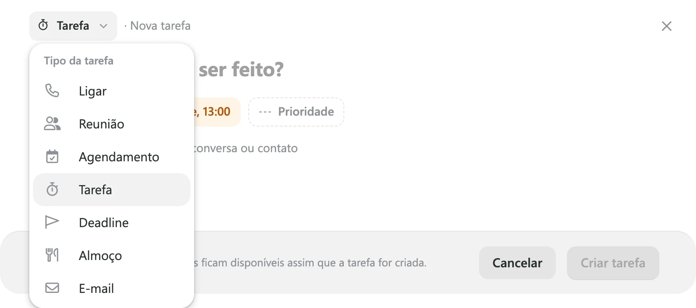
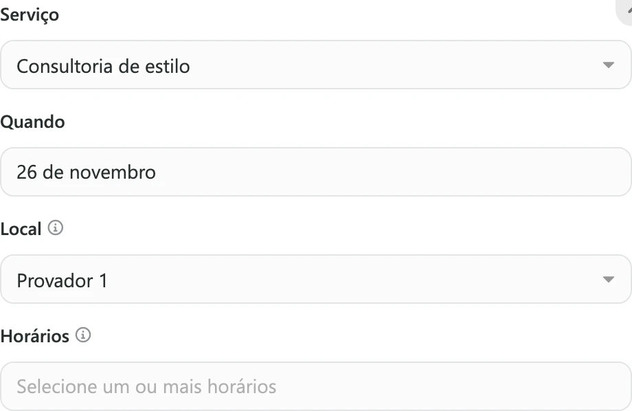

Crie, acompanhe, confirme presença, reagende e cancele atendimentos com hora marcada no **Kinbox Agenda** pelo calendário ou pela lista de **Tarefas**.

<Note>
  Quem pode: o proprietário do workspace ou membros com a permissão **Gerenciar agendamentos** (seção **Agendas** do papel, chamado na tela de **Permissão**). Essa permissão também é necessária para **ver** agendamentos no calendário e na lista de **Tarefas**. Se a opção **Agendamento** não aparecer, peça a quem administra o workspace a permissão **Gerenciar agendamentos** — veja [Criar papéis e permissões](/docs/configuracoes-no-workspace/configurar-permissoes-dos-usuarios).
</Note>

## Antes de começar

Você precisa ter pelo menos um serviço **Ativo** com horário configurado e um local **Disponível** vinculado a ele — veja [Cadastrar serviços e locais](/docs/agenda/servicos-e-locais).

## Onde ficam os agendamentos

Os agendamentos aparecem em dois lugares na Kinbox:

- **Calendário:** clique no botão **Calendário** (ícone de calendário no topo da tela, à direita, ao lado do sino) ou use o comando **Abrir Calendário** na busca do topo (`Ctrl+K` / `⌘K`, veja [Caixa de entrada: visão geral](/docs/conversas/caixa-de-entrada-do-kinbox)). O painel lateral oferece as visualizações **Mês**, **Semana**, **Dia** (padrão) e a visualização **Agenda** (lista), além dos botões **Hoje**, **Voltar** e **Próximo**. Cada agendamento aparece com o nome do serviço e o local (por exemplo, `Consultoria de estilo - Provador 1`).
- **Lista de Tarefas:** abra **Tarefas** no menu lateral. Os agendamentos aparecem junto às tarefas, mas só os do período escolhido: na visão padrão (**Pendente**), os do mês atual. Para ver outros meses, escolha **Próximo mês** no seletor de status da lista ou use o filtro **Período**. Os **Cancelado** e **Concluído** ficam ocultos até você filtrar por **Status do agendamento**.

## Criar um agendamento

<Steps>
  <Step title="Abra o formulário e escolha Agendamento">
    Clique em um horário vazio no **Calendário** (abre já na data clicada), clique em **Nova tarefa** na lista de **Tarefas** ou use **Adicionar Tarefa** na busca do topo (`Ctrl+K` / `⌘K`). No topo da janela, clique em **Tarefa** para abrir o menu **Tipo da tarefa** e escolha **Agendamento**. Essa opção só aparece em tarefas novas e para quem tem **Gerenciar agendamentos**; se não aparecer, peça essa permissão a quem administra o workspace.

    <Frame caption="Menu Tipo da tarefa aberto pelo botão Tarefa no topo da janela de nova tarefa">
      
    </Frame>
  </Step>

  <Step title="Escolha serviço, data, local e horários">
    - **Serviço** (obrigatório): selecione um serviço ativo (por exemplo, `Consultoria de estilo`). Se houver mais itens, clique em **Carregar mais**.
    - **Quando:** escolha o dia do agendamento.
    - **Local** (obrigatório): disponível depois de escolher o serviço (por exemplo, `Provador 1`). Um local sem horário livre no dia aparece desabilitado com a dica **Agenda indisponível**.
    - **Horários** (obrigatório): selecione um ou mais horários livres. Horários ocupados aparecem riscados; sem vagas no dia, a lista mostra "Nenhum horário disponível".

    <Frame caption="Campos Serviço, Quando, Local e Horários no formulário de agendamento">
      
    </Frame>

    <Tip>
      Você pode selecionar vários horários de uma vez no campo **Horários**: a Kinbox cria um agendamento separado para cada horário escolhido.
    </Tip>
  </Step>

  <Step title="Selecione ou cadastre o contato">
    Em **Contato**, escolha um cadastro em "Selecione um contato" ou clique em **Novo contato** para cadastrar na hora.

    - **Contato existente:** para escolher outro, clique em **Trocar**.
    - **Novo contato:** **Nome**, **Telefone** e **Data de nascimento** são obrigatórios, assim como os campos personalizados obrigatórios do contato. O **Email** não aparece como obrigatório na tela, mas a Agenda exige e-mail do contato: preencha-o para o agendamento ser salvo. Para desistir do cadastro novo, clique em **Remover contato**.
  </Step>

  <Step title="Salve o agendamento">
    Clique em **Salvar**. A Kinbox mostra "Agendamento criado." e o agendamento nasce com status **Confirmado**. Não há campo de preço nem de membro responsável no formulário: o preço vem do serviço e aparece nos detalhes.
  </Step>
</Steps>

**Dados exigidos do contato:** a Agenda exige nome, telefone, e-mail e data de nascimento do contato. Se você escolher um contato existente que ainda não tem esses dados, o formulário mostra "Esse contato ainda não tem os dados que o Kinbox Agenda exige. Preencha para continuar." e pede só os dados que faltam (**Email**, **Telefone**, **Data de nascimento** ou campos obrigatórios). O que você preencher fica salvo no contato; contatos já vinculados à Agenda não pedem esses dados novamente. Veja mais em [Contatos: encontrar, cadastrar, editar e excluir](/docs/conversas/clientes-contatos-e-organizacoes).

## Serviços com reserva de lugares

Quando o serviço usa [Reserva de lugares](/docs/agenda/servicos-e-locais#reserva-de-lugares), o formulário troca **Local** e **Horários** por **Pessoas** (indicando o mínimo e o máximo aceitos) e **Horário** (um único horário por vez, liberado depois de informar quantas pessoas vão). Abaixo do campo aparecem os espaços sugeridos pela Agenda ("Sugestão do sistema, confirmada ao salvar."). Horários sem espaço para o grupo aparecem marcados como **Lotado**.

## Ver os detalhes

Clique em um agendamento no calendário ou em **Visualizar** na lista de **Tarefas** para abrir **Detalhes do agendamento**. O cabeçalho exibe o nome do serviço, o status (**Confirmado**, **Cancelado** ou **Concluído**) e o horário de início e fim.

Na janela aparecem:

- **Serviço**, **Recurso** (o local escolhido) e **Localização** (com "-" quando o local não tem localização);
- os dados do cliente;
- **Preço do serviço** e **Preço do agendamento** (podem ser diferentes quando há tarifas adicionais).

Em serviços com reserva de lugares, **Pessoas** e **Espaço** (ou **Espaços**) aparecem no lugar de **Recurso**, e **Espaço ocupado até** aparece quando o serviço tem intervalo entre reservas. Nesses agendamentos com status **Confirmado**, o botão **Trocar espaços** no rodapé permite escolher outros espaços para a reserva.

## Confirmar presença

Não existe um botão **Concluir** no agendamento. Para concluir, abra **Detalhes do agendamento** e marque a caixinha **Confirmar presença** ao lado do título — ela aparece apenas em agendamentos com status **Confirmado** ou **Concluído**.

Marcar a caixinha muda o status para **Concluído** ("Presença confirmada."). Desmarcar a mesma caixinha (**Desfazer confirmação de presença**) volta o status para **Confirmado** ("Confirmação de presença desfeita.").

## Reagendar

Reagendar vale para agendamentos com status **Confirmado**. Abra **Detalhes do agendamento** e clique em **Reagendar** no rodapé. O formulário abre com o contato somente para leitura, para você escolher novo serviço, data, local e um único horário por vez. Clique em **Reagendar** para passar o agendamento para o novo horário ("Agendamento reagendado.").

## Cancelar

Cancelar vale para agendamentos com status **Confirmado**. Abra **Detalhes do agendamento**, clique em **Cancelar o agendamento** no rodapé e confirme em **Cancelar agendamento** na janela **Cancelar agendamento?** (não pede motivo). A Kinbox mostra "Agendamento cancelado.".

O agendamento não é excluído: ele permanece no calendário com o status **Cancelado** e sai da lista padrão de **Tarefas** (a menos que você filtre por status).

<Warning>
  Cancelar um agendamento não pode ser desfeito ("Ao confirmar, este agendamento será marcado como cancelado. Essa ação não poderá ser desfeita.").
</Warning>

## O contato é avisado?

Não. Criar, reagendar, cancelar ou confirmar presença não manda lembrete, confirmação nem aviso ao contato. Para avisar o cliente, mande uma mensagem na conversa ou use [Agendar uma mensagem](/docs/conversas/agendar-mensagem).

## Filtrar o calendário

No calendário, clique em **Filtros** (aparece para quem tem **Gerenciar agendamentos**, com o número de filtros ativos) para filtrar por **Local**, **Serviço** e **Status do agendamento** (**Confirmado**, **Cancelado** ou **Concluído**). Clique em **Limpar filtros** para remover a seleção.

Na lista de **Tarefas**, escolher **Tipo** = **Agendamento** libera os filtros **Serviço**, **Local** e **Status do agendamento**.

Agendamentos criados pelo agente de IA aparecem no calendário como os demais — veja [Dar ferramentas ao agente: Agenda, Google Calendar e HubSpot](/docs/agente-de-ia/ferramentas).

## Problemas comuns

- **Não aparece a opção Agendamento ou não vejo os agendamentos no calendário.** Falta a permissão **Gerenciar agendamentos** no seu papel. Peça a quem administra o workspace para liberá-la em [Criar papéis e permissões](/docs/configuracoes-no-workspace/configurar-permissoes-dos-usuarios).
- **O local aparece desabilitado com Agenda indisponível.** O local não tem horário livre no dia escolhido — pode estar todo ocupado, fora do expediente do serviço ou com status **Indisponível**.
- **Aparece "Nenhum horário disponível".** O dia está fora do expediente do serviço ou todos os horários daquele local estão ocupados. Escolha outra data ou outro local.
- **Marquei um agendamento e ele não aparece na lista de Tarefas.** A lista mostra só os agendamentos do período escolhido (na visão padrão, o mês atual). Para um agendamento do mês que vem, escolha **Próximo mês** no seletor de status ou use o filtro **Período**; no calendário, avance até a data.
- **Reagendar ou cancelar dá erro.** Os botões aparecem também em agendamentos **Cancelado** ou **Concluído**, mas só funcionam em agendamentos **Confirmado**. Em um agendamento **Concluído**, desmarque **Confirmar presença** antes, se precisar reagendar ou cancelar.
- **Pede e-mail e data de nascimento do contato.** O Kinbox Agenda exige nome, telefone, e-mail e data de nascimento para agendar. Preencha os dados no próprio formulário; eles ficam salvos no contato.
- **O serviço não aparece na lista.** Apenas serviços com status **Ativo** podem ser agendados. Ative o serviço em **Configurações** → **Agenda** → **Serviços**.
- **O cliente não recebeu aviso.** A Kinbox não envia confirmação nem lembrete automático ao contato. Envie uma mensagem na conversa ou use [Agendar uma mensagem](/docs/conversas/agendar-mensagem).

## Veja também

- [Kinbox Agenda: visão geral](/docs/agenda/kinbox-agenda)
- [Cadastrar serviços e locais](/docs/agenda/servicos-e-locais)
- [Contatos: encontrar, cadastrar, editar e excluir](/docs/conversas/clientes-contatos-e-organizacoes)
- [Agendar uma mensagem](/docs/conversas/agendar-mensagem)
- [Referência de permissões](/docs/administracao/referencia-de-permissoes)
