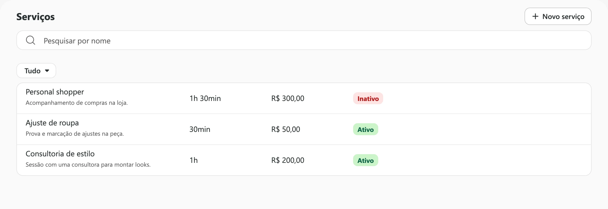
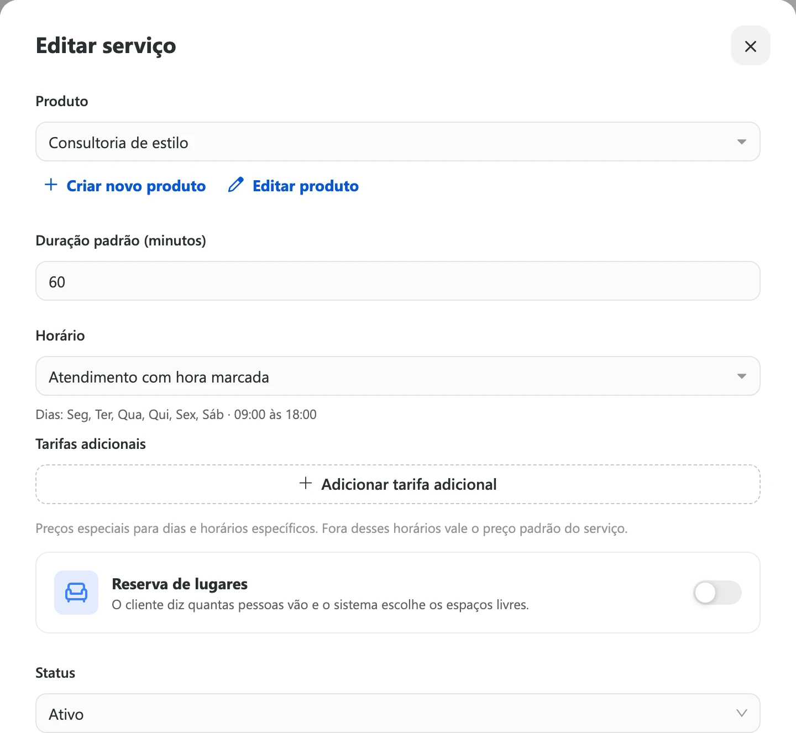
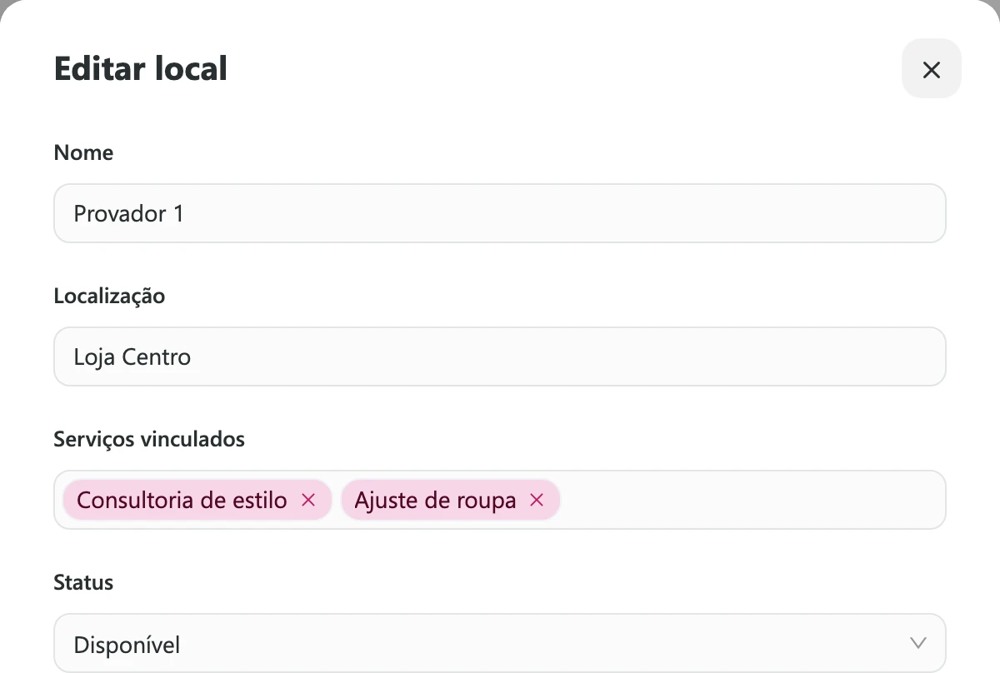

Cadastre no **Kinbox Agenda** os serviços que sua empresa oferece com hora marcada e os locais onde cada atendimento acontece. Depois que ambos estiverem ativos e vinculados, sua equipe já pode criar agendamentos.

<Note>
  Quem pode: o proprietário do workspace (na tela, **ambiente**) ou membros com as permissões **Gerenciar serviços** (para serviços) e **Gerenciar locais** (para locais), na seção **Agendas** do papel (na tela, **Permissão**). Se **Agenda** (ou **Serviços** / **Local**) não aparecer em **Configurações**, peça a permissão a quem administra o workspace — veja [Criar papéis e permissões](/docs/configuracoes-no-workspace/configurar-permissoes-dos-usuarios).
</Note>

## Antes de começar

Siga esta ordem para deixar tudo pronto para agendar:

1. **Horário e produto:** todo serviço usa um horário cadastrado em [Definir os horários de atendimento](/docs/configuracoes-no-workspace/criar-e-gerenciar-horarios) e um produto ativo de [Cadastrar produtos](/docs/crm/criar-e-gerenciar-produtos). Cadastre o horário antes; o produto pode ser cadastrado antes ou de dentro do formulário do serviço.
2. **Serviços:** cadastre cada serviço com o produto, a duração e o horário.
3. **Locais:** cadastre os espaços, unidades ou profissionais e vincule a cada local os serviços ativos que ele atende. Sem ao menos um local ligado ao serviço, não há **Local** disponível na hora de agendar.

## Cadastrar um serviço

<Steps>
  <Step title="Abra a lista de serviços">
    Vá em **Configurações** → **Agenda** → **Serviços** e clique em **Novo serviço** para abrir **Criar serviço** (ou clique em um serviço da lista para abrir **Editar serviço**).

    <Frame caption="Lista de serviços em Configurações → Agenda → Serviços com busca, filtro de status e botão Novo serviço">
      
    </Frame>
  </Step>

  <Step title="Escolha o produto e a duração">
    - **Produto** (obrigatório): selecione um produto ativo (por exemplo, `Consultoria de estilo`). O nome, a descrição e o preço do serviço vêm do produto. Se o produto ainda não existir, clique em **Criar novo produto** e salve em **Criar**; com um produto escolhido, **Editar produto** ajusta o cadastro.
    - **Duração padrão (minutos)** (obrigatório): informe a duração de cada horário oferecido (por exemplo, `60` para 1 hora ou `30` para 30 minutos).
  </Step>

  <Step title="Defina o horário, tarifas opcionais e status">
    - **Horário** (obrigatório): selecione um horário já cadastrado em [Definir os horários de atendimento](/docs/configuracoes-no-workspace/criar-e-gerenciar-horarios) (por exemplo, `Atendimento com hora marcada`), com pelo menos um dia da semana ativo. Abaixo do campo aparece o resumo dos dias e da faixa de horas. Para criar ou editar um horário, use a página **Horários**.
    - **Tarifas adicionais** (opcional): clique em **Adicionar tarifa adicional** se quiser cobrar outro valor em dias e horas específicos (veja [Tarifas adicionais](#tarifas-adicionais)).
    - **Reserva de lugares** (opcional): ligue apenas para serviços reservados por quantidade de pessoas (veja [Reserva de lugares](#reserva-de-lugares)).
    - **Status:** escolha **Ativo** (padrão) ou **Inativo**.

    <Frame caption="Painel Editar serviço com Produto, Duração padrão (minutos), Horário, Tarifas adicionais, Reserva de lugares e Status">
      
    </Frame>
  </Step>

  <Step title="Salve o serviço">
    Clique em **Salvar** no rodapé do painel.
  </Step>
</Steps>

Para criar ou editar um produto pelos botões **Criar novo produto** e **Editar produto**, você precisa da permissão **Produtos** (ou ser o proprietário). Se você não tem acesso a **Produtos** ou **Horários**, peça a quem tem para cadastrar o produto e o horário antes.

Ao salvar, o produto escolhido fica vinculado ao serviço e recebe o mesmo status (**Ativo** ou **Inativo**). Editar o produto em **Configurações** → **CRM** → **Produtos** atualiza o nome, a descrição, o preço e o status do serviço.

**Mudou o horário de atendimento?** Alterar o horário em **Configurações** → **Ambiente** → **Horários** não atualiza o serviço sozinho. Depois de salvar a mudança no horário, abra o serviço e clique em **Salvar** para a Agenda usar os novos dias e horas.

## Tarifas adicionais

Use **Tarifas adicionais** para definir preços especiais em dias e horários específicos (por exemplo, um valor diferente aos fins de semana ou à noite). Clique em **Adicionar tarifa adicional**, selecione um **Horário** (outro cadastro de **Horários**) e informe o **Valor da tarifa**. Fora dessas faixas, vale o preço padrão do produto. Para remover uma tarifa, clique no ícone de lixeira.

## Reserva de lugares

Ligue **Reserva de lugares** quando o serviço funciona por número de pessoas — como reservas de mesas, salas ou camarotes. Em vez de escolher o local na mão, quem agenda informa quantas pessoas vão e a Agenda seleciona os espaços livres.

Na tela, o fluxo segue três passos:

1. **Cadastre os espaços em Locais:** cada mesa, sala ou camarote com quantas pessoas cabem, vinculado a este serviço.
2. **Quem agenda informa quantas pessoas vão:** só os horários com espaço livre para o grupo podem ser selecionados; os outros aparecem como **Lotado**.
3. **O sistema escolhe e bloqueia os espaços:** escolhe a combinação com menos lugares sobrando e bloqueia os espaços durante a reserva.

Com a chave ligada, o formulário do serviço exibe:

- **Limite máximo de pessoas:** o maior grupo aceito numa reserva.
- **Unir locais:** quantos espaços podem ser combinados para um grupo.
- **Intervalo entre reservas:** minutos para limpar e arrumar o espaço antes da próxima reserva.

Nos locais vinculados a esse serviço, aparece o bloco **Reserva de lugares**:

- **Capacidade:** quantas pessoas cabem no espaço.
- **Ordem de uso:** se o espaço sai antes, sem preferência ou só quando os outros lotarem.
- **Pode ser juntado:** se o espaço pode ser combinado com outros para grupos maiores.
- **Ambiente:** com **Pode ser juntado** ligado, junta só espaços do mesmo ambiente.

## Cadastrar um local

<Steps>
  <Step title="Abra a lista de locais">
    Vá em **Configurações** → **Agenda** → **Local**. A lista **Locais** mostra as colunas **Nome**, **Localização**, **Capacidade** e **Status**, com o campo **Pesquisar por nome** e o filtro **Tudo** (**Tudo**, **Disponível** ou **Indisponível**). Clique em **Novo local** para abrir **Criar local** (ou clique em um local da lista para abrir **Editar local**).
  </Step>

  <Step title="Preencha os dados do local">
    - **Nome** (obrigatório): nome da sala, unidade, espaço ou profissional (por exemplo, `Provador 1`, `Ateliê`, `Sala 1` ou `Mesa 4`).
    - **Localização** (opcional): referência de onde fica o local (por exemplo, `Loja Centro` ou `Bloco A`). Aparece nos detalhes do agendamento.
    - **Serviços vinculados** (obrigatório): selecione um ou mais serviços ativos. Um local pode atender vários serviços, e um serviço pode estar em vários locais. Se um serviço já vinculado for desativado depois, ele aparece com `(Inativo)`.
    - **Reserva de lugares** (se aparecer): exibido apenas quando ao menos um serviço vinculado usa reserva de lugares; informe a **Capacidade** e as opções de combinação do espaço.
    - **Status:** escolha **Disponível** (padrão) ou **Indisponível**.

    <Frame caption="Painel Editar local com Nome, Localização, Serviços vinculados e Status">
      
    </Frame>
  </Step>

  <Step title="Salve o local">
    Clique em **Salvar**.
  </Step>
</Steps>

## Ativar ou desativar

Serviços e locais não têm opção de excluir nem de clonar. Para deixar de oferecer um item, abra o menu de três pontos na linha dele:

- **Serviços:** clique em **Desativar** (ou **Ativar**) e confirme em **Desativar** (ou **Ativar**) na janela **Desativar serviço** (ou **Ativar serviço**). O produto vinculado acompanha o status do serviço. Serviços **Inativo** não aparecem para novos agendamentos nem para vincular a locais.
- **Locais:** clique em **Desativar** (ou **Ativar**) e confirme em **Desativar** (ou **Ativar**) na janela **Desativar local** (ou **Ativar local**). Um local **Indisponível** continua na lista, mas fica sem horários livres para novos agendamentos.

## Problemas comuns

- **Não acho o produto ao criar o serviço.** O campo **Produto** lista apenas produtos ativos. Ative o item em **Configurações** → **CRM** → **Produtos** ou use **Criar novo produto** dentro do serviço.
- **Não consigo excluir um serviço ou local.** Serviços e locais não são excluídos; desative-os pelo menu de três pontos.
- **Não consigo excluir um produto ou um horário.** Produtos vinculados ao Kinbox Agenda são desativados em vez de excluídos, e horários em uso por um serviço ativo não podem ser excluídos nem ficar sem nenhum dia ativo. Veja [Cadastrar produtos](/docs/crm/criar-e-gerenciar-produtos) e [Definir os horários de atendimento](/docs/configuracoes-no-workspace/criar-e-gerenciar-horarios).
- **O serviço não aparece ao criar um local ou ao agendar.** Confira se ele está **Ativo** em **Configurações** → **Agenda** → **Serviços**. Sem nenhum serviço ativo, a tela de local avisa para criar ou reativar um serviço antes de continuar.
- **Mudei o horário e a Agenda continua com o antigo.** O serviço usa o horário que estava salvo quando ele foi gravado. Abra o serviço em **Configurações** → **Agenda** → **Serviços** e clique em **Salvar** de novo.
- **Como fecho a agenda num feriado ou bloqueio um horário?** A Agenda não tem cadastro de feriado nem de bloqueio de horário. O contorno é desligar o dia no horário em **Configurações** → **Ambiente** → **Horários**, abrir o serviço e clicar em **Salvar**; depois do feriado, religue o dia e salve o serviço de novo. Antes, saiba que:
  - O horário vale por dia da semana, não por data: desligar a quinta-feira fecha todas as quintas-feiras até você religar o dia.
  - A mudança vale para tudo o que usa esse mesmo horário (como bot, campanhas e chat do site), não só para a Agenda.
  - Não dá para desligar o dia se ele for o único dia ativo de um horário usado por serviço **Ativo**: a Kinbox avisa que o horário está em uso pelo serviço do Kinbox Agenda e precisa ter pelo menos um dia ativo.

  Para tirar um local de uso, deixe-o **Indisponível**.
- **Não vejo Agenda em Configurações.** Faltam as permissões **Gerenciar serviços** ou **Gerenciar locais** no seu papel. Peça a quem administra o workspace para liberá-las em [Criar papéis e permissões](/docs/configuracoes-no-workspace/configurar-permissoes-dos-usuarios).

## Veja também

- [Kinbox Agenda: visão geral](/docs/agenda/kinbox-agenda)
- [Criar, reagendar e cancelar agendamentos](/docs/agenda/agendamentos)
- [Cadastrar produtos](/docs/crm/criar-e-gerenciar-produtos)
- [Definir os horários de atendimento](/docs/configuracoes-no-workspace/criar-e-gerenciar-horarios)
- [Referência de permissões](/docs/administracao/referencia-de-permissoes)
- [Criar campos personalizados](/docs/configuracoes-no-workspace/campos-personalizados-no-kinbox)
