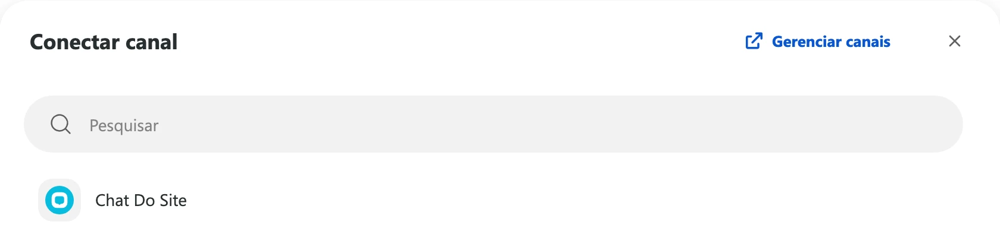

Conecte o agente de texto aos canais do workspace para que ele comece a atender os contatos, controle quando ele fica ligado ou pausado e saiba como a conversa passa para um membro da equipe. Para ligar um agente de voz às ligações do WhatsApp oficial, veja [Agente de voz (Beta)](/docs/agente-de-ia/agente-de-voz).

<Note>
Quem pode: membros com a permissão **Agentes de IA** e o proprietário do workspace. Para abrir a tela de canais pelo link **Gerenciar canais**, o membro também precisa da permissão **Gerenciar Canais**. Em agentes **Gerenciado pelo parceiro**, os cartões do agente não aparecem: o cliente só testa o agente.
</Note>

## Antes de começar

- O canal já precisa estar conectado à Kinbox — veja [Canais: conectar e gerenciar](/docs/canais/visao-geral).
- Valide as respostas antes de ligar ao público — veja [Testar o agente antes de ativar](/docs/agente-de-ia/testar).
- Confira se há [saldo na carteira](/docs/conceitos/saldo-e-creditos).

## Passo a passo

<Steps>
  <Step title="Abra o cartão Canais conectados">
    Em **Configurações** → **Automação** → **Agentes de IA**, abra o agente e clique no cartão **Canais conectados** (ou clique em **Adicionar**, ou nos ícones de canais no topo do painel da direita).
  </Step>
  <Step title="Escolha os canais">
    Na janela **Conectar canal**, marque os canais que o agente vai atender e clique em **Selecionar**. Cada canal indica se já está **Em uso pelo agente** ou **Também atendido pelo bot**, e o link **Gerenciar canais** leva ao cadastro de canais.

    <Frame caption="Janela Conectar canal para ligar o agente aos canais do workspace">
      
    </Frame>
  </Step>
  <Step title="Confirme se o canal já tinha outro agente">
    Se algum canal escolhido já estiver conectado a outro agente, abre a janela **Mover canal de agente**. Clique em **Mover** para tirar o canal do agente anterior e ligá-lo a este.
  </Step>
</Steps>

Ao conectar, o status do agente muda para **Conectado** e aparece o interruptor de controle no topo do painel da direita.

<Note>
**Um agente de texto por canal:** cada canal tem um único agente de texto para as mensagens. Mover o canal para outro agente de texto desconecta automaticamente do primeiro. As ligações do WhatsApp oficial têm, à parte, um agente de voz: o mesmo número pode ter os dois. Bots comuns que atendem o mesmo canal continuam ativos.
</Note>

## Desconectar, ligar e pausar

- **Desconectar um canal:** no cartão **Canais conectados**, remova o canal e confirme em **Desconectar**. Um canal excluído da Kinbox aparece listado como **Canal não encontrado**.
- **Ligar e pausar:** enquanto houver canal conectado, use o interruptor no topo do painel da direita (**Atendendo nos canais conectados**). Desligar muda o status para **Pausado** e o agente deixa de entrar em conversas novas nos canais conectados. Mesmo pausado nos canais, o agente ainda pode ser chamado por um bloco **Agente de IA** dentro de um bot.

## Quando o agente entra na conversa

- O agente entra apenas quando o contato envia a mensagem que abre uma [sessão nova](/docs/conceitos/conversas-e-sessoes). Mensagens em sessões já abertas ou reabertas, e mensagens enviadas pelo celular do número, não chamam o agente.
- O agente não responde em grupos de WhatsApp.
- Por trás, a Kinbox cria um bot do agente, que aparece na lista de **Bot** com a etiqueta **Agente de IA** e com o interruptor gerenciado pelo agente. Ao ser criado, esse bot fica no topo da lista de bots; se alguém reordenar a lista e outro bot ativo do mesmo canal ficar acima dele, o primeiro da lista atende no lugar do agente.
- O agente atende contatos novos e antigos e não possui configuração própria de horário de atendimento.

## O que a equipe vê na conversa

Quando o agente inicia o atendimento numa conversa:

- Aparece uma mensagem de sistema avisando que o agente começou o atendimento. Passando o mouse sobre ela, surge o botão **Inspecionar**, que abre o painel **Execução do agente** com as rodadas e ações executadas. Os registros ficam disponíveis por **60 dias** (e não aparecem em agentes **Gerenciado pelo parceiro**).
- No topo da conversa, aparece a faixa **Em atendimento pelo agente** com o nome do agente.

## Passar a conversa para um membro

Uma conversa atendida pelo agente pode ir para a equipe de duas formas:

- **Pelo agente:** configure a ferramenta **Transferir para humano** ou **Mover para grupo** (veja [Ferramentas](/docs/agente-de-ia/ferramentas)) ou a ação **Transferir** no fluxograma (veja [Ações do fluxograma](/docs/agente-de-ia/acoes-do-fluxograma)). Quando o agente transfere para um membro ou grupo, ele para de responder naquela sessão e só volta numa sessão nova.
- **Pelo membro:** quando qualquer membro envia uma mensagem comum para o contato na conversa, o agente para de atender; se a conversa ainda não tinha responsável, o membro passa a ser o responsável. Enviar uma nota pro time não desliga o agente.

Se o [saldo](/docs/conceitos/saldo-e-creditos) ficar insuficiente (R$ 1,00 ou menos) durante o atendimento, o agente para de responder e a conversa fica sem o agente. Se o agente não estiver entrando nas conversas como esperado, veja [O agente não responde ou responde errado](/docs/agente-de-ia/problemas-comuns).
