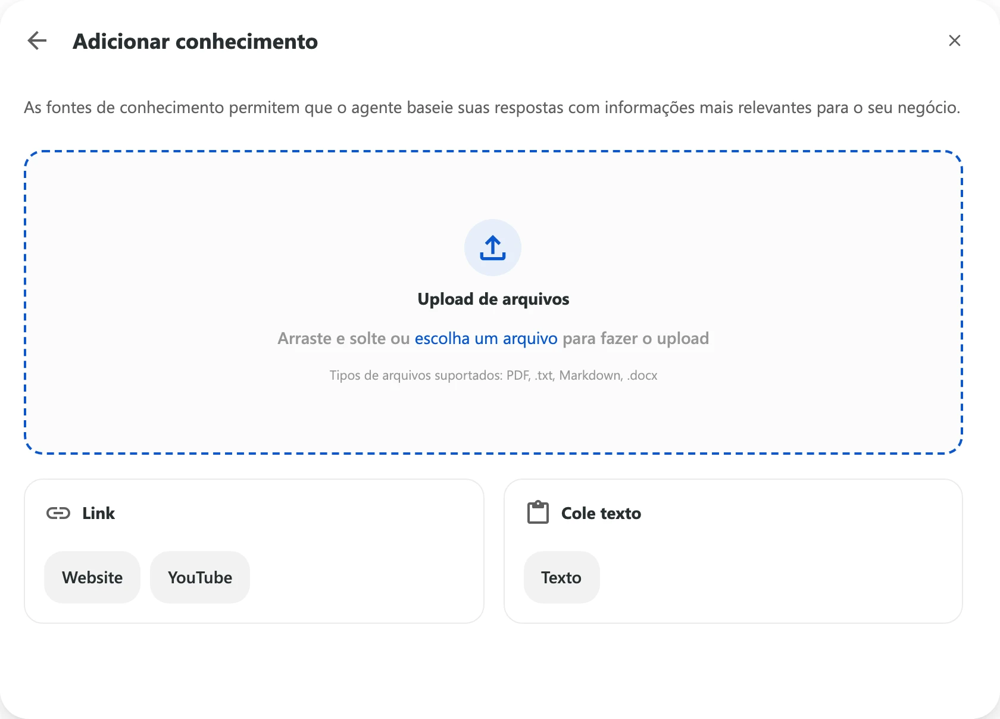

Adicione arquivos, textos, páginas de site e vídeos do YouTube no cartão **Conhecimento** para que o agente de IA (de texto ou de voz) consulte informações da sua empresa antes de responder.

Este cadastro é próprio dos agentes de IA e é separado da **Base de conhecimento** que fica em **Configurações** → **Automação**.

<Note>
Quem pode: para ligar ou tirar conhecimentos de um agente, o membro precisa da permissão **Agentes de IA**. Para criar, renomear ou excluir um conhecimento, também precisa da permissão **Base de conhecimento**. O proprietário do workspace tem as duas.
</Note>

## Passo a passo

<Steps>
  <Step title="Abra o cartão Conhecimento">
    No editor do agente, clique em **Adicionar** no cartão **Conhecimento** (ou clique no cartão vazio).
  </Step>
  <Step title="Escolha um conhecimento ou crie um novo">
    Na janela **Selecione um conhecimento**, escolha um item já cadastrado no workspace para ligar ao agente ou clique em **Adicionar conhecimento**. Se ainda não houver conhecimentos disponíveis, a tela de adicionar abre direto.
  </Step>
  <Step title="Selecione o tipo de fonte">
    Escolha como enviar o conteúdo:

    <Frame caption="Tela Adicionar conhecimento com envio de arquivo, links de site ou YouTube e texto colado">
      
    </Frame>

    | Tipo | O que aceita | Observações |
    | --- | --- | --- |
    | **Upload de arquivos** | `.pdf`, `.txt` e `.docx`, até **5 MB** por arquivo | Um arquivo por vez. Mesmo que a tela mencione Markdown, arquivos `.md` não são aceitos — salve como `.txt`. Prefira arquivos com texto selecionável. |
    | **Cole texto** (**Texto**) | Texto colado diretamente em **Nome** e **Texto** | Útil para perguntas frequentes, tabelas de regras ou textos curtos. |
    | **Link** → **Website** | Endereço em **URL** | Lê apenas o texto visível da página informada. Artigos pagos não são suportados. |
    | **Link** → **YouTube** | **Nome** e **Youtube URL** | Importa apenas a transcrição de vídeos públicos com legenda disponível. Pode levar alguns minutos para processar. |
  </Step>
  <Step title="Adicione e aguarde o processamento">
    Clique em **Adicionar** (no envio de arquivo, o upload começa assim que você solta o arquivo). O conhecimento entra automaticamente no cartão do agente e inicia o processamento.
  </Step>
</Steps>

## Estados do conhecimento e como agir em caso de erro

O status atualiza sozinho na tela conforme o processamento avança:

- **Ícone girando:** o conhecimento está sendo processado. O agente só consegue consultá-lo depois de pronto.
- **Ícone normal:** pronto para uso nas respostas.
- **Nome riscado com selo Error** (dica **Ocorreu um erro ao treinar o conhecimento**): o processamento falhou. Não há botão para reprocessar — clique no **X** do item para tirá-lo do agente, revise a fonte (arquivo com texto selecionável, página com texto visível ou vídeo público com legenda) e adicione novamente.

## Renomear, tirar do agente ou excluir

Clique em um item no cartão **Conhecimento** para abrir o painel **Conhecimento**, onde você pode editar o **Nome do conhecimento** ou consultar o conteúdo (pelo texto exibido ou em **Abrir em outra aba**). O conteúdo não pode ser editado depois de enviado; se precisar mudar o texto, adicione um novo conhecimento e retire o antigo.

- **Tirar do agente:** clique no **X** do item no cartão **Conhecimento** e confirme em **Retirar**. O item continua salvo no workspace e nos outros agentes que o usam.
- **Excluir:** abra **Selecione um conhecimento** e use o menu do item para excluir permanentemente.

<Warning>
Excluir um conhecimento apaga o item do workspace e faz com que **todos** os agentes que o usavam deixem de contar com ele. Para remover apenas de um agente, use o **X** no cartão **Conhecimento**.
</Warning>

## Conhecimento da etapa e custo

Em agentes que usam etapas, o cartão **Conhecimento da etapa** traz o interruptor **Herdar conhecimento**, que define se a etapa soma ou substitui o conhecimento do agente principal.

Processar um conhecimento e consultá-lo durante as respostas consome [saldo da carteira](/docs/conceitos/saldo-e-creditos).

## Próximos passos

- Confira na prática se o agente encontra os trechos certos em [Testar o agente antes de ativar](/docs/agente-de-ia/testar).
- Adicione ações para o agente agir na conversa em [Dar ferramentas ao agente](/docs/agente-de-ia/ferramentas).
- Veja como fazer buscas pontuais no fluxograma em [Ações do fluxograma](/docs/agente-de-ia/acoes-do-fluxograma).
