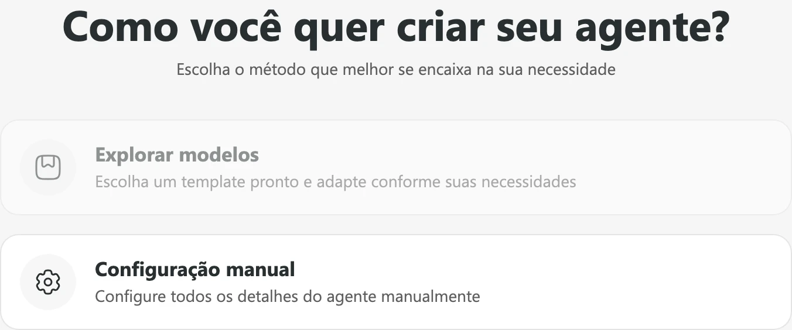
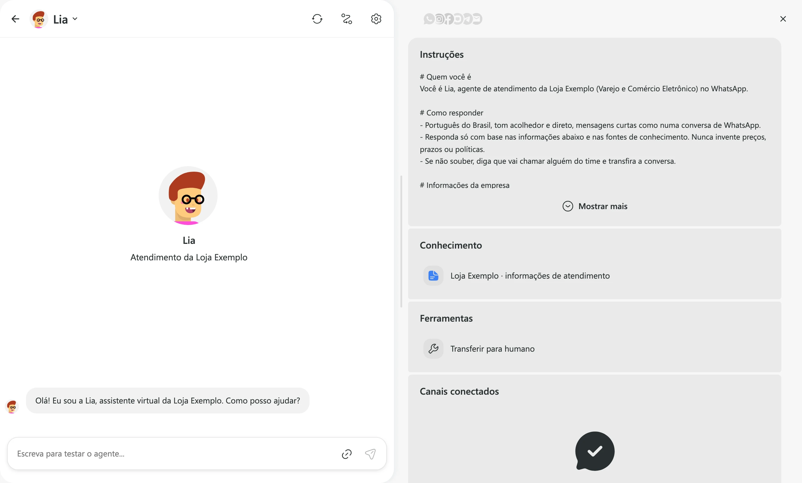
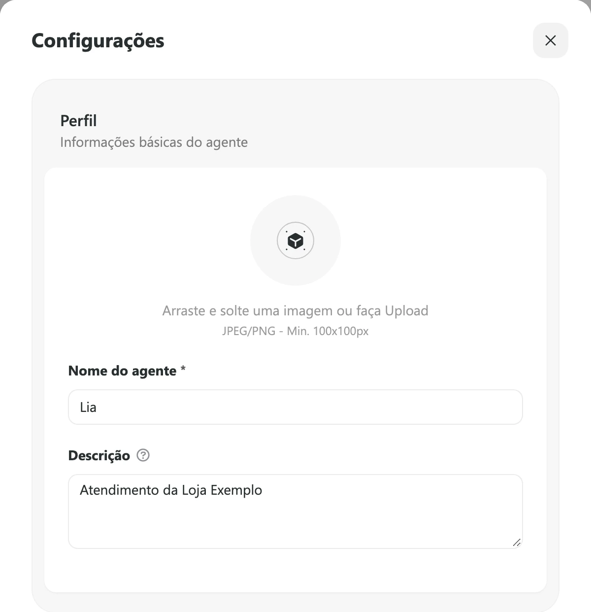
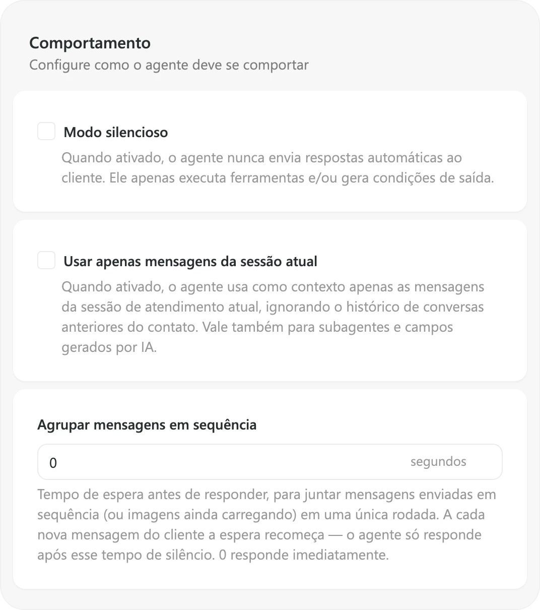

Crie um agente de IA de texto, ajuste o comportamento dele e escreva as instruções antes de conectar o agente aos seus canais.

<Note>
Quem pode: membros com a permissão **Agentes de IA** e o proprietário do workspace. Para criar e testar o agente, você não precisa conectar um canal. Para testar, o workspace precisa ter [saldo na carteira](/docs/conceitos/saldo-e-creditos).
</Note>

## Passo a passo

<Steps>
  <Step title="Abra a tela de agentes">
    Vá em **Configurações** → **Automação** → **Agentes de IA** e clique em **Novo agente de IA**.
  </Step>
  <Step title="Escolha a criação manual">
    Na tela **Como você quer criar seu agente?**, clique em **Configuração manual** para avançar. Se o seu workspace mostrar a tela **Que tipo de agente você quer criar?**, escolha **Agente de texto** — o tipo não pode ser trocado depois (para voz, veja [Agente de voz](/docs/agente-de-ia/agente-de-voz)).

    <Frame caption="Primeira tela da criação de um agente de IA">
      
    </Frame>
  </Step>
  <Step title="Dê um nome e crie o agente">
    Em **Como vai se chamar seu agente?**, preencha **Nome do agente** e clique em **Criar Agente**.
  </Step>
</Steps>

O agente abre no editor já ligado, sem instruções e sem canais conectados (status **Sem canais**). Enquanto nenhum canal estiver conectado, ele não atende conversas reais.

## A tela do agente

O editor divide a tela em dois painéis lado a lado, com uma divisória que você pode arrastar:

<Frame caption="Editor do agente com o chat de teste à esquerda e os cartões de configuração à direita">
  
</Frame>

- **À esquerda (chat de teste):** serve para conversar com o agente antes de ativá-lo. No topo ficam **Voltar**, o nome do agente (que abre **Ajustar simulação**), **Limpar histórico do chat**, **Fluxograma** e **Abrir configuração** (engrenagem).
- **À direita (painel do agente):** ficam o interruptor de ligar/pausar, os ícones de canais e os cartões **Instruções**, **Conhecimento**, **Ferramentas**, **Canais conectados** e **Etapas** (quando o agente já tiver etapas).

Toda alteração nos cartões da direita é salva na hora. Apenas a gaveta **Configurações** tem o botão **Salvar**.

## Escrever as instruções

As **Instruções** (também chamadas de prompt, o texto de orientação que a IA lê antes de responder) dizem ao agente quem ele é e como deve conduzir o atendimento.

1. No cartão **Instruções**, clique para adicionar ou editar.
2. No editor **Editar Instruções**, escreva as orientações do agente.
   - Digite `/` para abrir comandos de formatação.
   - Digite `@` para mencionar **Membros**, **Grupos**, **Tags**, **Bots** ou **Campos de contato**.
   - Digite `{` para inserir variáveis de **Contexto** (como data e hora atual), **Sessão** (como protocolo e ID da conversa) e **Contato** (como primeiro nome).
3. Salve para gravar as alterações.

Para deixar as instruções mais claras, vale cobrir cinco pontos:

- **Quem é o agente:** nome, papel e empresa (por exemplo, "Lia, assistente da Loja Exemplo").
- **O que a empresa faz:** resumo do negócio e dos assuntos que o agente pode tratar.
- **O que nunca fazer:** assuntos proibidos, dados que ele não deve inventar ou promessas fora da política da empresa.
- **Quando passar a conversa para um membro e qual ferramenta usar:** situações em que o agente deve transferir a conversa, aplicar tag ou agendar.
- **Tom e formato das respostas:** se fala de forma formal ou informal, direta ou detalhada.

## Ajustar as configurações

Clique no ícone de engrenagem **Abrir configuração**, no topo do chat de teste, para abrir a gaveta **Configurações**. Ao terminar, clique em **Salvar**.

<Frame caption="Bloco Perfil da gaveta Configurações">
  
</Frame>

<Frame caption="Bloco Comportamento da gaveta Configurações">
  
</Frame>

| Bloco | Campo | O que faz |
| --- | --- | --- |
| **Perfil** | Avatar | Imagem do agente (JPEG ou PNG, mínimo 100×100 px). |
| **Perfil** | **Nome do agente** | Nome obrigatório exibido na lista e no editor. |
| **Perfil** | **Descrição** | Resumo curto do objetivo do agente. |
| **LLM** (o modelo de IA que escreve as respostas) | **Modelo** | Escolhe o modelo usado para responder. Cada opção exibe uma faixa de custo relativo (**$**, **$$** ou **$$$**). Deixe em branco para usar o modelo padrão da Kinbox. |
| **Comportamento** | **Modo silencioso** | Quando ligado, o agente não envia mensagens ao contato; ele apenas executa ferramentas e avalia condições de saída. |
| **Comportamento** | **Usar apenas mensagens da sessão atual** | Faz o agente considerar só a [sessão](/docs/conceitos/conversas-e-sessoes) atual, ignorando conversas anteriores do contato. Vale também para subagentes e campos gerados por IA. |
| **Comportamento** | **Agrupar mensagens em sequência** | Define de `0` a `300` segundos de espera antes de responder, juntando várias mensagens seguidas do contato em uma única resposta. A espera recomeça a cada nova mensagem; `0` responde imediatamente. |

## Copiar, importar ou excluir um agente

Na lista de **Agentes de IA**, você pode reutilizar ou remover agentes:

- **Clonar:** no menu da linha do agente, cria uma cópia com o mesmo conteúdo.
- **Exportar:** no menu da linha, baixa um arquivo `.json` do agente.
- **Importar agente:** no menu de três pontos do topo da lista, cria um novo agente a partir de um `.json` exportado.
- **Excluir:** no menu da linha, apaga o agente. Se ele ainda estiver em uso em algum bot ou em outro agente, a Kinbox mostra quais fluxos precisam ser ajustados antes de excluir.

<Note>
Clonar ou importar não leva os canais conectados do agente original. A cópia nasce ligada, mas sem canais — conecte os canais nela quando estiver pronta.
</Note>

## Próximos passos

- [Ensinar o agente com arquivos, textos, sites e vídeos](/docs/agente-de-ia/conhecimento)
- [Dar ferramentas ao agente: Agenda, Google Calendar e HubSpot](/docs/agente-de-ia/ferramentas)
- [Montar o fluxograma do agente](/docs/agente-de-ia/fluxograma-e-etapas)
- [Testar o agente antes de ativar](/docs/agente-de-ia/testar)
- [Ligar o agente aos canais e passar para um humano](/docs/agente-de-ia/conectar-canais)
