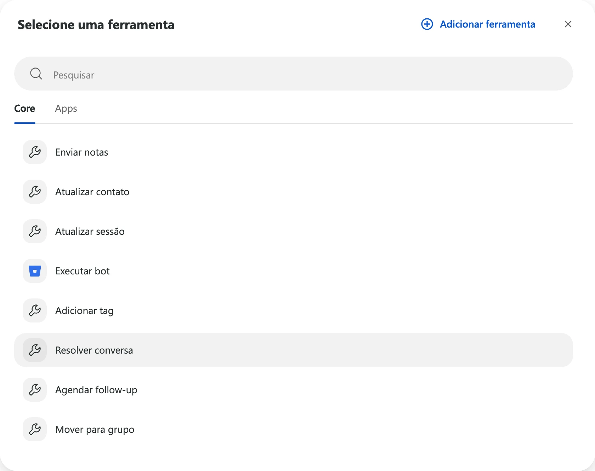

Sem ferramentas, o agente de IA apenas conversa. Com o cartão **Ferramentas**, o agente de texto executa ações na conversa e em apps conectados — ele decide quando usar cada ferramenta lendo a descrição configurada e as condições que você escreve.

<Note>
Quem pode: membros com a permissão **Agentes de IA** e o proprietário do workspace. Ferramentas existem apenas no **agente de texto**. O **Kinbox Agenda** exige o Agenda ativo no plano; **Google Calendar** e **HubSpot** exigem conectar uma conta.
</Note>

## Passo a passo

<Steps>
  <Step title="Abra o cartão Ferramentas">
    No editor do agente, clique em **Adicionar** no cartão **Ferramentas** (ou clique no cartão vazio).
  </Step>
  <Step title="Escolha a ferramenta">
    Na janela **Selecione uma ferramenta**, navegue pelas abas **Core** (ferramentas da Kinbox e ferramentas HTTP do workspace) e **Apps** (**Kinbox Agenda**, **Google Calendar** e **HubSpot**), ou clique em **Adicionar ferramenta** para cadastrar uma ferramenta HTTP.

    <Frame caption="Janela Selecione uma ferramenta na aba Core">
      
    </Frame>
  </Step>
  <Step title="Configure e adicione">
    Preencha as condições e os campos solicitados e clique em **Adicionar ferramenta**. Cada ferramenta entra uma única vez por agente.
  </Step>
</Steps>

Nas ferramentas do **Core**, você pode deixar a **Descrição (opcional)** em branco para usar o texto padrão (clique em **Mostrar padrão** para ver) e, nas ferramentas com lista, adicionar pelo menos um item com a respectiva **Condição**.

## Ferramentas do Core

| Ferramenta | O que faz |
| --- | --- |
| **Enviar notas** | Escreve uma nota interna na conversa, visível apenas para a equipe. |
| **Atualizar contato** | Grava dados informados pelo contato nos campos padrão (**Nome**, **E-mail**, **Telefone**, **Notas**) ou personalizados. |
| **Atualizar sessão** | Grava informações nos campos personalizados da [sessão](/docs/conceitos/conversas-e-sessoes). |
| **Executar bot** | Inicia um bot na conversa conforme a condição configurada. |
| **Adicionar tag** | Aplica uma tag na conversa quando a condição acontecer. |
| **Resolver conversa** | Encerra a conversa quando o contato indica que o atendimento terminou. |
| **Transferir para humano** | Atribui a conversa a um membro da lista de **Humanos permitidos**. |
| **Agendar follow-up** | Marca uma data e hora para o agente retomar a conversa com o contato. |
| **Mover para grupo** | Muda a conversa para um dos grupos em **Grupos permitidos**. |

## Transferir para humano e Mover para grupo

Quando o agente executa **Transferir para humano** ou **Mover para grupo**, o atendimento do agente é desligado naquela sessão — ele para de responder e só volta numa [sessão nova](/docs/conceitos/conversas-e-sessoes). Uma mensagem de sistema registra a transferência na conversa.

- Em **Transferir para humano**, se o membro escolhido não faz parte do grupo atual da conversa, a conversa sai desse grupo.
- Em **Mover para grupo**, se o responsável atual não pertence ao grupo de destino, a conversa fica sem responsável.

Veja também [Ligar o agente aos canais e passar para um humano](/docs/agente-de-ia/conectar-canais).

## Agendar follow-up

Com **Agendar follow-up**, o agente interpreta o horário combinado na conversa (no fuso do workspace) dentro do limite de **1 minuto a 60 dias** à frente.

- Configure a **Mensagem de retomada** no modo **Manual**, **Prompt AI** ou **Auto**.
- Em canais de WhatsApp oficial, marque **Usar template caso conversa expirada** e escolha o **Canal** e o template para retomar se a [janela de 24 horas](/docs/canais/whatsapp/whatsapp-cloud-api/janela-de-24-horas) estiver fechada.
- A conversa continua aberta, um novo agendamento substitui o anterior na mesma sessão e a equipe pode cancelar a qualquer momento pelo botão **Cancelar follow-up** no rodapé da conversa na **Caixa de entrada**.

## Ferramenta HTTP (sistemas próprios)

Para equipes que têm um sistema próprio com endereço de API, clique em **Adicionar ferramenta** dentro de **Selecione uma ferramenta** para cadastrar uma ferramenta HTTP do workspace:

| Bloco | O que você configura |
| --- | --- |
| **Configuração** | **Nome**, **Descrição** (o que faz e quando usar), **Método** (**GET**, **POST**, **PUT**, **PATCH** ou **DELETE**) e **URL** (use um endereço `https`). |
| **Headers** | Cabeçalhos enviados na chamada, usando **Add header**. |
| **Parâmetros de path** | Valores entre chaves na URL, com tipo de dado e preenchimento por **Prompt do LLM** ou **Constante ou variável**. |
| **Parâmetros de query** | Parâmetros de consulta adicionados com **Add param**. |
| **Parâmetros do body** | Corpo JSON enviado em **POST**, **PUT** e **PATCH**. |
| **Atribuições de variáveis** | Mapeia campos da resposta da API para atualizar variáveis com **Add atribuição**. |

A chamada tem tempo limite de 30 segundos. Se retornar erro, o agente recebe a resposta de erro e segue a conversa.

## Apps: Kinbox Agenda, Google Calendar e HubSpot

Na aba **Apps**, você encontra integrações prontas:

- **Kinbox Agenda:** oferece as ferramentas **Listar serviços**, **Consultar horários**, **Criar agendamento**, **Listar agendamentos**, **Reagendar** e **Cancelar agendamento**. Em **Consultar horários** e **Criar agendamento**, você pode escolher um **Serviço** fixo ou manter **Deixar o agente escolher**. Se o workspace não tiver o Agenda no plano, o item mostra "Adicione o Agenda ao seu plano" e, ao clicar, abre a janela **Kinbox Agenda** com o botão **Liberar potencial agora**.
- **Google Calendar e HubSpot:** cada ação do app entra como uma ferramenta separada (os nomes e descrições aparecem em inglês). Ao abrir a ação, clique em **Adicionar conta** no campo **Conexão** para autenticar na janela de login (permita pop-ups no navegador). Se uma conta aparecer como `(expirada)` ou `(pendente)`, reconecte para que o agente volte a usar essas ações.

<Warning>
No chat de teste do editor, **Google Calendar**, **HubSpot** e a **ferramenta HTTP** agem de verdade — um teste pode criar eventos reais, alterar registros no HubSpot ou chamar sua API. Use dados de teste que você possa apagar. Veja [Testar o agente antes de ativar](/docs/agente-de-ia/testar).
</Warning>

## Editar, tirar ou excluir uma ferramenta

- **Editar:** clique na ferramenta no cartão **Ferramentas**, ajuste os campos e clique em **Salvar** (em ferramentas HTTP, a edição altera o cadastro para todos os agentes que a usam).
- **Tirar do agente:** clique no **X** do item no cartão e confirme em **Remover**.
- **Excluir ferramenta HTTP:** abra **Selecione uma ferramenta** e exclua pelo menu do item — isso apaga a ferramenta do workspace para todos os agentes.
