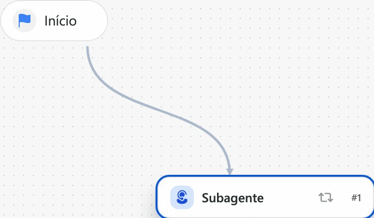

Use o **Fluxograma** quando o atendimento do agente precisa seguir passos definidos, coletar dados obrigatórios ou executar ações em ordem certa.

<Note>
Quem pode: membros com a permissão **Agentes de IA** e o proprietário do workspace. O fluxograma e as etapas existem apenas no **agente de texto** e não ficam visíveis em agentes marcados como **Gerenciado pelo parceiro**.
</Note>

## Quando usar o fluxograma

O fluxograma é opcional. Ele só passa a rodar quando o bloco **Início** tem pelo menos uma seta ligada a outro bloco; sem isso, o agente responde com as **Instruções**, o **Conhecimento** e as **Ferramentas** configuradas.

Comece só com as instruções se o atendimento for aberto. Use o fluxograma quando quiser garantir uma ordem de perguntas, ramificações claras ou ações automáticas entre uma etapa e outra da conversa.

## Passo a passo

<Steps>
  <Step title="Abra o fluxograma">
    No editor do agente, clique no ícone **Fluxograma**, no topo do chat de teste. O painel abre ao lado do chat, começando sempre pelo bloco **Início**.
  </Step>
  <Step title="Adicione e configure blocos">
    Clique no botão **+** da barra inferior para adicionar **Ação**, **Subagente**, **Coletar dados** ou **Anotação** (você pode clicar ou arrastar para a tela). Também dá para puxar uma seta de um bloco e soltar no vazio para criar e ligar uma nova ação, ou clicar com o botão direito no fundo.

    - O bloco **Ação** abre a janela **Selecione uma ação**, com busca e as abas **Top** (todas as ações), **Apps** (integrações) e **Core** (as demais ações da Kinbox).
    - Clique em qualquer bloco para configurar os campos e clique em **Salvar**. No menu do bloco, você encontra **Renomear**, **Clonar** e **Excluir**.
    - A barra inferior também traz **Desfazer**, **Refazer**, **Organizar nós** e **Enquadrar**.
    - O bloco **Anotação** funciona como um lembrete visual no desenho e não afeta a conversa.
  </Step>
  <Step title="Ligue os blocos com setas">
    Puxe uma seta da saída de um bloco até o próximo e clique na seta para definir o **Tipo de transição**:

    <Frame caption="Exemplo em montagem: os avisos amarelos indicam campos e condições que ainda faltam preencher">
      
    </Frame>

    | Tipo de transição | O que faz | Onde pode usar |
    | --- | --- | --- |
    | **Transição direta** | Segue sem condição e serve como caminho reserva quando outras condições não batem. | Todos os blocos |
    | **Condição LLM** | O agente lê a conversa e avalia se a frase descrita em **Condição** aconteceu. | Todos os blocos |
    | **Condição lógica** | Testa regras de **Campo**, **Operador** e **Valor** combinadas com E (todas precisam ser verdadeiras). | Todos os blocos |
    | **Sem resposta** | Segue por este caminho se o contato não responder no tempo definido (**Duração**, **Unidade**, **Repetir**, **Escalonar** e **Considerar horários**). | **Subagente**, **Coletar dados** e **Aguardar mensagem do cliente** |
    | **Erro** | Segue automaticamente quando ocorre um erro no bloco. | Todos os blocos |

    Em setas de **Condição LLM** ou **Condição lógica** que saem de **Subagente** ou **Coletar dados**, você pode marcar **Avaliar antes de responder** para testar a condição antes do bloco enviar uma mensagem.
  </Step>
  <Step title="Preencha campos com IA ou contexto">
    Muitos campos das ações oferecem três modos de preenchimento:

    - **Manual:** você digita o valor fixo.
    - **Prompt AI:** o agente gera o valor a partir do seu texto de orientação e da conversa.
    - **Auto:** o agente preenche sozinho usando o contexto da conversa (disponível nos campos que oferecem esta opção).

    Use o botão **Injetar contexto** (insere no campo um dado da conversa, do contato ou de um bloco anterior) para inserir valores de **Etapas anteriores**, **Contexto** (sessão, contato, negociações e tarefas) e **Utilitarios**.
  </Step>
  <Step title="Publique o fluxograma">
    Clique em **Publicar** no topo do editor. O botão só fica ativo quando há alterações pendentes. Se faltar algo no desenho, o editor não publica e mostra o motivo: corrija os blocos com aviso e publique de novo.

    Não existe rascunho separado: ao publicar, o desenho novo já entra em vigor. Conversas que já estavam em andamento continuam do bloco onde pararam (o estado fica salvo por até 7 dias na sessão), e [sessões novas](/docs/conceitos/conversas-e-sessoes) começam pelo **Início**.
  </Step>
</Steps>

## Etapas

As **Etapas** dividem o agente em fases com instruções, conhecimento e ferramentas próprios; o cartão só aparece em agentes que já têm etapas. Em agentes novos, use blocos de **Subagente** no fluxograma.

## Próximos passos

- Consulte todas as ações disponíveis em [Ações do fluxograma](/docs/agente-de-ia/acoes-do-fluxograma).
- Valide cada caminho no chat em [Testar o agente antes de ativar](/docs/agente-de-ia/testar).
