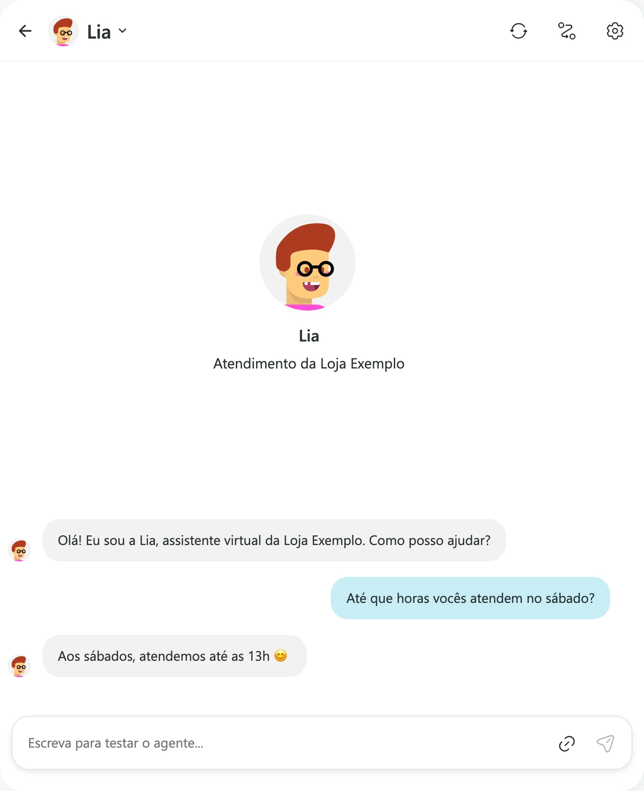

Use o chat de teste no editor do agente para simular contatos diferentes e validar respostas, conhecimento, ferramentas e fluxograma antes de conectar o agente aos canais reais.

<Note>
Quem pode: membros com acesso ao agente (permissão **Agentes de IA** ou proprietário do workspace). Você não precisa conectar um canal para testar, mas o teste consome [saldo da carteira](/docs/conceitos/saldo-e-creditos) como uma resposta real. Em agentes **Gerenciado pelo parceiro**, apenas o chat de teste fica disponível.
</Note>

<Warning>
Antes da primeira mensagem: no chat de teste, **Google Calendar**, **HubSpot** e a **ferramenta HTTP**/**Requisição HTTP** agem de verdade (podem criar eventos, alterar registros no HubSpot e chamar o seu sistema). Para testar essas ferramentas, use uma conta e um endereço de teste.
</Warning>

## Passo a passo

<Steps>
  <Step title="Abra o agente">
    Vá em **Configurações** → **Automação** → **Agentes de IA** e clique no agente. O chat de teste já abre pronto à esquerda — não há botão separado para iniciar o teste.
  </Step>
  <Step title="Envie mensagens como se fosse o contato">
    Escreva na caixa **Escreva para testar o agente...** e clique em **Enviar mensagem**. Se quiser enviar arquivos, clique em **Anexar arquivo** (até 10 arquivos por vez, de até 10 MB cada).

    <Frame caption="Chat de teste no editor do agente">
      
    </Frame>

    Se o agente tiver **Agrupar mensagens em sequência** configurado, o chat de teste também aguarda esse tempo de silêncio antes de responder — enviar novas mensagens nesse intervalo junta tudo na mesma resposta.
  </Step>
  <Step title="Inspecione o que o agente decidiu">
    Passe o mouse sobre uma resposta e clique em **Inspecionar** (ou clique em uma linha de ferramenta ou ação do fluxograma) para conferir como o agente chegou àquela resposta.
  </Step>
  <Step title="Limpe o histórico entre cenários">
    Clique em **Limpar histórico do chat** no topo do chat antes de testar um cenário novo.
  </Step>
</Steps>

## O que aparece no chat

| Elemento | O que indica |
| --- | --- |
| Linha de ferramenta | Mostra o que o agente fez (por exemplo, adicionou tag, transferiu para humano ou agendou follow-up). Clique para inspecionar. |
| Linha de ação do fluxograma | Mostra o ícone e a descrição da ação executada no [fluxograma](/docs/agente-de-ia/fluxograma-e-etapas). Clique para inspecionar. |
| Balão com **Nota:** | Nota interna que só a equipe veria na conversa real. |
| Aviso **Saldo Insuficiente** | O saldo estava em R$ 1,00 ou menos e o agente não respondeu. Clique em **Adicionar saldo** para ir à tela de assinatura (veja [Adicionar saldo e créditos de SMS](/docs/assinatura/adicionar-saldo)) (precisa da permissão **Assinatura**). Em agente **Gerenciado pelo parceiro**, os gastos podem sair da carteira do parceiro. |
| Contagem regressiva acima da caixa | Indica um follow-up agendado no teste; some quando dispara ou quando você envia uma nova mensagem. |
| Aviso **Error:** | Mostra quando houve erro ao gerar a resposta. |

## Inspecionar uma resposta

Ao passar o mouse sobre uma resposta do agente, aparecem **Inspecionar** e **Copiar**. Clicar em **Inspecionar** abre o painel **Inspeção** no lugar do painel da direita (feche em **Fechar inspeção**).

O painel **Inspeção** mostra o que o agente recebeu e decidiu naquela resposta: os trechos encontrados no [conhecimento](/docs/agente-de-ia/conhecimento), as ferramentas ou ações executadas com entrada e saída, a etapa escolhida (quando há etapas), o texto enviado e eventuais erros. Nas ferramentas **Executar bot** e **Resolver conversa**, a inspeção exibe um aviso informando que elas não executam na simulação.

## Ajustar simulação

Para testar o agente com perfis de contato ou estados de conversa diferentes, clique no nome do agente no topo do chat e selecione **Ajustar simulação**.

Na gaveta **Ajustes da simulação**, as mudanças são salvas na hora (e cada bloco tem o botão **Resetar**):

- **Campos da conversa:** **Atendente**, **Grupo**, **Protocolo**, **Checkpoint**, **Tags** e campos personalizados de sessão.
- **Campos de contato:** **ID do contato**, **Nome**, **E-mail**, **Celular** e campos personalizados de contato.

## Limpar histórico do chat

O botão **Limpar histórico do chat** apaga as mensagens da simulação, zera o ponto em que o fluxograma parou e cancela follow-ups e esperas pendentes do teste.

O histórico do chat e os ajustes da simulação ficam salvos no seu navegador, separados por agente — outra pessoa ou outro navegador não vê o mesmo teste.

## O que é de verdade e o que é simulado

| Ação ou recurso | Como se comporta no teste |
| --- | --- |
| **Adicionar tag**, **Atualizar contato**, **Atualizar sessão**, **Transferir para humano**, **Mover para grupo** | Simulados — atualizam apenas os dados da simulação, sem alterar conversas ou contatos reais. |
| Ações do fluxograma que gravam dados ou enviam mensagem (**Definir tags**, **Definir campos**, **Transferir**, **Criar negócio**, **Atualizar negócio**, **Criar tarefa**, **Enviar mensagem**, **Enviar template WhatsApp**, **Enviar nota de time**) | Simuladas. |
| **Executar bot** e **Resolver conversa** (ferramentas e ações) | Não executam na simulação. Para testar, use um canal real. |
| **Kinbox Agenda** (consultas de serviços, horários e agendamentos) | Rodam de verdade (somente leitura). |
| **Kinbox Agenda** (criar, reagendar e cancelar, nas ferramentas e no fluxograma) | Simulados — não alteram agendamentos reais. |
| **Google Calendar** (ferramentas e ações do fluxograma) e **HubSpot** (ferramentas) | Rodam de verdade — podem criar eventos ou alterar registros reais. |
| **Ferramenta HTTP** e **Requisição HTTP** | Rodam de verdade — chamam o endereço configurado (apenas a gravação de variáveis no contato ou na sessão é simulada). |
| **Agendar follow-up** | Roda no chat de teste e dispara no horário marcado dentro da própria simulação. |

## Roteiro sugerido de testes

- Faça as perguntas mais frequentes dos seus contatos e confira a resposta contra o conhecimento; se algo vier diferente do esperado, use **Inspecionar** para ver quais trechos o agente encontrou.
- Peça para falar com uma pessoa e confira se aparece a linha indicando que o agente transferiu para um humano (quando a ferramenta **Transferir para humano** estiver adicionada).
- Use **Ajustar simulação** para testar contatos com e sem nome, e-mail, tags ou responsável diferente.
- Para testar **Executar bot** ou **Resolver conversa**, conecte o agente a um canal de teste — veja [Ligar o agente aos canais](/docs/agente-de-ia/conectar-canais).
- Limpe o histórico antes de começar cada cenário novo.

Para testar um agente de voz falando pelo microfone, use o botão **Testar por voz** — veja [Agente de voz para as ligações do WhatsApp (Beta)](/docs/agente-de-ia/agente-de-voz).
