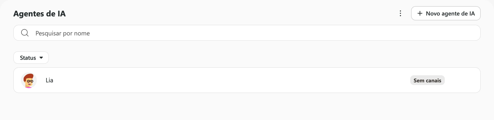

Um agente de IA conversa com o contato com as próprias palavras, seguindo as instruções que você escreve, consultando o conhecimento da empresa e executando ações por ferramentas. Diferente do **Bot**, que segue um fluxo fixo de blocos e respostas previstas, o agente de IA formula a resposta a partir do contexto da conversa — veja a diferença completa em [Bot, automações, cenários e agentes de IA: qual usar](/docs/conceitos/automacao-e-ia).

Um agente de IA pode atender diretamente nos canais conectados a ele ou ser chamado dentro de um fluxo de **Bot** pelo bloco **Agente de IA** (veja [Blocos do bot](/docs/bot/blocos-do-bot)).

## Onde fica e quem pode gerenciar

Os agentes ficam em **Configurações** → **Automação** → **Agentes de IA**. Para acessar, criar, editar ou excluir agentes, o membro precisa da permissão **Agentes de IA** (o proprietário do workspace sempre tem acesso — veja [Workspace, membros e papéis](/docs/conceitos/workspace-membros-e-papeis)).

<Frame caption="Lista de agentes em Configurações → Automação → Agentes de IA">
  
</Frame>

Na lista, você pode pesquisar por nome, filtrar por **Status** (**Conectados** ou **Não conectados**), clicar em **Novo agente de IA** ou abrir o menu de três pontos no topo para **Importar agente**. Agentes criados em versões antigas podem aparecer com o selo **Legado** e abrem o editor antigo.

## O que você configura

No editor de um agente de texto, você monta o atendimento usando os cartões da direita, o chat de teste à esquerda, o **Fluxograma** e a gaveta **Configurações**:

| Peça | Para que serve |
| --- | --- |
| **Instruções** | Define quem o agente é, como ele fala, o que pode fazer e quando deve passar a conversa para a equipe. |
| **Conhecimento** | Reúne arquivos, textos, páginas de site e vídeos do YouTube que o agente consulta antes de responder. |
| **Ferramentas** | Dá ao agente ações para agir na conversa, como adicionar tag, atualizar contato, transferir para humano, agendar follow-up ou integrar com Agenda, Google Calendar, HubSpot e APIs. |
| **Canais conectados** | Escolhe em quais canais do workspace o agente atende. |
| **Fluxograma** (opcional) | Desenha um caminho com blocos, perguntas estruturadas, desvios e ações em ordem fixa. |
| **Etapas** | Divide o atendimento em fases com regras próprias; o cartão só aparece em agentes que já têm etapas. |

## Tipos de agente

Você escolhe o tipo ao criar o agente, e o tipo não muda depois:

- **Agente de texto**: atende por mensagem nos canais conectados e tem instruções, conhecimento, ferramentas, fluxograma e etapas.
- **Agente de voz**: recurso em teste que atende ligações do WhatsApp oficial com instruções, conhecimento e idioma (pode não aparecer no seu workspace). Veja [Agente de voz para as ligações do WhatsApp (Beta)](/docs/agente-de-ia/agente-de-voz).

## Como o agente entra numa conversa

- O agente de texto atende nos canais ligados ao cartão **Canais conectados**, sem precisar montar um bot à parte.
- Ele entra quando o contato envia a mensagem que abre uma [sessão nova](/docs/conceitos/conversas-e-sessoes). Mensagens numa sessão já aberta ou reaberta não chamam o agente.
- Cada canal tem um único agente de texto para as mensagens. As ligações do WhatsApp oficial têm, à parte, um agente de voz: o mesmo número pode ter os dois.
- Se outro bot ativo atender o mesmo canal e estiver acima na lista de bots, o primeiro da lista responde.
- O agente não responde em grupos de WhatsApp.
- Enquanto o agente atende, a conversa mostra uma mensagem de sistema avisando do início do atendimento e a faixa **Em atendimento pelo agente** no topo. Quando um membro envia uma mensagem ao contato na conversa, o agente para (uma nota pro time não tira o agente).

## Quanto custa

O agente de IA consome [saldo da carteira](/docs/conceitos/saldo-e-creditos) a cada resposta e no processamento do conhecimento, e para de responder quando o saldo fica insuficiente (R$ 1,00 ou menos). Workspaces novos começam com um saldo de cortesia para testar. O plano não limita a quantidade de agentes de IA que você cria.

## Próximos passos

Ainda em dúvida entre agente de IA, bot, automação ou cenário? Compare em [Bot, automações, cenários e agentes de IA: qual usar](/docs/conceitos/automacao-e-ia). Para fluxos fixos de menus e perguntas, veja [Bot: visão geral](/docs/bot/visao-geral).

<CardGroup cols={2}>
  <Card title="1. Criar o agente e escrever as instruções" href="/docs/agente-de-ia/criando-seu-agente-de-ia">
    Crie o agente de texto, conheça a tela do editor, ajuste as configurações e escreva as instruções.
  </Card>
  <Card title="2. Ensinar o agente com conhecimento" href="/docs/agente-de-ia/conhecimento">
    Adicione arquivos, textos, sites e vídeos do YouTube para o agente consultar.
  </Card>
  <Card title="3. Dar ferramentas ao agente" href="/docs/agente-de-ia/ferramentas">
    Configure ações como adicionar tag, transferir para humano, follow-up, Agenda, Google Calendar e HubSpot.
  </Card>
  <Card title="4. Montar o fluxograma (opcional)" href="/docs/agente-de-ia/fluxograma-e-etapas">
    Desenhe passos fixos, coleta de dados e desvios quando só as instruções não bastarem.
  </Card>
  <Card title="5. Testar antes de ativar" href="/docs/agente-de-ia/testar">
    Converse no chat de teste, inspecione decisões e simule diferentes contatos.
  </Card>
  <Card title="6. Ligar aos canais e passar para um humano" href="/docs/agente-de-ia/conectar-canais">
    Conecte os canais, ligue ou pause o atendimento e acompanhe a execução na conversa.
  </Card>
  <Card title="Agente de voz (Beta)" href="/docs/agente-de-ia/agente-de-voz">
    Configure um agente de voz para atender ligações do WhatsApp oficial.
  </Card>
  <Card title="O agente não responde ou responde errado" href="/docs/agente-de-ia/problemas-comuns">
    Veja as causas mais comuns e como resolver cada uma.
  </Card>
</CardGroup>
