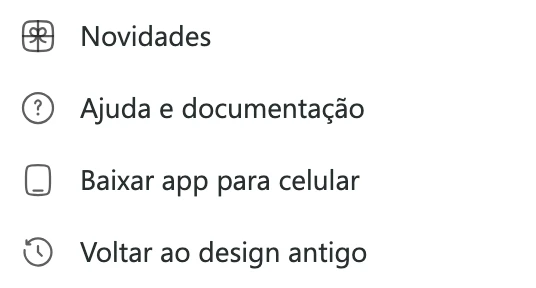

O app da Kinbox para celular funciona em iPhone e celular Android para atender conversas, usar as salas, acompanhar a agenda e receber notificações. Ele é grátis e feito para quem já tem uma conta na Kinbox.

## Baixar o app

Procure por "Kinbox" na App Store (iPhone) ou no Google Play (celular Android), ou abra [kinbox.com.br/app](https://www.kinbox.com.br/app/) para acessar as duas lojas com QR code.

Na Kinbox no navegador, no computador, clique na sua foto, no canto superior direito, e escolha **Baixar app para celular** para abrir a página com os QR codes. A tela de entrada também pode mostrar o botão **Baixar o app para celular**.

<Frame caption="Menu da sua foto na Kinbox no navegador com a opção Baixar app para celular">
  
</Frame>

Ao abrir a Kinbox no navegador do celular, pode aparecer um aviso oferecendo o app: toque em **Usar o app** para abrir a loja ou em **Continuar no navegador**.

<Note>
  Se a opção **Baixar app para celular**, o botão da tela de entrada ou o aviso no navegador do celular não aparecerem (por exemplo, se a sua empresa usa a Kinbox com outra marca), procure o app nas lojas ou fale com quem administra o workspace.
</Note>

## Entrar no app

O app entra apenas em uma conta que já existe: não há opção para criar conta nem workspace pelo celular. Para criar sua conta e seu workspace, use a Kinbox no navegador; para entrar no workspace da sua empresa, peça um convite a quem administra (veja [Gerenciar membros](/docs/configuracoes-no-workspace/gerenciar-membros)).

- **E-mail e senha:** use o mesmo e-mail e a mesma senha da Kinbox no navegador. Se precisar redefinir, toque em **Esqueci minha senha** no próprio app para receber o link de recuperação por e-mail (veja [Trocar a senha, recuperar o acesso e sair da conta](/docs/conta/senha-e-sessoes)).
- **Google:** no passo do e-mail, você pode escolher **Continuar com Google** (iPhone e Android).
- **Apple (só no iPhone):** na primeira vez, entre com e-mail e senha ou Google e vincule a Conta Apple em **Você** → **Privacidade**; depois, **Continuar com Apple** passa a funcionar.
- **Verificação em duas etapas:** se ela estiver ativa na sua conta, o app pede o código do app autenticador ou permite tocar em **Usar um código de recuperação**. Ligar ou desligar a verificação continua só na Kinbox no navegador (veja [Ativar a verificação em duas etapas](/docs/conta/verificacao-em-duas-etapas)).
- **Mais de um workspace:** se a sua conta faz parte de vários workspaces, o app abre **Escolher workspace** para você escolher em qual entrar agora.

## O que tem em cada aba

| Aba | Para que serve |
| --- | --- |
| **Conversas** | Listar, responder, resolver, atribuir e iniciar conversas nos seus canais. Veja [Atender conversas pelo app](/docs/app/atender-pelo-celular). |
| **Salas** | Conversar com a equipe em salas e mensagens diretas. Mostra o número de mensagens não lidas (até `99+`). Veja [Conversar nas salas: mensagens diretas, menções e threads](/docs/salas/usar-salas). |
| **Agenda** | Ver, buscar e criar as suas tarefas por **Dia**, **Semana** ou **Mês**. Mostra o número de tarefas atrasadas (até `29+`). Os agendamentos do Kinbox Agenda não aparecem no app (veja [Kinbox Agenda: visão geral](/docs/agenda/kinbox-agenda)). Veja [Criar e acompanhar tarefas](/docs/tarefas/criando-e-gerenciando-tarefas). |
| **Você** | Ajustar perfil, disponibilidade, notificações, workspaces, aparência, privacidade e saída da conta. |

## A aba Você

No topo da aba **Você** aparecem sua foto, nome, e-mail, o nome do workspace atual (toque para trocar) e o ícone de lápis **Editar perfil** (desativado quando o seu papel não permite mudar os dados do perfil). Logo abaixo ficam as opções:

- **Disponível:** mesmo interruptor do navegador para receber ou pausar novas atribuições automáticas no workspace aberto (veja [Ficar disponível ou indisponível](/docs/conta/disponibilidade)).
- **Meu perfil:** altera foto, **Nome**, **Celular** e senha (em **Segurança** → **Alterar senha**), conforme o seu papel (veja [Trocar a senha, recuperar o acesso e sair da conta](/docs/conta/senha-e-sessoes)).
- **Notificações:** liga ou desliga as notificações neste celular, define quando receber e quais avisos chegam (veja [Notificações no app](/docs/app/notificacoes-no-app)).
- **Workspaces:** troca o workspace aberto no app (veja [Trocar de workspace ou criar outro](/docs/conta/trocar-de-workspace)).
- **Aparência:** escolhe o **Tema de chat**, o modo claro ou escuro, a posição de **Ações da conversa** e se quer **Mostrar tags** na lista. Esses ajustes valem só para este aparelho.
- **Importar contatos do celular:** traz contatos da agenda do celular para a Kinbox. Essa opção aparece só com a permissão **Gerenciar Contatos** ou se você for o proprietário; se a opção não aparecer, peça acesso a quem administra o workspace (para importar por planilha no computador, veja [Importar contatos de uma planilha](/docs/clientes/importar-contatos)).
- **Kinbox no navegador:** abre a Kinbox no navegador do celular.
- **Privacidade:** acessa **Política de privacidade**, **Permissões de IA**, **Vincular Apple** / **Apple vinculada** (só no iPhone) e **Excluir conta** (veja [Excluir sua conta pelo app](/docs/app/excluir-conta)).
- **Sair da conta:** desconecta o app neste celular, apaga os dados e rascunhos salvos nele e desliga as notificações deste aparelho.

## O que continua no navegador

Para configurar o workspace (canais, membros, papéis, automações, bot e agentes de IA), gerenciar assinatura, ver relatórios, criar campanhas, usar funis e o Kinbox Agenda, use a Kinbox no navegador. Criar conta ou workspace e ligar ou desligar a verificação em duas etapas também ficam no navegador. Pelo app, acesse **Você** → **Kinbox no navegador**.

## Limite de acessos e sem internet

O app conta como um acesso aberto da sua conta: se aparecer o aviso **Limite de sessões**, libere um acesso na Kinbox no navegador e entre novamente no app (veja [Trocar a senha, recuperar o acesso e sair da conta](/docs/conta/senha-e-sessoes) e [Não consigo entrar na Kinbox](/docs/conta/problemas-de-acesso)).

Sem internet, a lista continua mostrando as conversas salvas ("Sem conexão · mostrando conversas salvas") e o envio fica desligado até a conexão voltar.

## Tablet

O app é feito para celular, em pé, e não tem layout para tablet: no tablet, use a Kinbox no navegador.
