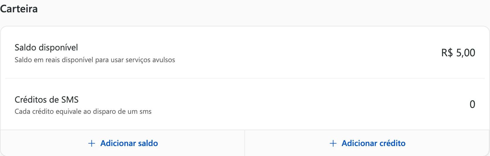
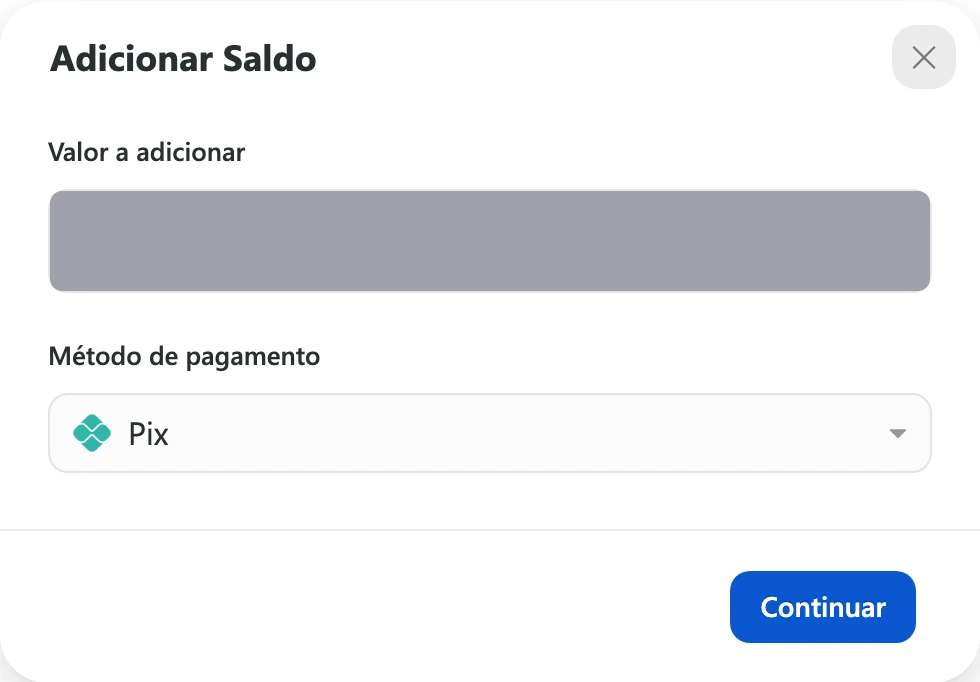

Na **Carteira** do seu workspace (na tela, **ambiente**), existem dois saldos separados: o **Saldo disponível** em reais (usado para serviços avulsos, como recursos de IA, ligações e diferenças ao aumentar o plano) e os **Créditos de SMS** (onde cada crédito equivale ao disparo de um SMS). Os dois são comprados à parte, sempre por **Pix** — o saldo da carteira não compra créditos de SMS pela tela.

<Note>Só quem tem a permissão **Assinatura** (ou é o proprietário do workspace) vê esta página.</Note>

## Adicionar saldo

<Steps>
  <Step title="Abra a janela de recarga">
    Vá em **Configurações** → **Assinatura**. Na seção **Carteira**, clique em **Adicionar saldo**. Você também encontra o botão **Adicionar Saldo** no topo do **Histórico de recargas**.

    <Frame caption="Seção Carteira na página Assinatura">
      
    </Frame>
  </Step>
  <Step title="Informe o valor">
    Na janela **Adicionar Saldo**, preencha **Valor a adicionar**. O campo já vem com R$ 500,00, e o mínimo é R$ 5. O **Método de pagamento** é **Pix**. Clique em **Continuar**.

    <Frame caption="Janela Adicionar Saldo com pagamento por Pix">
      
    </Frame>
  </Step>
  <Step title="Pague com Pix">
    Na janela **Pagar com Pix**, leia o QR Code com o app do banco ou clique em **Copiar** para pagar com o código Pix. Enquanto a janela fica aberta, a Kinbox verifica o pagamento automaticamente e atualiza o **Saldo disponível** assim que recebe a confirmação.
  </Step>
</Steps>

## Comprar créditos de SMS

<Steps>
  <Step title="Abra a compra de créditos">
    Vá em **Configurações** → **Assinatura**. Na seção **Carteira**, clique em **Adicionar crédito**.
  </Step>
  <Step title="Escolha o pacote">
    Na janela **Adicionar créditos**, selecione um pacote em **Quantidade de créditos** (os pacotes vão de 1 mil a 1 milhão de créditos). O **Método de pagamento** é **Pix**. Clique em **Continuar**.
  </Step>
  <Step title="Pague e aguarde a liberação">
    Pague o QR Code ou copie o código Pix. Depois da confirmação do pagamento, a liberação dos créditos pode levar até **1 dia útil**. Se houver algum problema ou se você precisar de liberação imediata, fale com o suporte.
  </Step>
</Steps>

Se você dispara SMS todo mês, também pode incluir créditos de SMS mensais na assinatura em [Assinar ou mudar o plano](/docs/assinatura/assinar-ou-mudar-plano).

## Acompanhar recargas e histórico

- **Histórico de recargas:** em **Configurações** → **Assinatura**, clique em **Saldo disponível** para ver as recargas do workspace com **Total**, **Data** e status (**Pago** ou **Aguardando pagamento**). Na própria linha de uma recarga pendente, você pode reabrir o QR Code. Pelo menu **...** → **Exportar**, você baixa a lista em CSV ou XLSX.
- **Relatório de uso:** no topo do **Histórico de recargas**, quem tem permissão de relatórios vê o botão **Ver relatório de uso** para conferir o consumo detalhado do saldo.
- **Histórico SMS:** clique em **Créditos de SMS** para ver as compras de pacotes com **Total**, **Créditos**, **Data** e status (**Pago**, **Pago, aguardando liberação** ou **Aguardando pagamento**), além do botão **Adicionar Crédito**.

Cada workspace tem a própria carteira. Para saber o que gasta o saldo, veja [Saldo da carteira e créditos: o que consome](/docs/conceitos/saldo-e-creditos). Para receber um aviso antes de o saldo acabar, veja [Configurar o alerta de saldo](/docs/assinatura/alerta-de-saldo).
