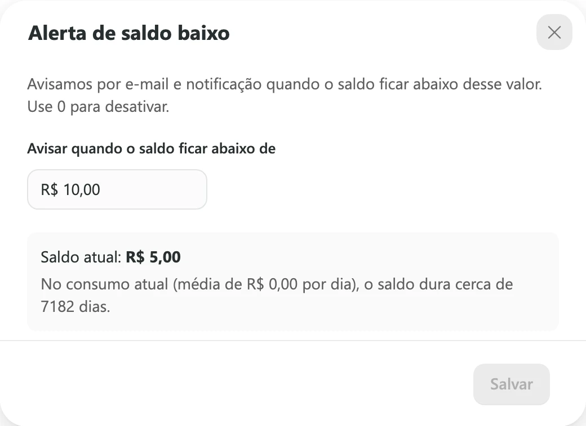

O alerta de saldo avisa quando o saldo em reais da carteira do workspace (na tela, **ambiente**) está baixo, para você recarregar antes de os serviços avulsos ficarem sem saldo (veja o que gasta o saldo em [Saldo da carteira e créditos: o que consome](/docs/conceitos/saldo-e-creditos)).

<Note>Só quem tem a permissão **Assinatura** (ou é o proprietário do workspace) vê e altera o alerta de saldo.</Note>

## Passo a passo

<Steps>
  <Step title="Abra o histórico de recargas">
    Vá em **Configurações** → **Assinatura**. Na seção **Carteira**, clique em **Saldo disponível** para abrir o **Histórico de recargas**.
  </Step>
  <Step title="Abra a configuração do alerta">
    No topo do **Histórico de recargas**, clique no botão de **Alerta de saldo** (se o alerta estiver desativado, o botão aparece como **Configurar alerta de saldo**).

    <Frame caption="Topo do Histórico de recargas com o botão do alerta de saldo">
      
    </Frame>
  </Step>
  <Step title="Defina o valor e salve">
    Na janela **Alerta de saldo baixo**, digite o limite desejado em **Avisar quando o saldo ficar abaixo de** e clique em **Salvar**. Quando nunca foi alterado, o alerta já vem ligado com um valor padrão.

    <Frame caption="Janela Alerta de saldo baixo com o campo do limite">
      
    </Frame>
  </Step>
</Steps>

## Previsão de duração do saldo

Dentro da janela **Alerta de saldo baixo**, a caixa de **Saldo atual** mostra a previsão de quantos dias o saldo deve durar no ritmo médio de gasto do workspace. Quando ainda não há consumo suficiente para calcular a média, a caixa exibe o aviso de que ainda não é possível prever a duração.

## Quando o aviso chega

- O alerta dispara quando o saldo fica abaixo do valor configurado **e**, no ritmo de gasto atual do workspace, está perto de acabar. Um workspace sem consumo recente não recebe o aviso mesmo com o saldo abaixo do limite.
- O aviso chega por **notificação** na Kinbox e por **e-mail** para o proprietário do workspace e para os membros ativos com a permissão **Assinatura**.
- A Kinbox envia **um aviso por vez**. Depois de avisar, um novo alerta só é enviado quando o saldo volta a ficar igual ou acima do limite (após uma recarga em [Adicionar saldo e créditos de SMS](/docs/assinatura/adicionar-saldo)) e cai abaixo dele de novo.

## Desativar o alerta

Para desativar o alerta, abra a janela **Alerta de saldo baixo**, informe `0` em **Avisar quando o saldo ficar abaixo de** e clique em **Salvar**.
