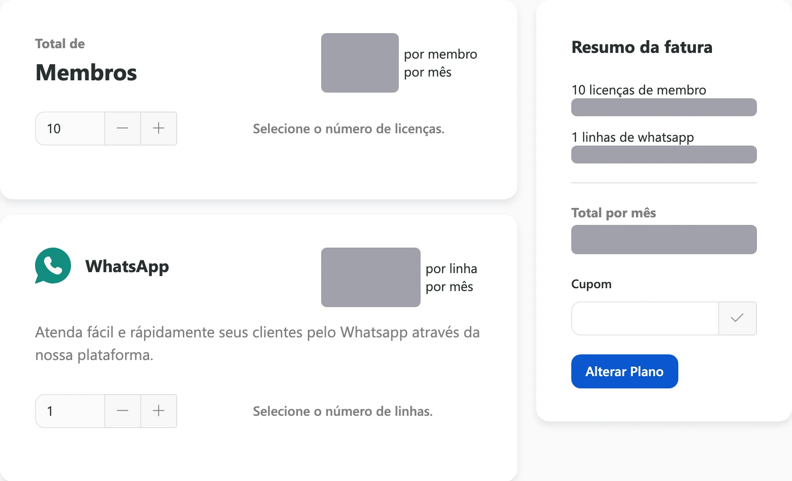

Use este guia para contratar um plano depois do teste grátis ou para aumentar e diminuir a quantidade de licenças e canais do seu workspace (na tela, **ambiente**). A contratação pela tela é mensal; para plano anual, fale com o comercial.

<Note>Só quem tem a permissão **Assinatura** (ou é o proprietário do workspace) vê esta página.</Note>

## Antes de começar

- Tenha em mãos os **Dados de cobrança**: nome, **E-mails de cobrança** (separados por vírgula), telefone, CPF ou CNPJ e endereço completo.
- Se você vai aumentar uma assinatura ativa, garanta saldo na carteira para pagar a diferença proporcional aos dias que faltam até o vencimento (veja [Adicionar saldo e créditos de SMS](/docs/assinatura/adicionar-saldo)).
- Para consultar os valores das unidades antes de contratar, acesse a [página de planos da Kinbox](https://www.kinbox.com.br/pricing/).
- Se você precisa só trocar a forma de pagamento ou o cartão das próximas cobranças sem mudar o plano, fale com o suporte.

## Passo a passo

<Steps>
  <Step title="Abra a tela do plano">
    Vá em **Configurações** → **Assinatura**. Clique em **Assinar um plano** (se estiver no teste grátis ou com a assinatura cancelada) ou em **Mudar plano** (se já tiver uma assinatura **PRO** ativa).
  </Step>
  <Step title="Escolha as quantidades e o cupom">
    Na tela **Checkout** (ou **Alterar Plano**), ajuste os cartões **Membros**, **WhatsApp**, **Instagram Direct**, **SMS** e, se quiser, **Ligações WhatsApp** usando o campo ou os botões − e +. Cartões sem unidades contratadas mostram o botão **Adicionar**.

    Confira os itens e o **Total por mês** no **Resumo da fatura**. Se tiver um código promocional, digite em **Cupom** e clique no botão de confirmar ao lado. Clique em **Comprar** ou em **Alterar Plano**.

    <Frame caption="Tela Alterar Plano com os cartões de unidades e o Resumo da fatura">
      
    </Frame>
  </Step>
  <Step title="Confirme os dados de cobrança">
    No painel **Dados de cobrança**, preencha ou revise **Nome**, **E-mails de cobrança**, **Número de telefone**, **Tipo de pessoa** (**Pessoa física** ou **Pessoa jurídica**), **CPF** ou **CNPJ** e **Endereço** (**CEP**, **Rua**, **Número**, **Bairro**, **Estado**, **Cidade** e **País**). Clique em **Continuar** para salvar os dados.
  </Step>
  <Step title="Escolha o método de pagamento e contrate">
    Em **Método de pagamento**, selecione **Pix**, **Boleto** ou **Cartão de crédito**. No cartão, escolha um cartão salvo ou clique em **Adicionar novo cartão**. Clique em **Contratar**.

    - No **Pix**, o painel **Pagamento PIX** mostra o QR Code e o botão **Copiar código PIX**. A tela confere o pagamento automaticamente e volta para **Assinatura** assim que recebe a confirmação.
    - No **Boleto** e no **Cartão de crédito**, a tela confirma a atualização e volta para **Assinatura**. O boleto fica disponível em [Faturas, boletos e nota fiscal](/docs/assinatura/faturas).
  </Step>
</Steps>

## Quando você aumenta o plano

Se o valor do novo plano for maior que o atual, a diferença proporcional aos dias que faltam até o vencimento (mostrada na tela como **pro-rata**) é debitada do saldo da carteira. A próxima mensalidade já vem com o novo valor.

Se o saldo da carteira não for suficiente, clicar em **Alterar Plano** abre a janela **Adicionar Saldo** com o valor necessário já preenchido para pagamento por **Pix**. Assim que o Pix é confirmado, a Kinbox aplica a mudança do plano sozinha. Se a alteração não puder ser concluída na hora, o saldo continua na carteira e você pode refazer o pedido.

## Quando você diminui o plano

Ao diminuir o plano, não há devolução nem crédito pela diferença do período atual. O novo valor vale a partir da próxima fatura mensal.

A tela não permite reduzir as quantidades abaixo do que está em uso:

- **Membros**: não pode ficar abaixo do total de membros ativos. Desative os membros que sobram antes de reduzir as licenças (veja o que é uma licença em [Workspace, membros e papéis](/docs/conceitos/workspace-membros-e-papeis)).
- **WhatsApp** e **Instagram Direct**: não podem ficar abaixo da quantidade de canais já conectados. Remova os canais extras antes em [Canais: conectar e gerenciar](/docs/canais/visao-geral).

## Depois de contratar

- **Primeira assinatura (saindo do teste grátis):** o plano passa para **PRO** na hora e a primeira fatura é gerada com vencimento no mesmo dia. No cartão, a cobrança ocorre nesse momento. Se a primeira fatura não for paga, os bloqueios de assinatura vencida começam 3 dias depois (veja [Minha assinatura venceu ou o pagamento falhou](/docs/assinatura/assinatura-vencida)). Um e-mail de confirmação vai para os **E-mails de cobrança**.
- **Alteração de plano ativo:** as novas quantidades valem na hora e um e-mail de atualização vai para os **E-mails de cobrança**. Faturas em aberto do período atual são canceladas; se faltarem 5 dias ou menos para o vencimento, uma nova fatura já é gerada com o novo valor.

## Problemas comuns

- **Cupom recusado.** A tela pode avisar que o cupom não pode mais ser reutilizado mesmo quando o código está incorreto ou expirado. Confira a digitação ou fale com quem forneceu o cupom.
- **Não consigo diminuir o número de licenças ou canais.** Reduza primeiro os membros ativos ou exclua os canais excedentes em [Canais: conectar e gerenciar](/docs/canais/visao-geral) e tente de novo.
- **Cartão recusado.** Confira os dados informados ou tente pagar a fatura com outro cartão em [Faturas, boletos e nota fiscal](/docs/assinatura/faturas).
