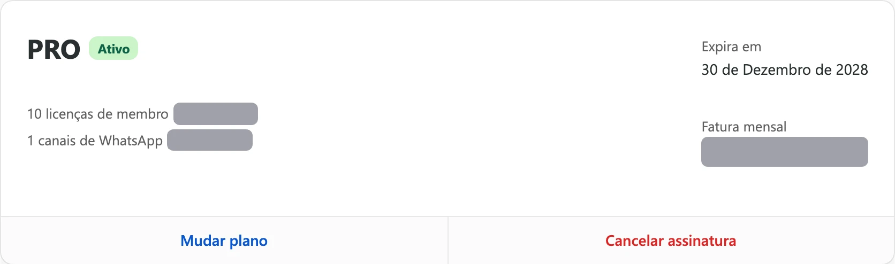

A assinatura é o que o seu workspace (na tela, **ambiente**) paga todo mês para usar a Kinbox, montada a partir das unidades que a sua equipe contrata.

## Onde fica

Vá em **Configurações** → **Assinatura**. Só quem tem a permissão **Assinatura** (ou é o proprietário do workspace) vê esta página. Em alguns workspaces gerenciados por parceiro, os botões de contratação e mudança de plano não aparecem.

<Frame caption="Cartão do plano em Configurações → Assinatura">
  
</Frame>

## O que entra no plano

Na Kinbox não existem planos com nome fixo. Você monta o plano com as unidades que precisa. A contratação pela tela é mensal; para plano anual, fale com o comercial.

| Item no plano | O que conta |
| --- | --- |
| **Membros** | Licenças de membro para pessoas acessarem o workspace. |
| **WhatsApp** | Linhas de WhatsApp, somando WhatsApp oficial e WhatsApp por QR Code (veja [Canais: conectar e gerenciar](/docs/canais/visao-geral)). |
| **Instagram Direct** | Canais de Instagram conectados ao workspace. |
| **SMS** | Créditos de SMS mensais incluídos no plano. |
| **Ligações WhatsApp** | Plano opcional de minutos para ligações pelo WhatsApp. |

Outros canais, como Telegram, e-mail, widget, Facebook e canal customizado, não entram na cobrança do plano.

Para consultar os valores atualizados, acesse a [página de planos da Kinbox](https://www.kinbox.com.br/pricing/).

## Teste grátis

Todo workspace novo começa em teste grátis de **7 dias**, sem precisar cadastrar cartão de crédito. O teste inclui **10 licenças** de membro e **1 linha de WhatsApp**, e não permite adicionar canais de Instagram.

Na página **Assinatura**, o plano em teste aparece como **Trial** e a seção **Faturas** não é exibida. Para continuar usando a Kinbox depois do teste, clique em **Assinar um plano** (veja [Assinar ou mudar o plano](/docs/assinatura/assinar-ou-mudar-plano)).

## Renovação mensal

Todo mês, a fatura da mensalidade é gerada automaticamente **5 dias** antes da data em **Expira em**:

- No **Cartão de crédito**, a cobrança é feita automaticamente.
- No **Boleto** e no **Pix**, a fatura é enviada para os **E-mails de cobrança** cadastrados e fica disponível na seção **Faturas**.

Quando o pagamento é confirmado, a data em **Expira em** avança um mês a partir do vencimento anterior. Se a fatura não for paga até o vencimento, o workspace tem **3 dias** de carência. Depois disso, não dá mais para responder conversas nem adicionar membros e canais (veja [Minha assinatura venceu ou o pagamento falhou](/docs/assinatura/assinatura-vencida)).

## Saldo e créditos de SMS são à parte

O saldo em reais da carteira e os créditos de SMS avulsos são separados da mensalidade e comprados por Pix em [Adicionar saldo e créditos de SMS](/docs/assinatura/adicionar-saldo). O saldo da carteira paga serviços avulsos, como recursos de IA e ligações (veja [Saldo da carteira e créditos: o que consome](/docs/conceitos/saldo-e-creditos)), e também cobre a diferença proporcional quando você aumenta o plano antes do vencimento.

## Próximos passos

<CardGroup cols={2}>
  <Card title="Assinar ou mudar o plano" href="/docs/assinatura/assinar-ou-mudar-plano">
    Contrate após o teste grátis ou ajuste a quantidade de licenças e canais.
  </Card>
  <Card title="Adicionar saldo e créditos de SMS" href="/docs/assinatura/adicionar-saldo">
    Coloque saldo em reais na carteira e compre pacotes de créditos de SMS por Pix.
  </Card>
  <Card title="Configurar o alerta de saldo" href="/docs/assinatura/alerta-de-saldo">
    Defina quando receber aviso por e-mail e notificação antes de o saldo acabar.
  </Card>
  <Card title="Faturas, boletos e nota fiscal" href="/docs/assinatura/faturas">
    Emita segunda via, baixe a nota fiscal e pague de novo uma fatura recusada no cartão.
  </Card>
  <Card title="Cancelar a assinatura" href="/docs/assinatura/cancelar">
    Encerre a renovação mensal e veja o que acontece com o acesso e as faturas.
  </Card>
  <Card title="Minha assinatura venceu ou o pagamento falhou" href="/docs/assinatura/assinatura-vencida">
    Entenda a carência de 3 dias, os bloqueios e como regularizar o pagamento.
  </Card>
</CardGroup>
