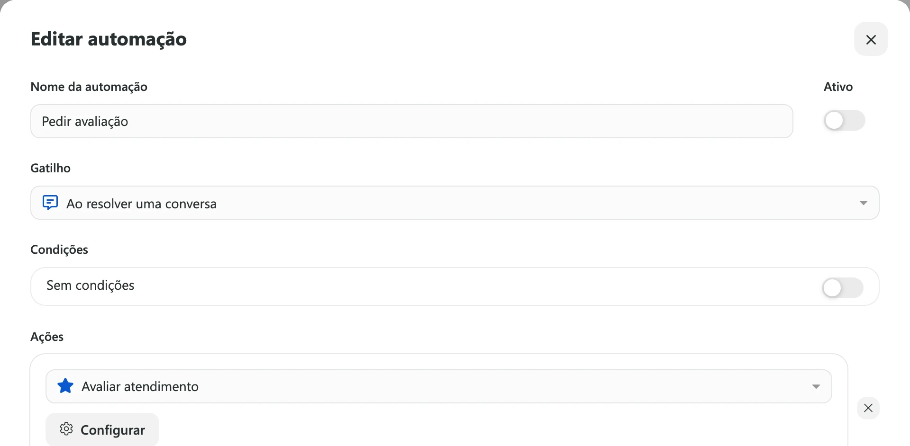
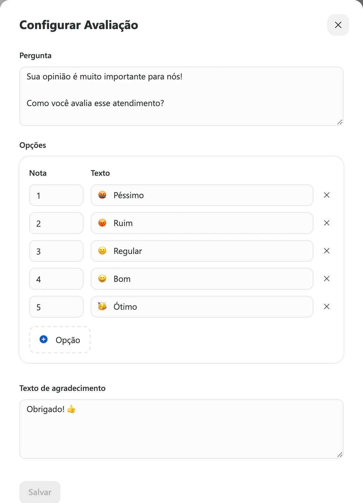

Envie uma pesquisa de satisfação ao contato quando uma conversa é resolvida usando uma automação com a ação **Avaliar atendimento**. A pesquisa não sai sozinha ao resolver: ela depende dessa automação e utiliza o bot de avaliação que, em geral, todo workspace (na tela, **ambiente**) novo já traz com a pergunta padrão.

<Note>
  Quem pode: criar a automação exige ser o proprietário ou ter a opção **Automações** ("Ver, adicionar, editar e excluir automações.") na seção **Gerenciamento do Ambiente** do papel (na tela, **Permissão**). Para ver as notas e abrir o botão **Configurar** no relatório, é preciso ser o proprietário ou ter **Gerenciar relatórios** ("Ver e gerar relatórios."). Se **Automações** não aparecer em **Configurações** → **Automação**, peça ao proprietário ou a quem administra o workspace para liberar essa permissão.
</Note>

## Criar a automação de avaliação

<Steps>
  <Step title="Abra a tela de automações e crie uma automação">
    Vá em **Configurações** (engrenagem no menu lateral) → **Automação** → **Automações** e crie uma automação (veja [Criar uma automação](/docs/automacao/configurando-automacoes)).
  </Step>
  <Step title="Defina o nome e o gatilho">
    Preencha **Nome da automação** (por exemplo, "Pedir avaliação") e, em **Gatilho**, selecione **Ao resolver uma conversa** (no grupo **Conversa**). O mesmo modelo está em [Exemplos de automação](/docs/automacao/exemplos#3-pedir-avaliação-ao-resolver).
  </Step>
  <Step title="Defina condições e adicione a ação Avaliar atendimento">
    Se quiser limitar a pesquisa a um canal ou outra regra, configure **Condições**; caso contrário, mantenha **Sem condições**. Em **Ações**, selecione **Avaliar atendimento** (o botão **Configurar** ao lado abre a edição da pergunta e das notas).

    <Frame caption="Painel Editar automação com o gatilho Ao resolver uma conversa e a ação Avaliar atendimento">
      
    </Frame>
  </Step>
  <Step title="Salve e ligue a automação">
    Confira se o interruptor **Ativo** está ligado (no topo do painel ou na lista) e clique em **Salvar**. A pesquisa passa a ser disparada quando uma conversa é resolvida (veja [Atender uma conversa: responder, notas, resolver e reabrir](/docs/conversas/gerenciar-conversas)).
  </Step>
</Steps>

## Mudar a pergunta e as notas

Clique em **Configurar** (na ação **Avaliar atendimento** da automação ou em **Relatórios** → **Avaliação**) para abrir **Configurar Avaliação**. Edite a **Pergunta**, ajuste cada linha de **Opções** com **Nota** (de `0` a `5`) e **Texto**, clique em **Opção** para acrescentar linhas ou em **x** para remover, ajuste o **Texto de agradecimento** e clique em **Salvar** (aparece o aviso "Avaliação Atualizada.").

A configuração é única para todo o workspace: alterar a pergunta ou as opções em um lugar muda o texto para todas as automações que usam **Avaliar atendimento**.

<Frame caption="Painel Configurar Avaliação com a pergunta padrão, as opções de nota e o texto de agradecimento">
  
</Frame>

## O que o contato recebe

Ao disparar a automação, o contato recebe a **Pergunta** com as opções configuradas; quando responde com a **Nota** ou o **Texto** de uma das opções, recebe o **Texto de agradecimento** e a nota fica gravada. Uma resposta que não corresponde a nenhuma opção não vira nota e segue como mensagem comum. A nota conta para o membro responsável pela conversa no momento da resposta — ou, se estiver sem responsável, para o último membro que foi responsável naquela sessão (veja [Conversas, sessões e status](/docs/conceitos/conversas-e-sessoes)).

## Quando a pesquisa não é enviada

A Kinbox não envia a avaliação nestes casos:

- A sessão foi reaberta (mesmo com o gatilho **Ao resolver uma conversa reaberta**, a pesquisa não sai em sessão reaberta).
- A sessão já recebeu uma avaliação (é permitida apenas uma avaliação por sessão).
- O contato não mandou nenhuma mensagem naquela sessão.
- A sessão nunca teve um membro responsável (está sem responsável e não teve nenhum responsável anterior).

## Ver as notas

Veja os resultados em **Relatórios** → **Avaliação** (**Relatório de Avaliação**; detalhes em [Relatório de avaliação](/docs/relatorios/avaliacao)), que reúne **Nota Média** e **Avaliadores** por membro, dia, grupo, tag ou canal, contando cada sessão pelo dia em que foi resolvida.

Para mostrar a nota de avaliação de cada membro para o restante da equipe nas salas, ligue **Nota de avaliação pública** em **Configurações** → **Ambiente** → **Geral** (veja [Mensagens automáticas e regras da caixa de entrada](/docs/administracao/mensagens-automaticas)).
