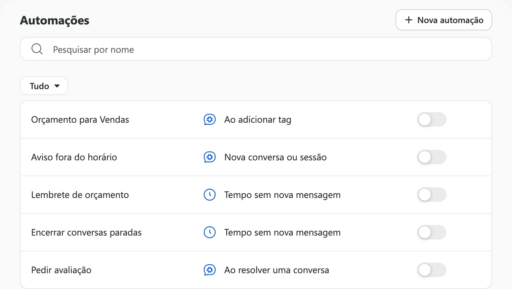
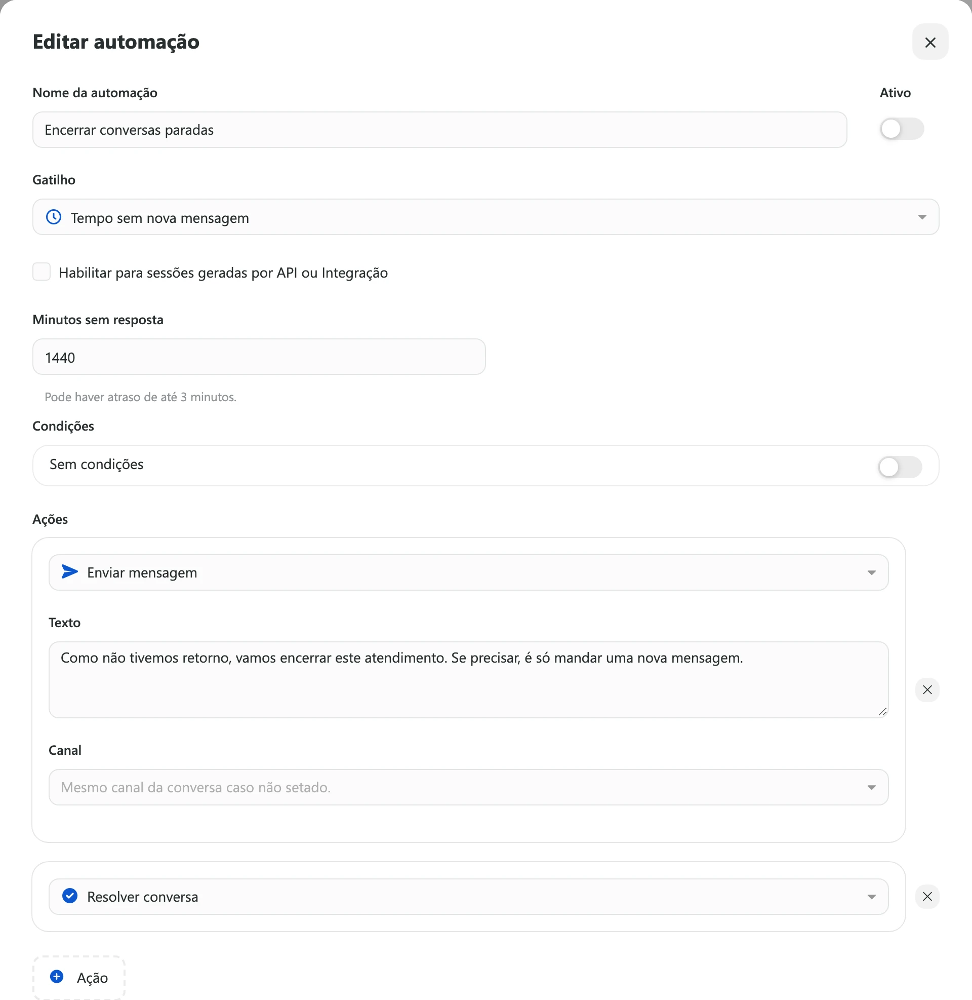
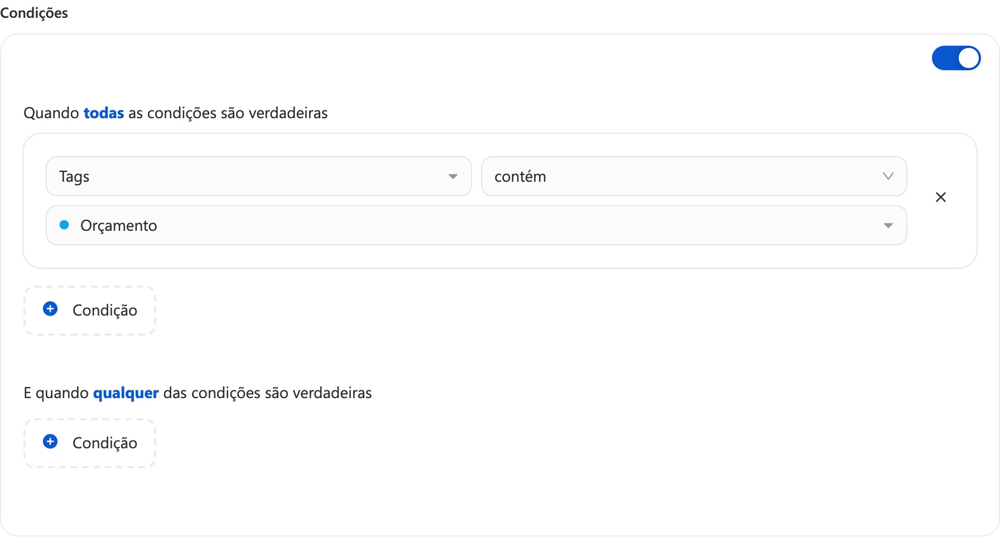
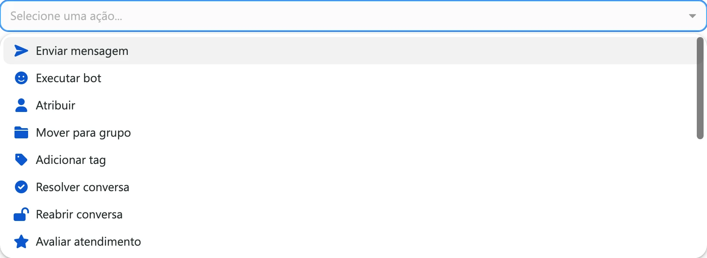

Crie uma automação para que a Kinbox execute ações sozinha quando um evento acontece — como responder fora do horário, mover conversas para um grupo ou encerrar atendimentos parados.

<Note>
  Quem pode: ver, criar, editar e excluir automações exige a permissão **Automações** (na seção **Gerenciamento do Ambiente** do papel, chamado na tela de **Permissão**) ou ser o proprietário do workspace (na tela, **ambiente**). Se o item **Automações** não aparecer, peça ao proprietário ou a quem administra os papéis (veja [Referência de permissões](/docs/administracao/referencia-de-permissoes) e [Criar papéis e permissões](/docs/configuracoes-no-workspace/configurar-permissoes-dos-usuarios)).
</Note>

## Antes de começar

- Confirme que você tem a permissão **Automações** ou é o proprietário do workspace.
- Crie antes os itens que a automação vai usar — [horários](/docs/configuracoes-no-workspace/criar-e-gerenciar-horarios), [grupos](/docs/configuracoes-no-workspace/criar-e-gerenciar-grupos), [tags](/docs/configuracoes-no-workspace/criar-e-gerenciar-tags), [bots](/docs/bot/visao-geral), [regras de atribuição automática](/docs/configuracoes-no-workspace/criar-atribuicoes-automaticas) e [funis](/docs/crm/visao-geral). As listas das condições e das ações só mostram o que já existe no workspace.

## Passo a passo

<Steps>
  <Step title="Abra a tela de automações">
    Vá em **Configurações** → **Automação** → **Automações** e clique em **Nova automação**.

    <Frame caption="Tela Automações com o botão Nova automação no topo">
      
    </Frame>
  </Step>

  <Step title="Defina o nome e se ela já nasce ativa">
    No painel **Criar automação**, preencha **Nome da automação** (obrigatório).

    O interruptor **Ativo** já vem ligado numa automação nova: ao salvar, ela passa a valer na hora. Se quiser montar com calma antes de ligar, desligue **Ativo**.
  </Step>

  <Step title="Escolha o gatilho primeiro">
    Abra a lista **Gatilho** e escolha o evento. Os gatilhos aparecem agrupados em **Conversa**, **Membro** e **Contato**, e você pode digitar parte do nome para encontrar mais rápido.

    Escolha o **Gatilho** antes de preencher condições e ações: trocar o gatilho depois apaga as condições e as ações já preenchidas e desliga **Condições**.
  </Step>

  <Step title="Preencha o tempo, se o gatilho for de tempo">
    Se você escolheu um gatilho de tempo, preencha **Minutos sem resposta** (ou **Minutos sem conversa criada**, no gatilho **Tempo sem conversa ao criar contato**). O campo é obrigatório, aceita no mínimo `1` minuto, vem com `3` nos gatilhos de conversa e mostra a ajuda "Pode haver atraso de até 3 minutos.". Se o campo de minutos não aparecer, confira se escolheu um gatilho de tempo.

    Nos gatilhos **Tempo sem nenhuma resposta do membro na sessão nova** e **Tempo sem nova mensagem**, também aparece a caixa **Habilitar para sessões geradas por API ou Integração**: marque se a automação também deve rodar em sessões abertas pela API ou por integrações. Essa caixa só aparece nesses dois gatilhos; se não aparecer, confira o gatilho escolhido.

    Lembre que só **uma** automação ligada vale por gatilho de tempo, e que **Tempo para expirar a Janela de 24h** só vale para WhatsApp oficial.

    <Frame caption="Automação com gatilho de tempo, sem condições e duas ações">
      
    </Frame>
  </Step>

  <Step title="Configure condições (opcional)">
    Com o interruptor desligado (**Sem condições**), a automação roda toda vez que o gatilho acontece.

    Para filtrar, ligue o interruptor de **Condições**, clique em **Condição** no bloco "Quando **todas** as condições são verdadeiras" ou em "E quando **qualquer** das condições são verdadeiras" e escolha campo, operador e valor. O **X** remove a linha.

    O gatilho **Tempo sem conversa ao criar contato** não tem condições. Alguns campos só aparecem em gatilhos específicos — como **Tag**, que só aparece em **Ao adicionar tag**; se não aparecer, confira o gatilho escolhido. Veja todos os campos em [Gatilhos, condições e ações das automações](/docs/automacao/gatilhos-e-acoes).

    <Frame caption="Bloco de condições ligado com o filtro Tags contém Orçamento">
      
    </Frame>
  </Step>

  <Step title="Adicione as ações">
    Clique em **Ação**, escolha uma opção em **Selecione uma ação...** e preencha os campos que aparecem. Repita para adicionar outras ações; o **X** remove a linha. As ações rodam na ordem em que aparecem na tela.

    Algumas ações só aparecem em gatilhos específicos: **Atribuir conversas sem atendimento** (com a opção **Atribuir ao membro do gatilho**) só existe em **Ao membro ficar online**, e **Iniciar conversa** só existe em **Tempo sem conversa ao criar contato**. Se uma dessas ações não aparecer, confira o gatilho escolhido.

    Em **Enviar mensagem**, a mensagem é só texto e o campo **Canal** não lista o WhatsApp oficial (deixe vazio para enviar na própria conversa). **Agendar execução de bot** só funciona em conversas de WhatsApp.

    <Frame caption="Lista de ações aberta em Selecione uma ação...">
      
    </Frame>
  </Step>

  <Step title="Salve a automação">
    Clique em **Salvar**. Aparece um aviso confirmando que a automação foi salva e ela passa a aparecer na lista. Se **Ativo** estiver ligado, ela já vale para novos eventos (automações não são retroativas).
  </Step>
</Steps>

## Depois de criar

- **Ligar ou desligar:** use o interruptor direto na linha da lista — a mudança grava na hora, sem abrir a automação. Use **Pesquisar por nome** e o filtro **Tudo** / **Ativos** / **Inativos** para localizar automações.
- **Editar:** clique no nome da automação ou no menu de três pontos → **Editar**. Se tentar fechar o painel com alterações sem salvar, a Kinbox pergunta "Fechar sem salvar?"; clique em **Prosseguir** para descartar.
- **Clonar:** no menu de três pontos, clique em **Clonar** para abrir uma automação nova já preenchida com o nome "Cópia de …". Revise os campos e salve. Antes de ligar uma cópia com gatilho de tempo, lembre que só **uma** automação ligada vale por gatilho de tempo.
- **Excluir:** no menu de três pontos, clique em **Excluir** e confirme em "Tem certeza que deseja excluir essa automação?" → **Excluir**.

<Warning>
  Excluir uma automação não tem volta. Se você quer apenas pausar o funcionamento sem perder a configuração, desligue o interruptor na lista em vez de excluir.
</Warning>

- **Testar:** ligue a automação e provoque o gatilho em uma conversa de teste — use uma sessão nova depois de salvar, porque a automação não é retroativa. Em gatilhos de tempo, teste com poucos minutos e espere até 3 minutos a mais ("Pode haver atraso de até 3 minutos.").

## Boas práticas

- Dê um nome que deixe claro o gatilho e o resultado (por exemplo, **Aviso fora do horário**).
- Use apenas uma automação ligada por gatilho de tempo e coloque todas as ações dela na mesma automação.
- Comece sem condições (ou com poucas), teste em uma conversa e depois adicione filtros.

## Próximos passos

- [Exemplos de automação: follow-up, encerrar por inatividade e avaliação](/docs/automacao/exemplos)
- [Gatilhos, condições e ações das automações](/docs/automacao/gatilhos-e-acoes)
- [Minha automação não disparou](/docs/automacao/problemas-comuns)
