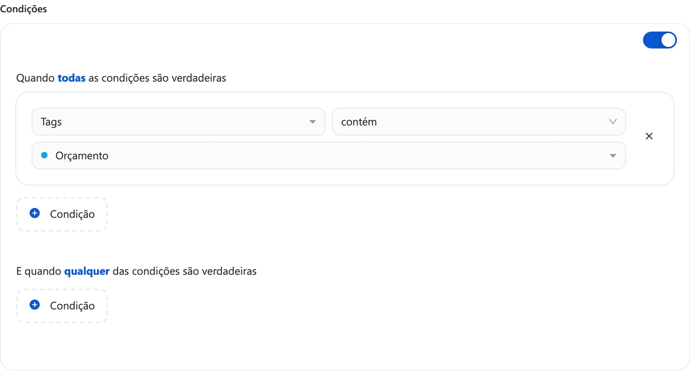
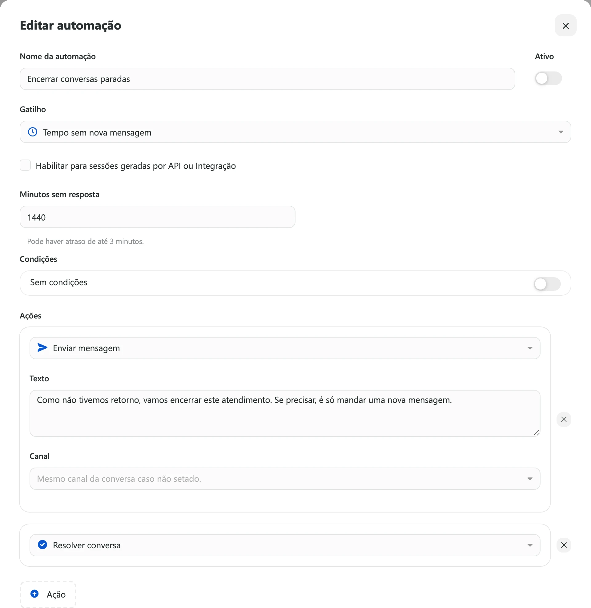
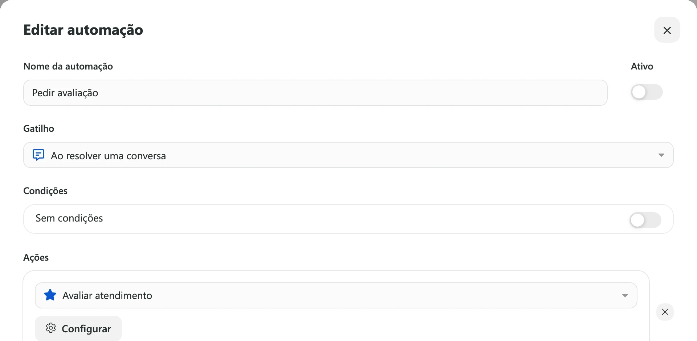

Use estes modelos prontos como base para montar suas primeiras automações na Kinbox. Todas elas são criadas em **Configurações** → **Automação** → **Automações** (exige a permissão **Automações** ou ser o proprietário), seguindo o passo a passo de [Criar uma automação](/docs/automacao/configurando-automacoes).

## 1. Lembrete de orçamento (follow-up)

**Quando usar:** para enviar um lembrete automático quando um orçamento fica sem resposta.

| Campo | Como preencher |
| --- | --- |
| **Nome da automação** | **Lembrete de orçamento** |
| **Gatilho** | **Tempo sem nova mensagem** — **Minutos sem resposta**: `120` (2 horas) |
| **Condições** | Em "Quando **todas** as condições são verdadeiras": **Tags** **contém** **Orçamento** |
| **Ações** | **Enviar mensagem** — **Texto**: `Oi! Conseguiu ver o orçamento que enviamos? Se tiver alguma dúvida, estamos por aqui.` — **Canal**: deixe vazio |

<Frame caption="Condição Tags contém Orçamento ligada na automação">
  
</Frame>

**O que acontece:** 2 horas depois da última mensagem (do contato ou de um membro), se ninguém mais escrever e a conversa estiver com a tag **Orçamento**, a mensagem sai na própria conversa. As condições são conferidas na hora de disparar: se a tag **Orçamento** sair antes de completar as 2 horas, nada é enviado.

**Cuidados:**

- Nos gatilhos de tempo, "Pode haver atraso de até 3 minutos.".
- **Tempo sem nova mensagem** dispara uma vez por sessão, e a mensagem enviada pela automação não recomeça a contagem.
- Se a conversa foi aberta pela API ou por uma integração, marque **Habilitar para sessões geradas por API ou Integração** (a caixa só aparece em **Tempo sem nenhuma resposta do membro na sessão nova** e **Tempo sem nova mensagem**).
- **Enviar mensagem** envia apenas texto e o campo **Canal** não lista os canais do WhatsApp oficial (API). No WhatsApp oficial fora da janela de 24 horas só sai template: nesses casos, use **Agendar mensagem template** em uma conversa do WhatsApp oficial em que o template está aprovado (veja [Enviar um template aprovado](/docs/canais/whatsapp/whatsapp-templates/enviar-template)).

<Tip>
  Para o lembrete sair dentro do horário de atendimento, troque **Enviar mensagem** por **Agendar mensagem** com **Para quando?** em **Próximo horário comercial**: a ação agenda a mensagem para o horário comercial selecionado depois que o gatilho dispara (no fuso horário do workspace).
</Tip>

## 2. Encerrar conversas paradas (inatividade)

**Quando usar:** para avisar o contato e resolver automaticamente conversas que ficaram sem movimento.

| Campo | Como preencher |
| --- | --- |
| **Nome da automação** | **Encerrar conversas paradas** |
| **Gatilho** | **Tempo sem nova mensagem** — **Minutos sem resposta**: `1440` (24 horas) |
| **Condições** | **Sem condições** |
| **Ações** *(nesta ordem)* | 1. **Enviar mensagem** (**Texto**: `Como não tivemos retorno, vamos encerrar este atendimento. Se precisar, é só mandar uma nova mensagem.`; **Canal**: deixe vazio); 2. **Resolver conversa** |

<Frame caption="Automação Encerrar conversas paradas com 1440 minutos, sem condições e duas ações em sequência">
  
</Frame>

**O que acontece:** depois de 24 horas sem mensagem do contato nem de um membro (com possível atraso de até 3 minutos), a Kinbox tenta enviar a mensagem de aviso na própria conversa e resolve a sessão em seguida, na ordem cadastrada. Em canais sem janela de resposta (como o WhatsApp por QR Code), o aviso sai antes da resolução. No WhatsApp oficial, 24 horas sem mensagem do contato já fecham a janela de 24 horas: o aviso em texto não é entregue e a conversa é resolvida mesmo assim. Se o contato escrever depois, começa uma sessão nova — ou a mesma sessão é reaberta se ainda estiver dentro do tempo de tolerância (veja [Conversas, sessões e status](/docs/conceitos/conversas-e-sessoes)).

<Note>
  Os exemplos **Lembrete de orçamento** e **Encerrar conversas paradas** usam o mesmo gatilho de tempo (**Tempo sem nova mensagem**). Só **uma** automação ligada vale por gatilho de tempo: ligue apenas uma das duas, ou junte as ações numa única automação se quiser que todas rodem após o mesmo tempo.
</Note>

**Cuidados:**

- Se o workspace tiver a **Mensagem ao resolver conversa** configurada em **Configurações** → **Ambiente** → **Geral**, veja como ela funciona quando a resolução é feita por automação em [Mensagens automáticas e regras da caixa de entrada](/docs/administracao/mensagens-automaticas).
- Para sessões abertas pela API ou por integrações, marque **Habilitar para sessões geradas por API ou Integração** (a caixa só aparece em **Tempo sem nenhuma resposta do membro na sessão nova** e **Tempo sem nova mensagem**).
- **Em que canais o aviso sai:** o texto sai na própria conversa em canais sem janela de resposta, como o WhatsApp por QR Code. No WhatsApp oficial, 24 horas sem mensagem do contato já fecham a [janela de 24 horas](/docs/canais/whatsapp/whatsapp-cloud-api/janela-de-24-horas): o aviso de texto não é entregue e a conversa é resolvida mesmo assim.
- **Agendar mensagem template** não substitui o aviso nesta receita: a mensagem agendada sai em ciclos de até 3 minutos e pode chegar depois que a conversa já foi resolvida.
- Não confunda com **Tempo sem nenhuma resposta do membro na sessão nova**: esse outro gatilho só conta enquanto nenhum membro respondeu — serve para avisar o contato que a equipe já vai responder, não para encerrar conversas já atendidas.

## 3. Pedir avaliação ao resolver

**Quando usar:** para enviar a pesquisa de satisfação assim que uma conversa é resolvida.

| Campo | Como preencher |
| --- | --- |
| **Nome da automação** | **Pedir avaliação** |
| **Gatilho** | **Ao resolver uma conversa** |
| **Condições** | **Sem condições** |
| **Ações** | **Avaliar atendimento** (clique em **Configurar** para alterar a pergunta e as opções) |

<Frame caption="Automação Pedir avaliação configurada com o gatilho Ao resolver uma conversa e a ação Avaliar atendimento">
  
</Frame>

**O que acontece:** quando a sessão é resolvida, a Kinbox envia a pesquisa de satisfação na conversa.

**Cuidados:**

- Conversas reabertas e resolvidas de novo disparam **Ao resolver uma conversa reaberta**, não **Ao resolver uma conversa**.
- Sessões resolvidas por outra automação (como a do exemplo 2, **Encerrar conversas paradas**) não disparam **Ao resolver uma conversa**, então a pesquisa não sai nelas.
- Para ver os detalhes da pesquisa e em quais casos ela não é enviada, acesse [Pedir avaliação no fim do atendimento](/docs/atendimento/pesquisa-de-satisfacao).

## 4. Aviso fora do horário

**Quando usar:** para avisar contatos que iniciam uma nova conversa ou sessão fora do expediente.

| Campo | Como preencher |
| --- | --- |
| **Nome da automação** | **Aviso fora do horário** |
| **Gatilho** | **Nova conversa ou sessão** |
| **Condições** | Em "Quando **todas** as condições são verdadeiras": **Horário** **está fora de** **Atendimento da loja** |
| **Ações** | **Enviar mensagem** — **Texto**: `Recebemos sua mensagem! Nosso horário é de segunda a sexta, das 9h às 18h, e aos sábados, das 9h às 13h. Respondemos assim que voltarmos.` — **Canal**: deixe vazio |

**O que acontece:** sempre que um contato envia uma mensagem abrindo uma nova sessão fora do horário **Atendimento da loja**, a Kinbox responde automaticamente na própria conversa.

**Cuidados:**

- Cadastre o horário antes em [Definir os horários de atendimento](/docs/configuracoes-no-workspace/criar-e-gerenciar-horarios).
- **Nova conversa ou sessão** dispara apenas em sessões abertas por mensagem do contato (não dispara em sessões iniciadas por membro, API ou integração).
- Se você precisa de aviso fora do horário só para conversas que já têm membro responsável, há uma opção pronta sem automação na tela **Geral** (veja [Mensagens automáticas e regras da caixa de entrada](/docs/administracao/mensagens-automaticas)).

## 5. Mandar conversas de orçamento para Vendas

**Quando usar:** para mover a conversa automaticamente para um grupo assim que a equipe aplica uma tag.

| Campo | Como preencher |
| --- | --- |
| **Nome da automação** | **Orçamento para Vendas** |
| **Gatilho** | **Ao adicionar tag** |
| **Condições** | Em "Quando **todas** as condições são verdadeiras": **Tag** **é igual a** **Orçamento** (grupo **Contexto**) |
| **Ações** | **Mover para grupo** → **Mover para um grupo específico** → **Vendas** |

**O que acontece:** assim que a tag **Orçamento** é adicionada à conversa, ela é movida para o grupo **Vendas**.

**Cuidados:**

- A condição **Tag** (no singular, no grupo **Contexto**) só aparece quando o gatilho escolhido é **Ao adicionar tag** — se não aparecer, confira o gatilho escolhido. Ela confere a tag que acabou de ser adicionada, enquanto **Tags** confere todas as tags da conversa.
- Cada tag adicionada dispara **Ao adicionar tag** de novo, inclusive quando a tag vem de outra automação (**Adicionar tag**): evite automações que adicionem tags em cadeia.

Para conhecer todos os gatilhos, campos de condição e ações que você pode combinar, veja [Gatilhos, condições e ações das automações](/docs/automacao/gatilhos-e-acoes).
