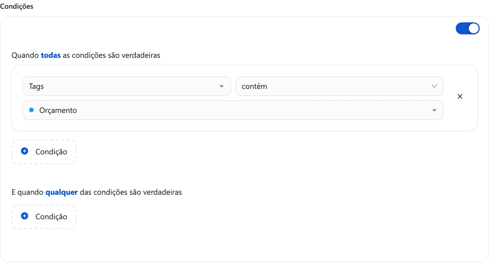

Use esta referência para consultar todos os gatilhos, campos de condição e ações disponíveis ao criar ou editar automações em **Configurações** → **Automação** → **Automações** (exige a permissão **Automações** ou ser o proprietário do workspace).

## Gatilhos

Cada automação tem um único **Gatilho**. Trocar o gatilho depois apaga as condições e as ações já preenchidas.

### Conversa

| Gatilho | Quando acontece |
| --- | --- |
| **Nova conversa ou sessão** | O contato manda uma mensagem que abre uma sessão nova (ou a primeira conversa). |
| **Nova conversa ou sessão iniciada pelo membro** | Um membro começa uma sessão nova enviando a primeira mensagem. |
| **Ao resolver uma conversa** | Uma sessão (que não foi reaberta) é resolvida. Não roda quando a sessão tinha sido reaberta. |
| **Ao resolver uma conversa reaberta** | É resolvida uma sessão que tinha sido reaberta dentro do tempo de tolerância. Nunca dispara junto com **Ao resolver uma conversa**. |
| **Ao atribuir membro** | A conversa recebe um membro responsável (inclusive pela atribuição automática). |
| **Ao mover grupo** | A conversa muda de grupo. |
| **Ao adicionar tag** | Uma tag é adicionada à conversa (cada tag adicionada dispara de novo). |
| **Ao transferir conversa** | A conversa é transferida para outro canal; a automação roda na conversa de destino. |
| **Conversas reaberta dentro do tempo de tolerância** | O contato escreve depois da resolução, dentro do **Tempo de tolerância ao resolver conversa**, e a sessão é reaberta ([Conversas, sessões e status](/docs/conceitos/conversas-e-sessoes) e [Configurações gerais](/docs/configuracoes-no-workspace/configuracoes-gerais)). |
| **Negócio da conversa atualizado** | Uma negociação ligada à conversa é atualizada. |
| **Chamada perdida** | Uma ligação do WhatsApp ou do telefone VoIP para o workspace não é atendida ([Não consigo ligar ou a ligação caiu](/docs/canais/ligacoes/problemas-comuns)). |
| **Tempo sem nenhuma resposta do membro na sessão nova** | Passam os minutos configurados desde que o contato abriu a sessão (nova ou reaberta) sem resposta de um membro. Para quando um membro responde e não conta em sessões iniciadas pelo membro. |
| **Tempo sem nova mensagem** | Passam os minutos configurados desde a última mensagem do contato ou de um membro. Cada mensagem nova de um dos dois recomeça a contagem; dispara uma vez por sessão. |
| **Tempo pendente** | Passam os minutos configurados enquanto a conversa está **Pendente** (aguardando resposta do membro). Para quando deixa de estar pendente e não conta em sessões iniciadas pelo membro ([Conversas, sessões e status](/docs/conceitos/conversas-e-sessoes)). |
| **Tempo para expirar a Janela de 24h** | Apenas **WhatsApp oficial**. Dispara com a antecedência escolhida em minutos **antes** de a janela de 24 horas fechar, contada da última mensagem do contato ([Janela de 24 horas](/docs/canais/whatsapp/whatsapp-cloud-api/janela-de-24-horas)). |

### Membro

| Gatilho | Quando acontece |
| --- | --- |
| **Ao membro ficar online** | Um membro fica online na Kinbox ([Ficar disponível ou indisponível](/docs/conta/disponibilidade)). Só aceita a ação **Atribuir conversas sem atendimento** e as condições **Horário**, **Grupo do membro** e **Disponibilidade do membro**. |

### Contato

| Gatilho | Quando acontece |
| --- | --- |
| **Tempo sem conversa ao criar contato** | Um contato é cadastrado e, passados os minutos em **Minutos sem conversa criada**, ainda não tem conversa em nenhum canal. Só aceita a ação **Iniciar conversa** e não tem condições. |

<Note>
  Regras dos gatilhos de tempo:
  - Todos pedem **Minutos sem resposta** (ou **Minutos sem conversa criada** em **Tempo sem conversa ao criar contato**), obrigatório, mínimo `1` (nos gatilhos de conversa, vem com `3`) e avisam "Pode haver atraso de até 3 minutos.".
  - A caixa **Habilitar para sessões geradas por API ou Integração** só aparece em **Tempo sem nenhuma resposta do membro na sessão nova** e **Tempo sem nova mensagem** (se não aparecer, confira o gatilho escolhido). Sem marcá-la, esses dois gatilhos ignoram sessões abertas pela API ou por integrações.
  - Só **uma** automação ligada vale por gatilho de tempo. Se precisar de várias ações para o mesmo gatilho de tempo, coloque todas na mesma automação.
</Note>

## Condições

Com o interruptor de **Condições** desligado (**Sem condições**), a automação roda toda vez que o gatilho acontece. Para filtrar, ligue o interruptor e clique em **Condição** em um dos dois blocos:

- **"Quando todas as condições são verdadeiras"**: todas as linhas deste bloco precisam bater.
- **"E quando qualquer das condições são verdadeiras"**: pelo menos uma linha deste bloco precisa bater.

Quando você preenche os dois blocos, precisam bater todas as condições do primeiro **e** pelo menos uma do segundo. Cada linha pede campo, operador e valor (o **X** remove a linha). Se faltar campo ou operador, a tela avisa "Faltando Campo" ou "Faltando Operador".

<Frame caption="Seção Condições ligada com o bloco todas preenchido e o bloco qualquer vazio">
  
</Frame>

### Campos disponíveis por grupo de gatilho

| Gatilhos | Grupo de campos | Campos disponíveis |
| --- | --- | --- |
| **Conversa** | **Contexto** | **Horário** (dentro ou fora de um horário cadastrado), **Tag** (só aparece no gatilho **Ao adicionar tag**; confere a tag que acabou de ser adicionada — se não aparecer, confira o gatilho escolhido) |
| **Conversa** | **Contato** | **Tipo de contato** (**Primeira conversa do canal**, **Já conversou no canal**, **Contato novo**, **Contato já cadastrado**), **Nome do contato**, **E-mail do contato**, **Celular do contato**, **Negócios abertos do contato** e campos personalizados do contato |
| **Conversa** | **Conversa/Sessão** | **Grupo**, **Atribuído**, **Campanha**, **Tags** (todas as tags da conversa), **Tipo de canal**, **Canal**, **Negócios abertos da conversa**, **Minutos desde sessão criada**, **Avaliação de atendimento**, **Ads** (**Google** / **Meta**) e campos personalizados da sessão |
| **Ao membro ficar online** | **Contexto** | **Horário** |
| **Ao membro ficar online** | **Membro** | **Grupo do membro** e **Disponibilidade do membro** (**Disponível** / **Indisponível**) |
| **Tempo sem conversa ao criar contato** | — | Não tem condições |

## Ações

Clique em **Ação**, escolha uma opção em **Selecione uma ação...** e preencha os campos que aparecem. Trocar a ação de uma linha apaga os campos dela; o **X** remove. Você pode repetir a mesma ação na mesma automação. As ações rodam na ordem da tela e, se uma falha, as seguintes continuam.

| Ação | O que faz | Onde aparece |
| --- | --- | --- |
| **Enviar mensagem** | Envia uma mensagem de texto (**Texto** obrigatório). Deixe **Canal** vazio para enviar na própria conversa, ou escolha um canal (só WhatsApp por QR Code e SMS) para enviar ao telefone do contato por esse canal. | Gatilhos de **Conversa** |
| **Executar bot** | Inicia o bot escolhido na conversa ([Bot: visão geral](/docs/bot/visao-geral)). | Gatilhos de **Conversa** |
| **Atribuir** | Escolhe entre **Atribuir usando uma atribuição automática**, **Desatribuir membro**, **Desatribuir grupo** ou **Atribuir a um membro específico** (**Membro**). A regra de atribuição escolhida roda mesmo se estiver desligada na lista de **Atribuição automática** ([Distribuir as conversas automaticamente](/docs/configuracoes-no-workspace/criar-atribuicoes-automaticas)). | Gatilhos de **Conversa** |
| **Mover para grupo** | Escolhe entre **Mover para um grupo específico** (**Grupo**), **Atribuir ciclicamente a um grupo** (**Grupos participantes**) ou **Atribuir a um grupo que o membro participa**. | Gatilhos de **Conversa** |
| **Adicionar tag** | Adiciona uma ou mais tags à conversa. | Gatilhos de **Conversa** |
| **Resolver conversa** | Resolve a sessão e para as contagens de tempo daquela conversa. | Gatilhos de **Conversa** |
| **Reabrir conversa** | Reabre a conversa. | Gatilhos de **Conversa** |
| **Avaliar atendimento** | Envia a pesquisa de satisfação; o botão **Configurar** abre a configuração da pesquisa ([Pedir avaliação no fim do atendimento](/docs/atendimento/pesquisa-de-satisfacao)). | Gatilhos de **Conversa** |
| **Agendar mensagem** | Agenda uma mensagem de texto para depois, definindo **Para quando?**, **Canal** opcional (WhatsApp por QR Code), **Texto** e a caixa **Não reabrir conversa**. Usa o fuso horário do workspace ([Configurações gerais](/docs/configuracoes-no-workspace/configuracoes-gerais)). | Gatilhos de **Conversa** |
| **Agendar mensagem template** | Agenda um template do WhatsApp oficial definindo **Para quando?**, **Canal** (obrigatório, só WhatsApp oficial) e **Modelo de mensagem** ([Enviar um template aprovado](/docs/canais/whatsapp/whatsapp-templates/enviar-template)). Usa o fuso horário do workspace. | Gatilhos de **Conversa** |
| **Agendar execução de bot** | Agenda a execução de um **Bot** definindo **Para quando?** e a caixa **Não reabrir conversa**. Usa o fuso horário do workspace. | Gatilhos de **Conversa** |
| **Criar negociação** | Cria uma negociação no CRM com nome, valor, funil, etapa, responsável, grupo e tags ([Funis e negociações: visão geral](/docs/crm/visao-geral)). | Gatilhos de **Conversa** |
| **Atualizar negociação** | Atualiza campos das negociações da conversa. | Gatilhos de **Conversa** |
| **Mudar etapa da negociação** | Move o **Negócio mais recente aberto da conversa** ou **Todos os negócios abertos da conversa** para o **Funil de vendas** e a **Etapa do funil** escolhidos. Dispara as [cadências](/docs/crm/cadencias) da etapa. | Gatilhos de **Conversa** |
| **Integração** | Executa ações de apps conectados ao workspace, como o [HubSpot](/docs/integracoes/hubspot). | Gatilhos de **Conversa** |
| **Atribuir conversas sem atendimento** | Distribui conversas abertas sem responsável do workspace usando **Atribuir ao membro do gatilho** ou **Atribuir para o membro que tem menos atendimentos**, com **Quantidade** e **Limite do membro**. A opção **Atribuir ao membro do gatilho** só existe em **Ao membro ficar online**; se não aparecer, confira o gatilho escolhido. | Gatilhos de **Conversa** e **Ao membro ficar online** |
| **Iniciar conversa** | Abre uma conversa para o contato novo com **Canal** (obrigatório, WhatsApp), **Bot** (opcional) e **Texto** (obrigatório; em canal de WhatsApp oficial, escolhe-se um template no lugar do texto). É feita para **Tempo sem conversa ao criar contato**; nos gatilhos de **Conversa**, para responder na própria conversa, use **Enviar mensagem**. | **Tempo sem conversa ao criar contato** e gatilhos de **Conversa** |

### Cuidados com mensagens e bots

- **Enviar mensagem:** envia apenas texto (sem anexo ou template) e o campo **Canal** não lista o WhatsApp oficial; no WhatsApp oficial fora da janela de 24 horas só sai template.
- **Agendar mensagem template:** o template sai pelo canal da conversa em que a automação rodou (não pelo **Canal** escolhido) e templates com mídia no cabeçalho não funcionam nesta ação.
- **Agendar execução de bot:** funciona apenas em conversas de WhatsApp.

Se alguma automação não rodou como esperado, veja [Minha automação não disparou](/docs/automacao/problemas-comuns).
