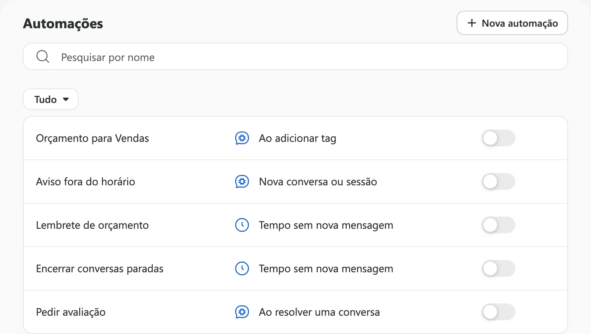

Uma automação faz a Kinbox executar ações sozinha quando um evento acontece — por exemplo, avisar um contato que escreveu fora do expediente ou resolver conversas paradas.

## Como uma automação funciona

Toda automação tem três partes:

- **Gatilho:** o evento que faz a automação rodar (cada automação tem um único gatilho), como uma sessão nova, uma tag adicionada ou um tempo sem nova mensagem.
- **Condições:** filtro opcional para escolher em quais casos a automação roda. Com as condições desligadas (**Sem condições**), ela roda toda vez que o gatilho acontece.
- **Ações:** o que a Kinbox faz quando o gatilho acontece e as condições batem. Você pode colocar uma ou mais ações, e elas rodam na ordem em que aparecem. As ações permitem falar com o contato (enviar ou agendar mensagem, agendar template, executar bot ou pedir avaliação), organizar a conversa (atribuir, mover para grupo, adicionar tag, resolver ou reabrir), agir no CRM (criar, atualizar ou mudar etapa de negociação) e acionar integrações conectadas (como o HubSpot).

Veja todos os gatilhos, condições e ações em [Gatilhos, condições e ações das automações](/docs/automacao/gatilhos-e-acoes).

## Onde fica e quem pode

As automações ficam em **Configurações** → **Automação** → **Automações**. Você também pode abrir a tela pela busca global usando o comando **Ir para automações**.

<Frame caption="Lista de automações em Configurações → Automação → Automações">
  
</Frame>

- **Quem pode:** ver, criar, editar e excluir automações exige a permissão **Automações** (na seção **Gerenciamento do Ambiente** do papel, chamado na tela de **Permissão**) ou ser o proprietário do workspace (na tela, **ambiente**). Se o item **Automações** não aparecer, peça ao proprietário ou a quem administra os papéis (veja [Referência de permissões](/docs/administracao/referencia-de-permissoes) e [Criar papéis e permissões](/docs/configuracoes-no-workspace/configurar-permissoes-dos-usuarios)).
- **Custo:** automações não descontam saldo da carteira; apenas o que elas acionam pode consumir saldo, como um bot com recursos de IA (veja [Saldo da carteira e créditos: o que consome](/docs/conceitos/saldo-e-creditos)).
- **Por assistente de IA:** um assistente externo conectado pelo [MCP](/docs/desenvolvedor/mcp) também pode ler, criar e editar automações, usando a mesma permissão **Automações**.

## Quando a automação roda

- **Ligada ou desligada:** uma automação nova já nasce com **Ativo** ligado e vale assim que é salva. Automações desligadas não disparam, e uma automação de tempo de conversa desligada antes da hora de disparar também não roda. Em **Tempo sem conversa ao criar contato** é diferente: desligar impede novos agendamentos, mas os contatos que já estavam aguardando ainda podem ter a conversa aberta. Você pode ligar ou desligar direto pelo interruptor na lista.
- **Não é retroativa:** a automação só reage a eventos que acontecem depois de salva e ligada. Ela não age sobre conversas ou eventos antigos.
- **Age sem membro:** a automação executa as ações sozinha e só fala com o contato quando alguma ação envia mensagem, executa um bot ou pede avaliação.
- **Gatilhos de tempo:** podem atrasar até 3 minutos ("Pode haver atraso de até 3 minutos."). Nos gatilhos **Tempo sem nenhuma resposta do membro na sessão nova** e **Tempo sem nova mensagem**, existe a caixa **Habilitar para sessões geradas por API ou Integração** (ela só aparece nesses dois gatilhos): sem marcá-la, esses gatilhos ignoram sessões abertas pela API ou por integrações.
- **Uma automação por gatilho de tempo:** só **uma** automação ligada vale por gatilho de tempo. Se precisar de várias ações para o mesmo gatilho de tempo, coloque todas na mesma automação (veja os detalhes em [Gatilhos, condições e ações das automações](/docs/automacao/gatilhos-e-acoes)).

## Exemplos de uso

- **Aviso fora do horário:** responder automaticamente quem escreve fora do expediente.
- **Lembrete de orçamento:** enviar um follow-up quando uma conversa com a tag **Orçamento** fica sem resposta.
- **Encerrar conversas paradas:** avisar o contato e resolver sessões sem nova mensagem.
- **Pedir avaliação:** enviar a pesquisa de satisfação quando uma conversa é resolvida.
- **Orçamento para Vendas:** mover a conversa para o grupo **Vendas** ao adicionar a tag **Orçamento**.

Veja como montar cada um em [Exemplos de automação](/docs/automacao/exemplos).

## Automação, bot, cenário ou atribuição automática?

- **Automações:** reagem a eventos e tempos dentro da Kinbox com ações prontas em um formulário, sem caminhos.
- **Atribuição automática:** distribui conversas novas entre membros ou grupos (veja [Distribuir as conversas automaticamente](/docs/configuracoes-no-workspace/criar-atribuicoes-automaticas)).
- **Bot:** conduz uma conversa com o contato por blocos de mensagens, menus e perguntas (veja [Bot: visão geral](/docs/bot/visao-geral)).
- **Cenários:** montam fluxos de vários passos com caminhos, webhooks e requisições HTTP para integrar sistemas externos (veja [Cenários: visão geral](/docs/cenarios/visao-geral)).

Veja a comparação completa em [Bot, automações, cenários e agentes de IA: qual usar](/docs/conceitos/automacao-e-ia).

## O que as automações não fazem

- Não conversam com o contato sozinhas além do que uma ação envia (mensagem, template, bot ou avaliação): para conversar com o contato, use um bot ou um [agente de IA](/docs/agente-de-ia/visao-geral).
- Não chamam endereços externos nem recebem webhooks (só executam ações de **Integração** de apps conectados): para isso, use [Cenários](/docs/cenarios/visao-geral).
- Não agem sobre conversas ou eventos antigos (não são retroativas).

<CardGroup cols={2}>
  <Card title="Criar uma automação" href="/docs/automacao/configurando-automacoes">
    Passo a passo para montar, ligar, editar, clonar e excluir automações.
  </Card>
  <Card title="Exemplos de automação" href="/docs/automacao/exemplos">
    Modelos prontos de follow-up, encerramento por inatividade, avaliação e aviso fora do horário.
  </Card>
  <Card title="Gatilhos, condições e ações" href="/docs/automacao/gatilhos-e-acoes">
    Lista completa de gatilhos, campos de condição e ações disponíveis.
  </Card>
  <Card title="Minha automação não disparou" href="/docs/automacao/problemas-comuns">
    Causas mais comuns quando a automação não roda, atrasa ou roda só em parte.
  </Card>
</CardGroup>
