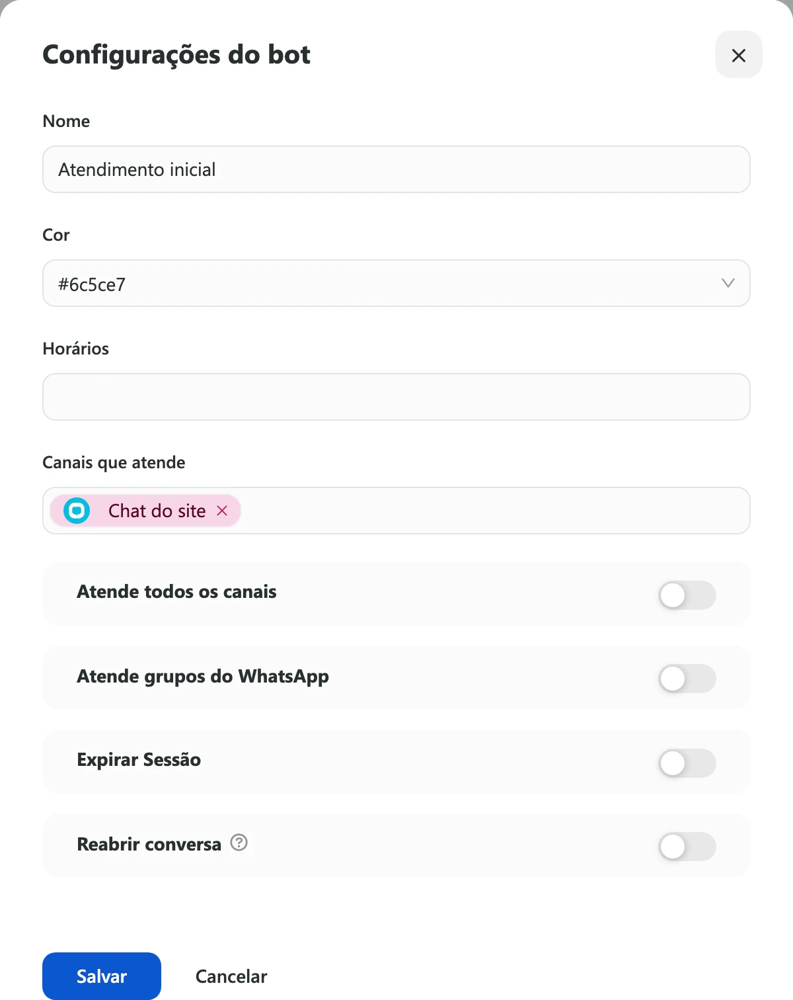
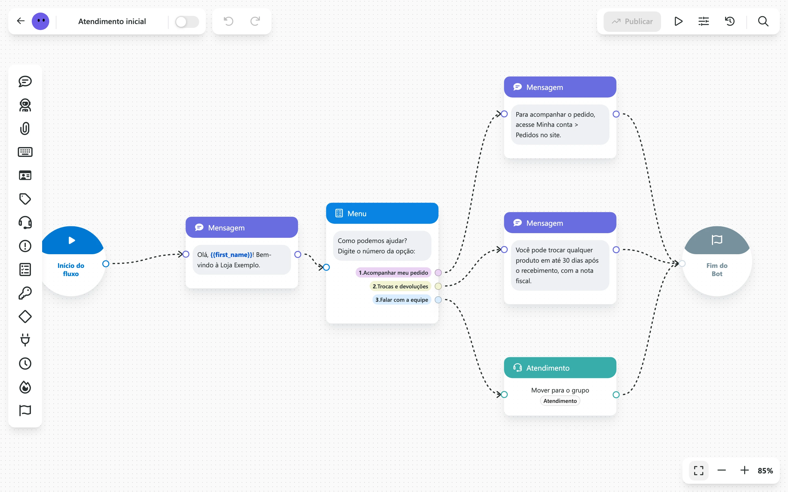

Crie um fluxo de atendimento automático, configure em quais canais e horários ele entra, teste no simulador e publique para começar a atender.

<Note>
  Quem pode: permissão **Bot** ou proprietário do workspace. Monte e publique o bot pelo computador — no celular o editor esconde o botão **Publicar**, o painel de blocos e o interruptor de ativação.
</Note>

## Antes de começar

- Se o bot vai atribuir conversas a um membro ou grupo, chamar um agente de IA, aplicar tags ou preencher campos personalizados, crie esses cadastros antes: os blocos selecionam apenas itens que já existem no workspace.
- Se quiser restringir o bot por horário, cadastre antes o horário de atendimento em **Configurações** → **Ambiente** → **Horários**.

## Passo a passo

<Steps>
  <Step title="Crie um novo bot">
    Vá em **Configurações** → **Automação** → **Bot** e clique em **Novo Bot**.

    O editor abre desligado, com o nome inicial "Meu chatbot" e dois blocos na tela: **Início do fluxo** e **Fim do Bot**. Um bot novo só passa a existir na lista depois do primeiro **Publicar**.
  </Step>

  <Step title="Configure canais, horários e expiração">
    Clique em **Configurações** (ícone de controles no topo direito) ou clique no nome do bot no topo esquerdo para abrir **Configurações do bot**. Preencha os campos que precisar e clique em **Salvar**:

    - **Nome** e **Cor:** identificam o bot na lista e no editor.
    - **Horários:** limita o início automático do bot aos horários escolhidos (vazio = qualquer horário).
    - **Canais que atende** ou **Atende todos os canais:** define em quais canais o bot pode iniciar sozinho.
    - **Atende grupos do WhatsApp:** permite iniciar automaticamente em conversas de grupo de WhatsApp (o canal de WhatsApp por QR Code também precisa estar com **Permitir Grupos de WhatsApp** ativo; veja [Configurações do WhatsApp por QR Code](/docs/canais/whatsapp/whatsapp-app/configuracoes)).
    - **Expirar Sessão:** define um tempo em horas e minutos sem resposta do contato para encerrar a sessão com **Mensagem ao expirar** ou transferir com **Executar bot ao expirar**.
    - **Reabrir conversa:** quando o bot é executado manualmente ou por automação em uma sessão já resolvida, ele reabre a conversa automaticamente.

    **Horários** e **Atende grupos do WhatsApp** só valem quando você escolhe os canais em **Canais que atende**. Com **Atende todos os canais** ligado, o bot começa também fora dos horários e em grupos do WhatsApp — para usar horário ou controlar grupos, desligue **Atende todos os canais** e selecione cada canal.

    Clicar em **Salvar** apenas guarda as configurações no editor; elas só passam a valer depois de **Publicar**.

    <Frame caption="Painel Configurações do bot com nome, cor, horários, canais, grupos, Expirar Sessão e Reabrir conversa">
      
    </Frame>
  </Step>

  <Step title="Monte o fluxo com blocos">
    Arraste os blocos do painel à esquerda para a área do fluxo. Para configurar um bloco, clique duas vezes nele ou selecione-o e clique em **Editar**. Para conectar etapas, arraste da bolinha de saída de um bloco até a entrada do próximo.

    Ligue o **Início do fluxo** ao primeiro bloco e termine cada caminho em um **Fim do bot** (você pode usar mais de um **Fim do bot** no mesmo fluxo). Para conhecer todos os 17 blocos e suas saídas, veja [Blocos do bot](/docs/bot/blocos-do-bot).

    Na barra do editor você também encontra **Desfazer**, **Refazer** e **Pesquisar ação** (lupa para localizar um bloco pelo tipo, número ou texto). Ao selecionar vários blocos de uma vez, aparecem **Clonar selecionados** e **Excluir selecionados**.

    <Frame caption="Editor do bot com barra superior, painel de blocos à esquerda e fluxo ligado do Início do fluxo ao Fim do Bot">
      
    </Frame>
  </Step>

  <Step title="Teste no simulador">
    Clique em **Simular bot** (ícone de play no topo direito) para testar o fluxo antes de publicar. Digite uma mensagem ou clique em **Iniciar**; você também pode usar **Enviar áudio**, **Enviar arquivo**, clicar em **Reiniciar** ou ajustar os dados fictícios em **Ver dados do contato**. Para começar a simulação a partir de um bloco específico, selecione o bloco e clique em **Executar**.

    Nem tudo funciona igual na simulação: o bloco **Agente de IA** não responde no simulador, e os blocos **Notificar** e **Ação de CRM** são pulados sem executar ações reais.

    <Warning>
      Na simulação, os blocos **Integração** fazem a chamada externa e executam o código de verdade. Se você não quiser disparar requisições para o seu sistema durante o teste, abra **Ver dados do contato** e ligue **Pular integrações**.
    </Warning>
  </Step>

  <Step title="Publique o bot">
    Clique em **Publicar** no topo direito. O botão só fica ativo quando há alterações não publicadas. Se o fluxo passar na validação, aparece o aviso "Bot publicado!".

    Se você sair do editor sem publicar, a Kinbox avisa que há mudanças não salvas.
  </Step>

  <Step title="Ligue o bot">
    Você pode ativar o bot de duas formas:

    - **Na lista de bots:** ative o interruptor da linha. A mudança é salva na hora.
    - **No editor:** ative o interruptor ao lado do nome do bot e clique em **Publicar** para salvar.
  </Step>

  <Step title="Defina a ordem de prioridade na lista">
    Todo bot novo, clonado ou importado entra no fim da lista. Quando mais de um bot ligado atende ao mesmo canal, a Kinbox percorre a lista de cima para baixo e inicia o primeiro que serve — arraste as linhas pela alça à esquerda para mudar a prioridade.

    <Note>
      Bots gerenciados por agentes de IA entram no topo da lista quando criados. Se você arrastar um bot comum ativo do mesmo canal para cima de um agente de IA, o bot comum atende primeiro e o agente não entra.
    </Note>
  </Step>
</Steps>

## Depois de publicar

### Quando o bot começa sozinho

O bot inicia sozinho apenas quando o **contato** manda a mensagem que abre uma [sessão](/docs/conceitos/conversas-e-sessoes) nova em um canal atendido pelo bot, com o bot ligado, sendo o primeiro bot ativo da lista que serve àquele canal, horário e tipo de conversa. Ele não começa sozinho em sessões já abertas ou reabertas (inclusive dentro do **Tempo de tolerância ao resolver conversa**), em mensagens enviadas pelo celular do número nem em conversas iniciadas por um membro.

### Testar em uma conversa real

Para validar um bot em uma conversa real — inclusive blocos que não rodam no simulador — abra a conversa na Caixa de entrada e clique em **Mais ações** → **Executar bot** → nome do bot (veja [Atender uma conversa](/docs/conversas/gerenciar-conversas)). É preciso ter a permissão **Iniciar Bot** (ou ser proprietário).

A ação **Executar bot** roda o bot mesmo se ele estiver desligado e ignora canais e horários configurados. A conversa registra a mensagem de sistema indicando que o membro executou o bot. O mesmo vale quando o bot é disparado por automações, cenários, ações em lote de funil ou agentes de IA.

### O que tira o bot da conversa

O bot para quando um membro envia uma mensagem comum ao contato (notas com **Nota pro time** não param o bot), quando um membro atribui a conversa ou move para um grupo (veja [Atribuir, mover para um grupo ou transferir uma conversa](/docs/conversas/atribuir-e-transferir)), quando alguém escolhe **Executar bot** → **Atendimento manual** ou inicia outro bot, quando o fluxo chega ao **Fim do bot** (ou a um bloco sem saída ligada), quando a sessão expira ou quando atinge o limite de respostas inválidas ou de loop.

### Como funciona o Expirar Sessão

O prazo de **Expirar Sessão** começa quando o bot inicia, zera quando o contato responde e recomeça a cada mensagem que o bot envia — ou seja, conta o tempo desde a última mensagem do bot sem resposta, enquanto o bot estiver ativo na conversa. A Kinbox verifica as sessões expiradas a cada minuto.

Ao atingir o prazo, se houver um bot em **Executar bot ao expirar**, a Kinbox inicia esse outro bot na mesma sessão, sem enviar a **Mensagem ao expirar** e sem resolver a sessão. Sem bot de destino, a Kinbox envia a **Mensagem ao expirar** (se preenchida) e resolve a sessão com o aviso "Essa sessão expirou e foi finalizada".

### Gerenciar bots na lista

Pelo menu de três pontos de cada linha (e pelo menu de três pontos acima da lista, à direita, para importar), você pode:

- **Editar:** abre o fluxo no editor.
- **Clonar:** cria uma cópia desligada no fim da lista, com os mesmos canais e a mesma senha (se bloqueado).
- **Exportar:** baixa o fluxo em um arquivo `.json`.
- **Importar:** cria um bot desligado no fim da lista a partir de um `.json` exportado da Kinbox.
- **Excluir:** apaga o bot e os vínculos com canais e horários; as conversas que estavam com ele ficam sem esse bot.

<Warning>
  Excluir um bot não avisa se outro bot (em **Fim do bot** ou **Executar bot ao expirar**), automação ou cenário aponta para ele. Confira esses vínculos antes de confirmar a exclusão.
</Warning>

Para abrir versões anteriores no histórico de publicações ou proteger o bot com senha, veja [Histórico de publicações, clonar, exportar e bloquear um bot](/docs/bot/versoes-e-bloqueio).

## Problemas comuns

- **Erro `Necessário que todos os caminhos acabem no nó "Fim do Bot"...`:** o **Início do fluxo** não está ligado a nenhum bloco. Ligue-o ao primeiro bloco do fluxo.
- **Erro `Loop inválido detectado.`:** existe uma volta no fluxo formada só por blocos que não esperam o contato. Coloque um bloco que espera (**Menu**, **Entrada de dados**, **Esperar um tempo** ou **Agente de IA**) na volta ou desfaça a ligação.
- **Mudei o bot e nada mudou nas conversas:** clique em **Publicar** no editor. Salvar um bloco ou clicar em **Salvar** nas **Configurações do bot** não publica as alterações.

Para outros cenários — como bot ligado que não começa, para no meio ou atende fora do horário — veja [O bot não ativa, travou ou repete mensagens](/docs/bot/problemas-comuns).
