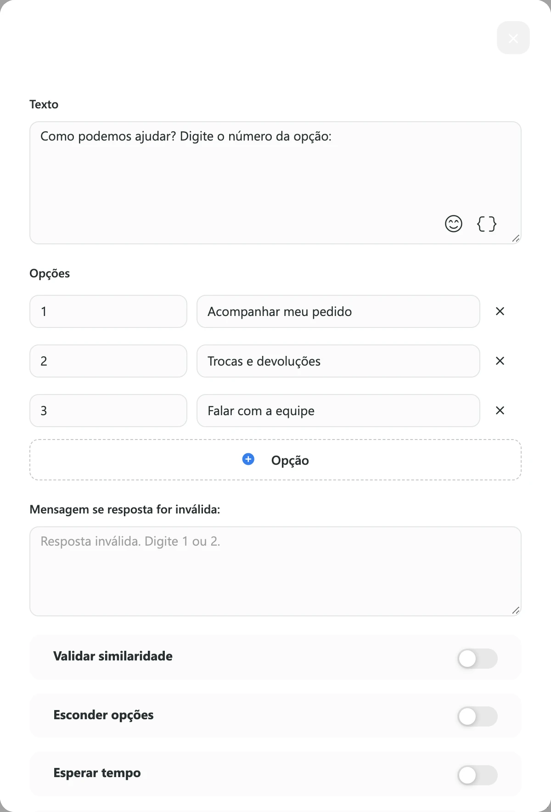

Referência dos 17 blocos disponíveis no editor de bot, o que cada um faz e quais saídas ele possui.

## Como os blocos funcionam

- **Adicionar blocos:** no computador, arraste qualquer um dos 17 blocos da barra à esquerda para a área do fluxo. Todo bot novo nasce com **Início do fluxo** (que não pode ser apagado) e **Fim do bot**.
- **Ligar blocos:** arraste da bolinha de saída de um bloco até a entrada do próximo. Cada saída aceita apenas **uma** ligação, e um bloco não pode se ligar a si mesmo.
- **Editar e gerenciar um bloco:** clique duas vezes no bloco para abrir a configuração, ou selecione-o para exibir a barra com **Editar**, **Executar** (abre o simulador a partir daquele bloco), **Clonar** (cria uma cópia sem as ligações) e **Excluir**.
- **Salvar não publica:** o botão **Salvar** da gaveta guarda a configuração apenas no editor; para valer nas conversas, clique em **Publicar** (veja [Criar e publicar um bot](/docs/bot/aprender-a-usar-o-bot)).
- **Blocos que esperam × blocos que passam direto:** quatro blocos pausam o fluxo aguardando o contato ou um evento (**Entrada de dados**, **Menu**, **Agente de IA** e **Esperar um tempo**). Os outros executam a ação e seguem direto para o próximo bloco.
- **Saída sem ligação:** se um bloco não tem nada ligado na saída seguida pelo fluxo, o bot termina ali e a conversa continua aberta (exceto no **Agente de IA**, que permanece aguardando, e na **Decisão**, onde você deve manter as saídas ligadas).
- **Saldo:** dentro do bot, consomem saldo apenas o bloco **Agente de IA** (a cada resposta), a opção **Usar prompt** em **Mensagem** e **Menu**, a opção **Transcrever áudio** no **Menu** e o botão **Assistente Kin** no bloco **Integração** (veja [Saldo da carteira e créditos](/docs/conceitos/saldo-e-creditos)).

<Warning>
  Clicar em **Excluir** em um bloco apaga o item na hora, sem pedir confirmação. Se excluir por engano, clique em **Desfazer** no topo do editor.
</Warning>

## Resumo dos 17 blocos

| Bloco | O que faz | Saídas |
| --- | --- | --- |
| **Mensagem** | Envia texto (ou nota interna com **Enviar como nota de time**) e pode anexar cartão de contato ou gerar texto com **Usar prompt**. | 1 saída |
| **Agente de IA** | Coloca um agente de IA para conversar com o contato naquele ponto do fluxo (gasta saldo). | **Sem saldo**, **Erro**, até 5 **Condições de saída** e **Saída normal** (com **Executar somente uma vez**) |
| **Mídia** | Envia um arquivo (imagem, áudio, vídeo ou documento) ao contato; opção **Enviar como figurinha**. | 1 saída |
| **Entrada de dados** | Faz uma pergunta, espera a resposta do contato e grava em um campo de **Contato**, **Sessão** ou **Negócio**. | 1 saída |
| **Definir campo** | Grava um valor em um campo de **Contato** ou **Sessão** (inclusive **Checkpoint**) sem perguntar ao contato. | 1 saída |
| **Adicionar tag** | Adiciona e/ou remove tags da sessão atual, incluindo a opção **Todas as tags** (no fluxo aparece como **Tags**; na gaveta, **Adicionar tags**). | 1 saída |
| **Atendimento** | Atribui a conversa a um **Membro**, **Grupo** ou regra de **Atribuição automática**, sem tirar o bot da conversa (diferente de um membro atribuir pela conversa; veja [Atribuir e transferir](/docs/conversas/atribuir-e-transferir)). | 1 saída |
| **Pendência** | Executa **Marcar como pendente** ou **Remover pendência** na conversa. | 1 saída |
| **Menu** | Mostra opções ao contato e direciona o fluxo conforme a opção escolhida. | 1 saída por opção + saída extra de tempo (se **Esperar tempo** estiver ligado) |
| **Palavra-chave** | Atalho global do bot (sem entrada): quando o contato envia exatamente uma das palavras configuradas, o fluxo pula para a saída dela. | 1 saída por palavra-chave |
| **Decisão** | Desvia o fluxo avaliando condições de contexto, contato, conversa/sessão, negócio ou membro. | **Sim** e **Não** (ou 1 saída por condição + **Nenhum** no modo individual) |
| **Integração** | Chama uma API externa (**Chamar endpoint**), roda JavaScript (**Executar código**) ou usa integrações prontas (**Outros**). | 1 saída |
| **Esperar um tempo** | Pausa o fluxo por intervalo fixo, tempo sorteado, mensagem do contato ou recebimento de webhook. | 1 saída + saída extra de tempo esgotado (opcional em espera por mensagem ou webhook) |
| **Ação de CRM** | Executa **Criar negócio** ou **Atualizar negócio** nos funis (na gaveta aparece como **Ações de CRM**). | 1 saída |
| **Fim do bot** | Encerra o bot e pode resolver a conversa, transferir para outro bot, trocar de canal ou voltar a um checkpoint. | Nenhuma |
| **Notificar** | Envia uma mensagem (WhatsApp, SMS ou e-mail) para o próprio contato ou para outro número/e-mail. | 1 saída |
| **Split** | Divide conversas sorteando uma entre 2 ou mais saídas ligadas (a divisão é aproximada, não em rodízio). | 1 saída por caminho (mínimo 2) |

## Detalhes por bloco

### Mensagem

Aceita chaves reservadas (`{{...}}`) trocadas pelos dados do contato e da conversa e permite anexar um cartão de contato (**Enviar contato**). Ligue **Enviar como nota de time** para mandar o texto como nota interna — nesse modo, você pode mencionar membros com `@` para notificá-los.

**Digitação natural** exibe o indicador de "digitando" por um tempo proporcional ao tamanho do texto. **Usar prompt** gera a mensagem com IA a partir de um **Prompt** e consome saldo; se faltar saldo ou ocorrer erro, o bot envia o **Texto** padrão.

### Agente de IA

Escolhe um agente do workspace (**Agente de IA** obrigatório) para responder cada mensagem do contato enquanto o fluxo estiver nesse bloco; ele funciona mesmo que o agente esteja pausado nos canais diretos (veja [Bot, automações, cenários e agentes de IA](/docs/conceitos/automacao-e-ia)). Você pode vincular uma **Base de conhecimento** opcional (de **Configurações** → **Automação** → **Base de conhecimento**), adicionar **Instruções extras**, ligar **Digitação natural** e definir até 5 **Condições de saída** (**Sair direto** ou **Enviar mensagem e sair**).

- **Saídas fixas:** ligue sempre **Sem saldo** e **Erro** para evitar que o contato fique parado sem resposta no bloco.
- **Executar somente uma vez:** faz o agente responder uma única vez e seguir pela **Saída normal**.
- **Considerar última mensagem do contato:** ligado, o agente já responde a mensagem anterior do contato ao entrar no bloco; desligado, espera a próxima mensagem.

### Entrada de dados

Preencha **Pergunta** e escolha o campo de destino em **Tipo da resposta**, nos grupos **Contato** (**Nome**, **Email**, **Celular**, **Notas** e campos personalizados), **Sessão** (**Checkpoint**, **Avaliação de atendimento**, **Motivo da avaliação** e campos personalizados) ou **Negócio** (campos personalizados de negociação).

Campos de lista/múltipla escolha e **Avaliação de atendimento** exibem **Opções**, **Validar similaridade** e **Esconder opções**. Ligue **Validar resposta** para conferir o formato antes de gravar — campos personalizados de texto aceitam **Tipo de validação** (**Celular**, **Email**, **CPF**, **Máscara** ou **Expressão regular**), enquanto **Nome**, **Email** e **Celular** usam validação própria. Quando a resposta não passa na validação, o bot envia **Mensagem se resposta for inválida:** e pergunta novamente. Este bloco não tem tempo limite próprio: use **Expirar Sessão** nas configurações do bot se quiser encerrar por falta de resposta.

### Menu

Configure **Texto**, a lista de **Opções** (valor e **Nome da opção**) e **Mensagem se resposta for inválida:**. O contato pode responder pelo número ou pelo nome da opção (sem diferença entre maiúsculas e minúsculas).

- **Como as opções aparecem:** no **WhatsApp oficial**, até 3 opções com nome curto aparecem como botões e, acima disso, como lista interativa; no **WhatsApp por QR Code** e nos outros canais, as opções são enviadas como texto, uma por linha (veja [O que funciona no WhatsApp por QR Code](/docs/canais/whatsapp/whatsapp-app/o-que-funciona)). **Esconder opções** envia apenas o **Texto**.
- **Recursos extras:** **Validar similaridade** aceita respostas parecidas com uma opção; **Esperar tempo** cria uma saída extra se o contato não responder no prazo (até 7 dias); **Transcrever áudio** transcreve áudios enviados pelo contato para comparar com as opções (gasta saldo); **Considerar última mensagem do contato** usa a mensagem enviada antes do menu como resposta, sem enviar o texto do menu.

<Frame caption="Gaveta do bloco Menu com Texto, Opções, Mensagem se resposta for inválida e interruptores">
  
</Frame>

### Decisão

Avalia condições organizadas em "Quando **todas** as condições são verdadeiras" e "E quando **qualquer** das condições são verdadeiras", com saídas **Sim** e **Não** — mantenha as duas saídas ligadas para garantir o desvio correto. Ao ligar "Cada condição do tipo **qualquer** deve virar uma opção", cada item da lista "qualquer" ganha uma saída própria, seguindo pela primeira verdadeira ou por **Nenhum**.

As condições cobrem **Contexto** (horário, tag), **Contato** (tipo de contato, dados, negócios abertos e campos personalizados), **Conversa/Sessão** (estado, origem, grupo, atribuído, campanha, **Janela de resposta**, UTMs, tags, canal, avaliação e anúncios), **Negócio** e **Membro**. A condição **Janela de resposta** verifica o prazo de 24 horas no WhatsApp oficial, Instagram e Facebook Messenger (veja [Janela de 24 horas](/docs/canais/whatsapp/whatsapp-cloud-api/janela-de-24-horas)). Para condições usando campos do tipo **Json**, veja [Usar um campo personalizado JSON no bot](/docs/bot/usar-campo-personalizado-em-json).

### Integração

Permite chamar uma API externa (**Chamar endpoint**), rodar JavaScript (**Executar código**) ou escolher integrações prontas do grupo **Outros**, sempre com uma única saída. Veja o passo a passo completo em [Chamar um sistema externo no bot](/docs/bot/integracoes-do-bot) e [Executar código no bot](/docs/bot/usando-integracao-execucao-codigo).

### Esperar um tempo

Oferece quatro opções em **Tipo de espera**:

- **Intervalo de tempo:** aguarda um valor fixo em **Segundos de espera** (de 1 segundo até 7 dias).
- **Envio de mensagem pelo cliente:** pausa até o contato mandar uma nova mensagem.
- **Recebimento de webhook:** pausa até um sistema externo enviar uma requisição POST para o **Endereço do webhook** exibido na gaveta.
- **Randomizar delay:** sorteia um tempo entre **Tempo mínimo entre envios** e **Tempo máximo entre envios** na **Unidade** escolhida (**Segundos**, **Minutos**, **Horas** ou **Dias**).

Em **Envio de mensagem pelo cliente** e **Recebimento de webhook**, ligar **Tempo máximo de espera** cria uma saída extra de tempo esgotado; se o contato responder antes do prazo, a contagem é cancelada.

### Ação de CRM

Em **Ação**, escolha **Criar negócio** (define funil, etapa, nome com chaves `{{...}}`, valor ou produtos, **Responsável** com opção **Mesmo da conversa**, **Grupo** com **Algum grupo do membro**, **Tags** e campos personalizados) ou **Atualizar negócio** (define **Que negócios serão afetados** — todos os abertos da conversa, os de determinado funil ou todos do contato — e atualiza produtos, tags, **Status**, **Motivo de perda**, responsável, grupo ou etapa).

### Fim do bot

Encerra o fluxo no ponto escolhido (você pode usar mais de um bloco **Fim do bot** no mesmo bot). Sem nenhuma opção ativada, o bot apenas sai da conversa e a mantém aberta.

- **Resolver conversa:** encerra a sessão. Quando está ligada, tem prioridade e impede **Transferir para outro bot** (somente a troca de canal acontece junto).
- **Transferir para outro bot:** inicia outro bot na conversa, com opções de **Agendar para próximo horário comercial** (escolhendo um **Horário**) e **Iniciar na última ação executada desse bot**; no bloco aparece o atalho **Abrir próximo fluxo**.
- **Transferir para outro canal:** transfere a conversa para outro canal do workspace.
- **Transferir para checkpoint:** retorna ao ponto marcado anteriormente por um bloco **Definir campo** configurado com **Checkpoint**.

### Notificar

Envia uma mensagem usando um canal escolhido em **Do canal** (WhatsApp, e-mail, SMS do workspace ou e-mail de envio da Kinbox), para o contato atual ou para outra pessoa:

- **WhatsApp oficial:** selecione um template aprovado (com anexo, se exigido pelo template). **Para celular** é opcional (com código do país e DDD); em branco, envia para o contato em atendimento.
- **WhatsApp por QR Code** e **SMS:** exige **Para celular** (com código do país e DDD) e **Texto** (no SMS, limite de 160 caracteres).
- **E-mail:** exige **Para e-mail**, **Assunto** e **Texto**.
