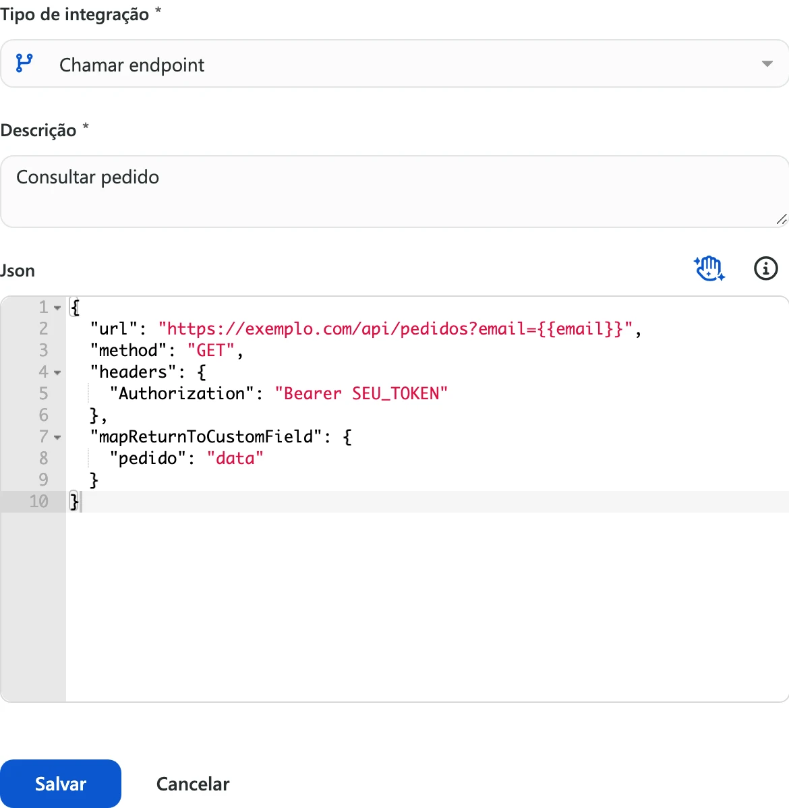

O bloco **Integração** permite que o bot consulte ou envie dados para a API de outro sistema durante a conversa usando **Chamar endpoint**, execute JavaScript ou use integrações prontas.

O bloco tem **uma única saída**: tanto em caso de sucesso quanto em caso de falha, o bot não exibe erro na conversa e segue para o próximo bloco ligado.

<Note>
  Quem pode: permissão **Bot** ou proprietário do workspace, usando o editor pelo computador.
</Note>

## Passo a passo

<Steps>
  <Step title="Adicione o bloco Integração">
    No editor do bot (**Configurações** → **Automação** → **Bot**), arraste o bloco **Integração** (ícone de tomada) para o fluxo e clique duas vezes nele para abrir a configuração.
  </Step>

  <Step title="Escolha Chamar endpoint">
    Em **Tipo de integração**, troque o padrão (**Executar código**) para **Chamar endpoint**, dentro do grupo **Personalizado**.
  </Step>

  <Step title="Preencha a descrição">
    Digite um nome em **Descrição** (campo obrigatório), como "Consultar pedido". Esse texto identifica o bloco no fluxo.
  </Step>

  <Step title="Configure o JSON da requisição">
    No campo **Json**, escreva um JSON válido com os dados da chamada. Você pode usar chaves reservadas do contato, da sessão e de campos personalizados (como `{{email}}`) dentro do JSON; elas são substituídas pelos dados da conversa antes do envio.

    | Chave | O que faz |
    | --- | --- |
    | `url` | Endereço completo do endpoint que o bot vai chamar. |
    | `method` | Método HTTP, como `GET` ou `POST`. Se omitido, usa `GET`. |
    | `headers` | Cabeçalhos da requisição, como autenticação e `Content-Type`. |
    | `body` | Corpo enviado na requisição (por exemplo, em `POST` ou `PUT`). |
    | `params` | Parâmetros adicionados à query string da URL. Use `params` ou a query na própria `url`, não os dois. |
    | `mapReturnToCustomField` | Mapeia caminhos da resposta para campos do contato ou da sessão, usando a **Chave reservada** sem `{{}}` (por exemplo, `"pedido": "data"`). |

    Exemplo fictício que consulta o pedido pelo e-mail do contato e salva o objeto retornado em `data` no campo personalizado `pedido`:

    ```json
    {
      "url": "https://exemplo.com/api/pedidos?email={{email}}",
      "method": "GET",
      "headers": {
        "Authorization": "Bearer SEU_TOKEN"
      },
      "mapReturnToCustomField": {
        "pedido": "data"
      }
    }
    ```

    No canto superior direito do editor **Json**, o botão **Assistente Kin** oferece ajuda de IA para **Analisar e corrigir**, **Explicar** e **Gerar JSON** (esse recurso gasta saldo da carteira; veja [Saldo da carteira e créditos](/docs/conceitos/saldo-e-creditos)).

    <Frame caption="Gaveta do bloco Integração configurada com Chamar endpoint e mapReturnToCustomField">
      
    </Frame>
  </Step>

  <Step title="Salve, simule e publique">
    Clique em **Salvar** na gaveta do bloco. Em seguida, clique em **Simular bot** no topo do editor para conferir o retorno na caixa **Resultado da integração** e clique em **Publicar** para aplicar no bot.

    <Warning>
      No **Simular bot**, o bloco **Chamar endpoint** chama o endereço configurado de verdade. Se não quiser enviar requisições reais durante o teste, abra **Ver dados do contato** no simulador e ligue **Pular integrações**.
    </Warning>
  </Step>
</Steps>

## Integrações prontas

Em **Tipo de integração**, o grupo **Outros** reúne integrações prontas para conectar sistemas externos sem montar o JSON manualmente. Para que uma integração pronta funcione no fluxo, o workspace precisa ter a conexão com aquele sistema configurada; na simulação, integrações de **Outros** são puladas, então teste em uma conversa real usando **Executar bot** (veja [Criar e publicar um bot](/docs/bot/aprender-a-usar-o-bot)).

## Esconder o conteúdo com senha

Se você quiser manter o fluxo editável mas esconder a configuração dos blocos de integração no editor para quem não tem a senha, ative a opção **Bloquear apenas integrações** ao bloquear o bot pela lista (é preciso ter a permissão **Pode Bloquear bots** ou ser proprietário). Veja como funciona em [Histórico de publicações, clonar, exportar e bloquear um bot](/docs/bot/versoes-e-bloqueio).

## Quando usar outra opção

- Precisa de lógica com vários passos, condições ou ações na Kinbox durante a integração: use [Executar código no bot](/docs/bot/usando-integracao-execucao-codigo).
- Quer guardar um objeto JSON retornado pela API e usar propriedades dele em mensagens ou no bloco **Decisão**: veja [Usar um campo personalizado JSON no bot](/docs/bot/usar-campo-personalizado-em-json).
- Quer pausar o bot até que um sistema externo envie uma requisição para continuar o fluxo: use o bloco **Esperar um tempo** com **Recebimento de webhook**, com **Tempo máximo de espera** desligado (veja [Continuar o bot por webhook](/docs/desenvolvedor/webhook-continuar-bot)).
- Quer montar integrações que rodam fora de uma conversa de bot (por webhook, agenda ou eventos do workspace): use **Cenários** em **Configurações** → **Automação** → **Cenários**.
