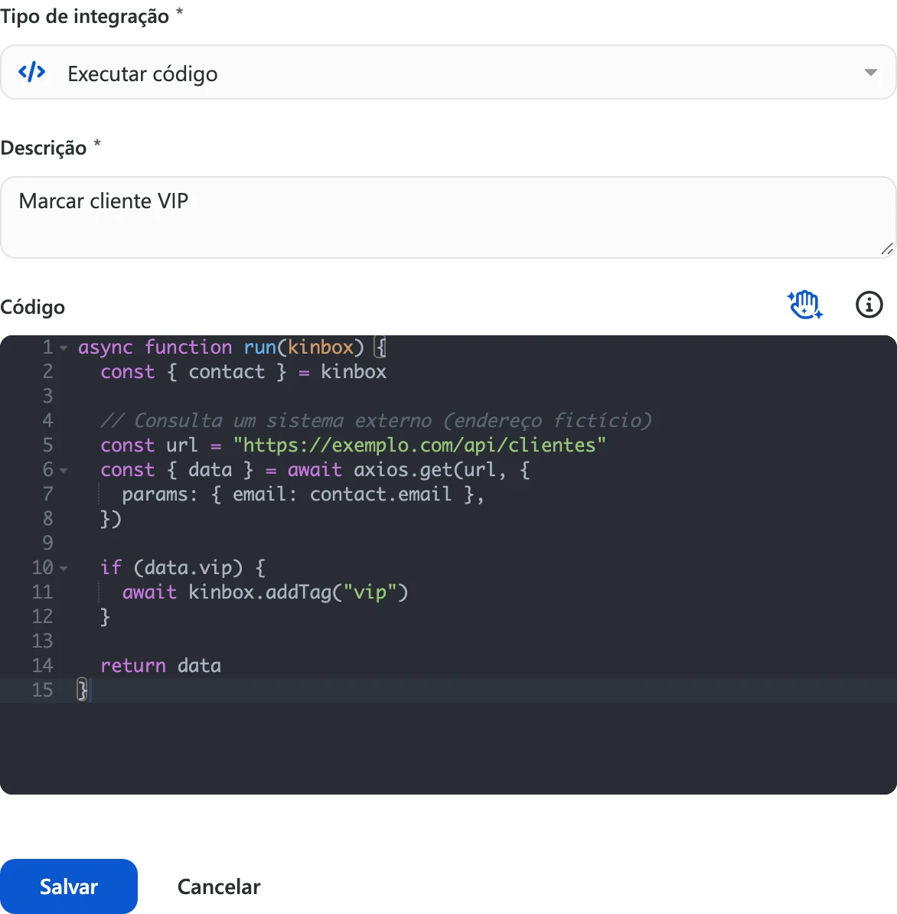

Use **Executar código** no bloco **Integração** quando precisar de JavaScript para consultar APIs com vários passos, atualizar dados do contato ou da sessão, aplicar tags, atribuir a conversa ou desviar o fluxo para outro bloco.

<Note>
  Quem pode: permissão **Bot** ou proprietário do workspace, usando o editor pelo computador.
</Note>

## Passo a passo

<Steps>
  <Step title="Adicione o bloco Integração">
    No editor do bot (**Configurações** → **Automação** → **Bot**), arraste o bloco **Integração** para o fluxo e clique duas vezes nele. Por padrão, **Tipo de integração** já vem selecionado como **Executar código**.
  </Step>

  <Step title="Preencha a descrição">
    Informe uma **Descrição** (obrigatória), como "Marcar cliente VIP". Ela identifica o bloco no fluxo.
  </Step>

  <Step title="Escreva a função run(kinbox)">
    No editor **Código**, escreva sua lógica dentro da função `async function run(kinbox)`. O cliente HTTP `axios` já está disponível como variável global — não é preciso importar nem passar como segundo parâmetro.

    O valor retornado com `return` serve para inspeção no simulador (aparece em **Resultado da integração**); na conversa real, o retorno é ignorado.

    Exemplo fictício que consulta um sistema externo pelo e-mail do contato e adiciona a tag `vip`:

    ```js
    async function run(kinbox) {
      const { contact } = kinbox

      // Consulta um sistema externo (endereço fictício)
      const url = "https://exemplo.com/api/clientes"
      const { data } = await axios.get(url, {
        params: { email: contact.email },
      })

      if (data.vip) {
        await kinbox.addTag("vip")
      }

      return data
    }
    ```

    <Frame caption="Gaveta do bloco Integração com Executar código e exemplo usando axios e kinbox.addTag">
      
    </Frame>
  </Step>

  <Step title="Salve, simule e publique">
    Clique em **Salvar** na gaveta do bloco, teste em **Simular bot** para conferir o retorno em **Resultado da integração** e clique em **Publicar** para ativar a mudança no bot.

    <Warning>
      Na simulação, chamadas externas feitas com `axios` acontecem de verdade. Já as ações do objeto `kinbox` (como enviar mensagens, adicionar tags, atualizar campos e atribuir) afetam apenas a conversa de teste. Para pular o bloco durante a simulação, abra **Ver dados do contato** e ligue **Pular integrações**.
    </Warning>
  </Step>
</Steps>

## O que o `kinbox` faz

O parâmetro `kinbox` traz os dados do contato (`kinbox.contact`) e da conversa (`kinbox.conversation`), além das funções abaixo:

| Função | O que faz |
| --- | --- |
| `kinbox.sendMessage(texto)` | Envia uma mensagem de texto ao contato. |
| `kinbox.sendNote(texto)` | Envia uma nota interna na conversa (**Nota pro time**). |
| `kinbox.updateContact({ ... })` | Atualiza dados do contato. |
| `kinbox.setCustomField(chave, valor)` | Grava um valor em um campo personalizado de contato ou de sessão (use a chave reservada sem `{{}}`). |
| `kinbox.addTag(nomeOuId)` / `kinbox.removeTag(nomeOuId)` | Adiciona ou remove uma tag da sessão pelo nome ou ID. |
| `kinbox.assignTo(tipo, id)` | Atribui a conversa a um membro (`"agent"`), a um grupo (`"group"`) ou executa uma regra de atribuição automática (`"assignmentRule"`). |
| `kinbox.resolve()` | Resolve a conversa. |
| `kinbox.jumpTo(idDoBloco, idDoBot?)` | Pula para um bloco do mesmo bot ou, informando o segundo parâmetro, transfere para outro bot. |

Para descobrir o ID de um bloco ao usar `kinbox.jumpTo`, clique em **Pesquisar ação** (lupa no topo direito do editor): cada item aparece com `#<id>`. O ID de outro bot é o número no endereço do editor (`/settings/bots/<id>`).

## Erros na execução

O bloco **Integração** tem uma única saída. Se o código lançar um erro durante uma conversa real, nenhum aviso aparece na conversa e o fluxo segue para o próximo bloco ligado.

Sempre valide o código antes no **Simular bot**: quando há falha, a caixa **Resultado da integração** fica destacada em vermelho com a mensagem do erro.

## Assistente Kin no editor

No canto superior direito do editor **Código**, o botão **Assistente Kin** oferece as opções **Analisar e corrigir**, **Explicar**, **Refatorar** e **Gerar código** (onde você descreve o que deseja em **O que você gostaria de fazer?**). O uso do assistente consome saldo da carteira (veja [Saldo da carteira e créditos](/docs/conceitos/saldo-e-creditos)). O texto gerado aparece na área **Resultado** sem substituir seu código automaticamente — revise o resultado antes de copiar e publicar.

## Veja também

- [Chamar um sistema externo no bot](/docs/bot/integracoes-do-bot) para requisições HTTP diretas com **Chamar endpoint**.
- [Usar um campo personalizado JSON no bot](/docs/bot/usar-campo-personalizado-em-json) para gravar objetos em campos **Json** e usá-los em mensagens e decisões.
- [Histórico de publicações, clonar, exportar e bloquear um bot](/docs/bot/versoes-e-bloqueio) para esconder o conteúdo dos blocos de integração com senha no editor (**Bloquear apenas integrações**).
