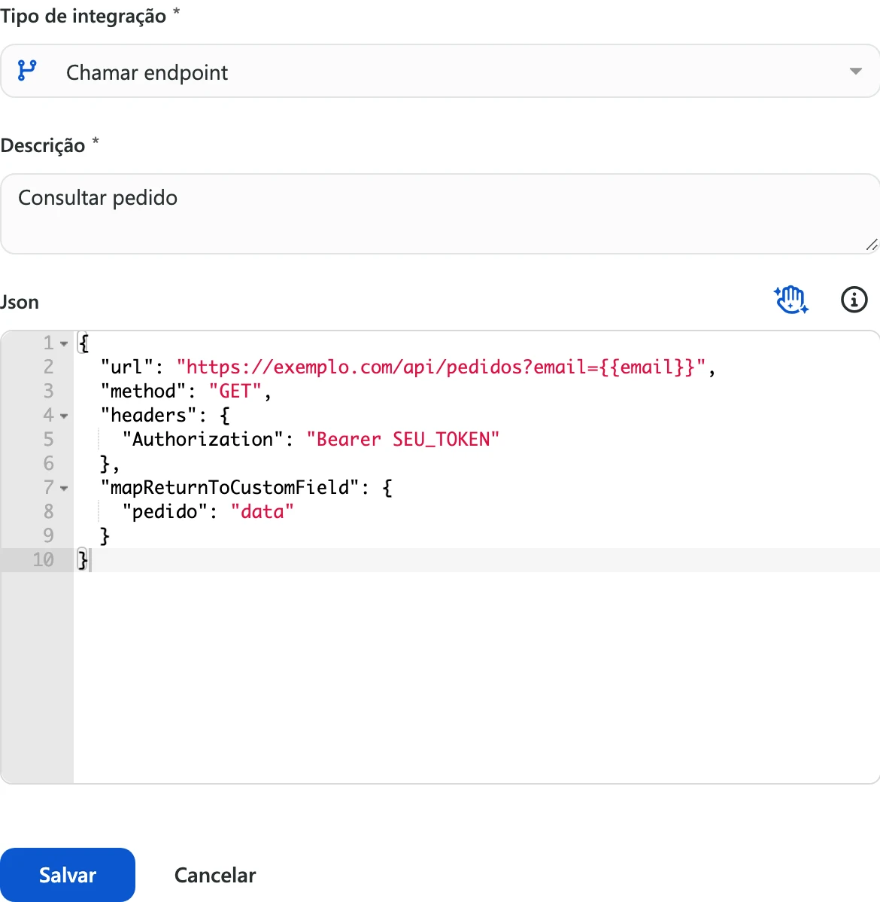

Guarde o objeto JSON devolvido por uma integração em um campo personalizado do tipo **Json** e leia cada propriedade desse objeto nas mensagens e nas condições do bloco **Decisão**.

<Note>
  Quem pode: para criar o campo personalizado, permissão **Campos** (seção **Gerenciamento do Ambiente**) ou proprietário do workspace. Para configurar o bot, permissão **Bot** ou proprietário.
</Note>

## Passo a passo

<Steps>
  <Step title="Crie um campo personalizado do tipo Json">
    Vá em **Configurações** → **Ambiente** → **Campos personalizados** e crie um novo campo (passo a passo em [Criar campos personalizados](/docs/configuracoes-no-workspace/campos-personalizados-no-kinbox)) com:

    - **Nome do campo:** por exemplo, `Pedido`.
    - **Tipo de campo:** selecione **Json**.
    - **Entidade:** selecione **Contato** ou **Sessão de conversa** (somente essas duas entidades podem ser gravadas e lidas pelo bot em mensagens e decisões).

    A **Chave reservada** é gerada a partir do nome, sem acentos, em minúsculas e com `_` no lugar de espaços — por exemplo, `Pedido` gera `{{pedido}}`.
  </Step>

  <Step title="Grave a resposta da integração no campo">
    No editor do bot, adicione um bloco **Integração** antes de usar o campo:

    - **Com Chamar endpoint:** use `mapReturnToCustomField` com a chave do campo sem `{{}}` apontando para o caminho do objeto na resposta. Sempre indique um caminho (não deixe vazio).
    - **Com Executar código:** chame `await kinbox.setCustomField("pedido", data)` passando o objeto recebido.

    Por exemplo, imagine que o endpoint `https://exemplo.com/api/pedidos?email={{email}}` devolve:

    ```json
    {
      "data": {
        "numero": "123456",
        "dias_para_entrega": 5
      }
    }
    ```

    Com `"mapReturnToCustomField": { "pedido": "data" }`, o bot grava o objeto inteiro de `data` no campo `pedido`. Veja mais em [Chamar um sistema externo no bot](/docs/bot/integracoes-do-bot) e [Executar código no bot](/docs/bot/usando-integracao-execucao-codigo).

    <Frame caption="Bloco Integração salvando o objeto data da resposta no campo personalizado pedido">
      
    </Frame>
  </Step>

  <Step title="Use as propriedades em uma mensagem">
    Nos campos de texto do bot (como no bloco **Mensagem**), use a sintaxe `{{json:<chave>.<caminho>}}`. Ela aceita propriedades aninhadas com ponto e índices de lista, como `{{json:pedido.itens[0].nome}}`.

    Caminhos com índice de lista, como `[0]`, e valores `0` ou falso (`false`) podem aparecer de um jeito diferente no **Simular bot**. Confira esses casos numa conversa de teste, com dados fictícios, usando **Executar bot**.

    Seguindo o exemplo anterior:

    ```text
    Seu pedido {{json:pedido.numero}} chega em {{json:pedido.dias_para_entrega}} dias.
    ```

    Você também pode clicar no botão `{}` (**Chaves reservadas**) no editor de texto e escolher o campo: a Kinbox insere `{{json:pedido.key_name}}` para você trocar `key_name` pelo caminho desejado.

    <Note>
      Usar `{{pedido}}` sozinho em um campo do tipo **Json** sai vazio no texto enviado ao contato. Sempre inclua o prefixo `json:` e o caminho da propriedade, como `{{json:pedido.numero}}`.
    </Note>
  </Step>

  <Step title="Decida o caminho no bloco Decisão">
    Adicione um bloco **Decisão** (veja [Blocos do bot](/docs/bot/blocos-do-bot)) e crie uma condição escolhendo o campo **Pedido** (no grupo **Contato** ou **Conversa/Sessão**, conforme a entidade criada).

    Ao escolher um campo **Json**, aparece um campo extra para o caminho (`json path (e.g: a[0].b)`). Informe apenas o caminho **dentro** do objeto, sem o nome do campo e sem `json:` — por exemplo:

    - **Campo:** **Pedido**
    - **Caminho** (campo extra): `dias_para_entrega`
    - **Operador:** **é igual a**
    - **Valor:** `0`

    Os operadores disponíveis para campos **Json** são **é igual a**, **não é igual a**, **é maior que**, **é menor que**, **é vazio**, **não é vazio**, **contém** e **não contém**.
  </Step>
</Steps>

## Depois de configurar

Clique em **Salvar** em cada bloco editado, teste no **Simular bot** para conferir se as propriedades são preenchidas corretamente na mensagem e se a **Decisão** segue pelo caminho esperado, e clique em **Publicar**.

<Warning>
  No **Simular bot**, o bloco **Integração** chama o seu sistema de verdade, a não ser que **Pular integrações** esteja ligado em **Ver dados do contato**. Para testar sem efeito no seu sistema, use um endereço ou dados de teste.
</Warning>
