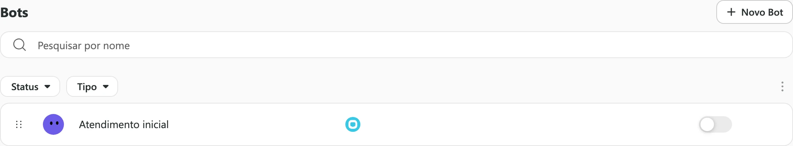

O bot é um fluxo montado com blocos que conversa com o contato seguindo caminhos previstos: envia mensagens, mostra menus, faz perguntas, salva dados em campos, toma decisões por condições, chama sistemas externos, atribui a conversa a um membro ou grupo e encerra ou transfere para outro bot.

Ele serve para fazer o primeiro contato, coletar informações dos contatos e direcionar cada conversa ao time certo, deixando a equipe livre para focar nos atendimentos que precisam de resposta humana.

## Bot e agente de IA

O bot segue exatamente o fluxo de blocos que você desenha, enquanto o agente de IA conversa com o contato usando inteligência artificial e as próprias palavras. Os dois podem trabalhar juntos quando você adiciona o bloco **Agente de IA** em um ponto do fluxo do bot — veja a comparação completa em [Bot, automações, cenários e agentes de IA: qual usar](/docs/conceitos/automacao-e-ia).

Quando você conecta um agente de IA diretamente a canais, ele também aparece na lista de bots com a etiqueta **Agente de IA** e o interruptor travado; para ligar, desligar ou editar esse atendimento, abra o próprio agente.

## Onde fica

Acesse **Configurações** → **Automação** → **Bot** para ver a lista de bots, buscar por nome, filtrar por **Status** e **Tipo** e criar novos fluxos pelo botão **Novo Bot**.

<Note>
  Quem pode:
  - Ver, criar, editar e excluir bots: permissão **Bot** ou proprietário do workspace (na tela de permissões, a seção aparece como **Gerenciar Ambiente**).
  - Proteger ou liberar bots com senha: permissão **Pode Bloquear bots** ou proprietário.
  - Iniciar um bot manualmente em uma conversa: permissão **Iniciar Bot** ou proprietário.

  Monte e publique seus bots pelo computador.
</Note>

<Frame caption="Tela Bots com o botão Novo Bot, busca, filtros Status e Tipo e a lista de bots">
  
</Frame>

## Quando o bot entra na conversa

Um bot começa sozinho apenas quando o **contato** envia a mensagem que abre uma [sessão](/docs/conceitos/conversas-e-sessoes) nova em um canal atendido pelo bot, com o bot ligado. Ele não começa sozinho em sessões já abertas ou reabertas (inclusive dentro do **Tempo de tolerância ao resolver conversa**), em mensagens enviadas pelo celular do número nem em conversas iniciadas por um membro.

Quando mais de um bot ligado serve à mesma conversa, a Kinbox percorre a lista de cima para baixo e inicia o **primeiro bot ligado** que atende ao canal, ao horário e ao tipo de conversa; você muda a prioridade arrastando as linhas na lista. Para usar **Horários** ou controlar **Atende grupos do WhatsApp**, escolha os canais em **Canais que atende** em vez de ligar **Atende todos os canais**, pois com **Atende todos os canais** ligado o bot inicia também fora dos horários e em grupos.

Você também pode iniciar um bot manualmente em uma conversa por **Mais ações** → **Executar bot** (veja [Atender uma conversa](/docs/conversas/gerenciar-conversas)), ou automaticamente por automações, cenários, ações em lote de funil e agentes de IA. Nesses casos, o bot roda mesmo se estiver desligado e sem depender dos canais ou horários configurados nele.

## Quando o bot sai da conversa

O bot para de responder e sai da conversa quando acontece qualquer uma destas situações:

- Um membro envia uma mensagem comum para o contato (notas internas com **Nota pro time** não param o bot).
- Um membro atribui a conversa ou move para um grupo pela conversa (veja [Atribuir, mover para um grupo ou transferir uma conversa](/docs/conversas/atribuir-e-transferir)). Atribuir pelo bloco **Atendimento** não para o bot.
- Alguém escolhe **Mais ações** → **Executar bot** → **Atendimento manual** ou inicia outro bot na conversa.
- O fluxo chega ao bloco **Fim do bot** ou a um bloco sem saída ligada.
- A sessão expira pela configuração **Expirar Sessão** do bot.
- O contato envia mais de 15 respostas inválidas seguidas em um **Menu** ou **Entrada de dados**, ou o fluxo atinge a proteção contra loop.

## Como um bot é organizado

- **Lista e ordem:** a posição de cada linha define a prioridade de início automático.
- **Configurações:** definem nome, cor, **Horários**, canais, grupos do WhatsApp, **Expirar Sessão** e **Reabrir conversa**.
- **Blocos:** cada etapa do fluxo, das mensagens e menus até decisões e integrações (veja [Blocos do bot](/docs/bot/blocos-do-bot)).
- **Simulação e publicação:** você testa o fluxo no editor e clica em **Publicar** para aplicar as alterações.
- **Histórico e bloqueio:** o editor guarda o histórico de publicações e permite proteger o bot — ou apenas os blocos de integração — com senha (veja [Histórico de publicações, clonar, exportar e bloquear um bot](/docs/bot/versoes-e-bloqueio)).

## Saldo

O bot em si não consome saldo da carteira. Só consomem saldo o bloco **Agente de IA** (a cada resposta), a opção **Usar prompt** nos blocos **Mensagem** e **Menu**, a opção **Transcrever áudio** no bloco **Menu** e o botão **Assistente Kin** nos blocos de integração. Veja o detalhe de débitos em [Saldo da carteira e créditos: o que consome](/docs/conceitos/saldo-e-creditos).

## Próximos passos

<CardGroup cols={2}>
  <Card title="Criar e publicar um bot" href="/docs/bot/aprender-a-usar-o-bot">
    Passo a passo para configurar canais e horários, montar o fluxo, simular e ligar seu bot.
  </Card>
  <Card title="Blocos do bot" href="/docs/bot/blocos-do-bot">
    Referência dos 17 blocos disponíveis no editor e das saídas de cada um.
  </Card>
  <Card title="Chamar um sistema externo no bot" href="/docs/bot/integracoes-do-bot">
    Como consultar APIs externas, gravar respostas em campos e usar integrações prontas.
  </Card>
  <Card title="O bot não ativa, travou ou repete mensagens" href="/docs/bot/problemas-comuns">
    Causas e soluções para os erros mais frequentes ao publicar ou rodar um bot.
  </Card>
</CardGroup>
