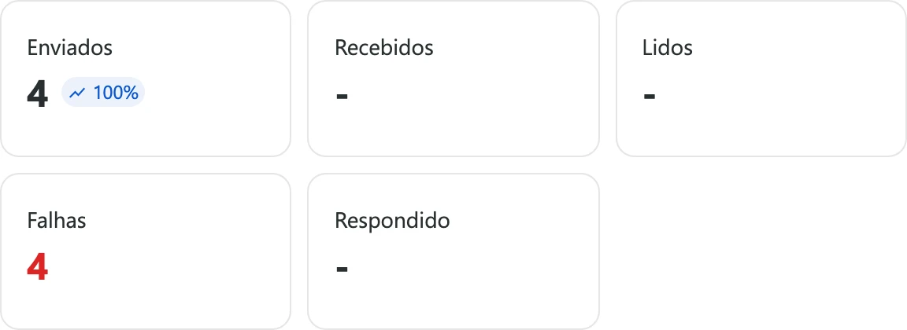
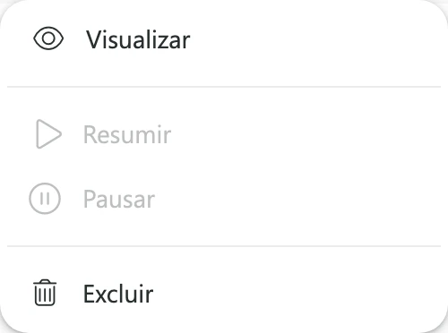

Acompanhe o andamento das campanhas na Kinbox, veja quem recebeu, leu, respondeu ou teve falha no envio e controle a execução pausando, retomando ou excluindo disparos.

## Na lista de campanhas

Abra **Campanhas** no menu lateral para consultar todas as campanhas do workspace. Você pode buscar pelo nome em **Pesquisar** e filtrar pelo canal em **Filtros** → **Canais**.

Cada linha exibe:

- **Progresso:** barra que calcula enviadas mais falhas sobre o total da lista, colorida conforme o status (azul enviando, amarelo pausada ou aguardando, vermelho falhou e verde concluída).
- **Status:** situação atual da campanha (veja a tabela abaixo).
- **Selo Canal desconectado:** aparece quando o canal principal da campanha está desconectado **neste momento** — por isso, pode aparecer inclusive em campanhas já concluídas se o canal estiver desconectado hoje.
- **Ícone de informação (ⓘ):** passe o mouse para ver **Progresso**, **Início**, **Prev. Término**, **Prev. Duração**, **Autor**, **Leads**, **Enviadas**, **Recebidas**, **Falhas**, **Lidas** e **Respondidas**.

| Status | O que significa |
| --- | --- |
| **Processando** | A Kinbox está lendo a lista e montando os lotes. |
| **Agendado** | Aguardando a **Data de início** programada. |
| **Enviando mensagens** | Enviando as mensagens do lote atual. |
| **Aguardando lote** | Pausa entre lotes antes de iniciar o próximo. |
| **Aguardando horário** | Fora do **Horário comercial** escolhido; retoma sozinha no próximo período. |
| **Aguardando outra campanha** | Outra campanha já está enviando pelo mesmo canal principal. |
| **Pausado** | Campanha pausada manualmente por um membro. |
| **Falhou** | Nenhum número válido na lista ou erro ao ler o arquivo. |
| Concluída (✓ verde) | Todos os envios da campanha foram finalizados. |

Para entender os status de espera e a fila por canal, veja [Velocidade de envio e horário comercial](/docs/campanhas/velocidade-e-horario).

## Abrir a campanha

Clique na linha da campanha (ou no menu **...** → **Visualizar**) para abrir o painel de resultados. No topo ficam o nome, o status e o menu de ações.

<Frame caption="Cartões de resumo no painel de resultados da campanha">
  
</Frame>

| Cartão | O que contabiliza |
| --- | --- |
| **Enviados** | Total de contatos para os quais foi tentado enviar a mensagem (inclui tentativas que falharam), com a porcentagem sobre o total. |
| **Recebidos** | Total de contatos com recebimento confirmado (conta recebidos, lidos e respondidos). |
| **Lidos** | Total de contatos com leitura confirmada (conta lidos e respondidos). |
| **Falhas** | Total de contatos cujo envio falhou. |
| **Respondido** | Total de contatos que responderam à campanha, com a porcentagem sobre os enviados. |

Abaixo dos cartões, o gráfico mostra um ponto por mensagem no horário do envio, colorido pelo status; passe o mouse sobre um ponto para ver **Data**, **Envios restantes**, **Status** e **Número**. Logo abaixo fica a barra de progresso.

Na seção **Detalhes**, você consulta a prévia da mensagem (preenchida com a primeira linha do arquivo), **Canais** (principal e adicionais), **Início**, **Previsão de término**, **Previsão de duração**, **Autor**, **Horário comercial**, **Lote**, **Tempo entre lotes** e **Tempo entre mensagens**.

## Ver quem recebeu, falhou ou respondeu

- **Contatos da lista:** clique nos cartões **Enviados**, **Recebidos**, **Lidos** ou **Falhas** para abrir a lista correspondente. Ela traz busca e as colunas **Número**, **Status**, **Data de envio**, **Detalhes** (com o motivo da falha), **Canal** (o canal que enviou) e as colunas do arquivo.
  - As colunas extras do arquivo aparecem a partir da segunda coluna: **Coluna 1** na tela corresponde à segunda coluna da sua planilha (porque a primeira está em **Número**).
  - Clique em **Exportar** para baixar a lista em CSV ou planilha do Excel.
- **Respostas:** clicar no cartão **Respondido** abre as **sessões** de conversa ligadas à campanha (em vez da lista de contatos). A Kinbox contabiliza em **Respondido** as respostas que abrem uma **sessão nova** pelo **canal principal** da campanha em até **96 horas** após o início do lote daquele contato.

Se o número de falhas estiver alto ou **Respondido** estiver abaixo do esperado, consulte [Minha campanha não envia ou parou](/docs/campanhas/problemas-comuns).

## Na conversa

Quando um contato responde dentro da regra de rastreamento, a conversa recebe o cartão **Campanha** com o nome da campanha (clicável para membros com a permissão **Campanhas**) e o texto **como foi escrito** na criação (com as variáveis e frases aleatórias sem preencher, embora o contato tenha recebido o texto já preenchido). A sessão também fica ligada à campanha nos relatórios de sessões.

## Pausar, retomar e excluir

Abra o menu **...** de uma linha na lista (ou o menu no topo do painel da campanha) para controlar a execução:

<Frame caption="Menu de ações na lista de campanhas">
  
</Frame>

- **Visualizar:** abre o painel de resultados (no menu da lista).
- **Pausar:** fica ativo apenas enquanto a campanha está em **Enviando mensagens**. Pausar devolve o lote em andamento para a fila. Se houver outra campanha aguardando o mesmo canal, a Kinbox exibe a confirmação **Iniciar campanha** perguntando se você deseja iniciar a campanha que esperava (botão **Sim**).
- **Resumir:** na lista, fica ativo em **Pausado** e em **Aguardando outra campanha** (no painel da campanha, em **Pausado**). Continua de onde parou — se outra campanha ainda estiver enviando no mesmo canal, **Resumir** não passa na frente na fila.
- **Baixar arquivo de leads:** disponível no menu do painel da campanha para baixar a planilha usada na criação.
- **Excluir:** disponível no menu da lista. Excluir também libera a próxima campanha que estava aguardando o mesmo canal.

<Warning>
  Ao clicar em **Excluir**, a Kinbox pede confirmação: "Ao excluir esta campanha, os envios pendentes serão cancelados imediatamente. Essa operação não poderá ser desfeita." Não é possível editar ou duplicar uma campanha depois de criada; para mudar algo, exclua e crie outra em [Criar uma campanha](/docs/campanhas/campanhas-no-kinbox).
</Warning>
