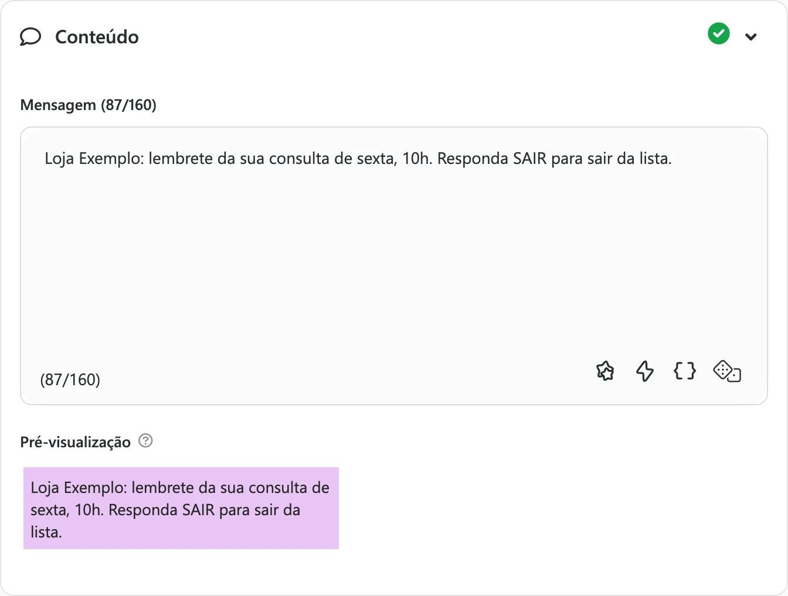

Crie uma campanha por SMS para disparar mensagens curtas de texto para uma lista de contatos. O fluxo geral é o de [Criar uma campanha](/docs/campanhas/campanhas-no-kinbox); esta página reúne apenas o que muda ao usar um canal de SMS.

<Note>
  Quem pode: membros com a permissão **Campanhas**. A restrição **Proibir criar campanha de WhatsApp** não bloqueia campanhas por SMS.
</Note>

## Antes de começar

- **Canal de SMS configurado:** criado em **Configurações** → **Chat** → **Canais** (veja [Usar SMS: criar o canal e comprar créditos](/docs/canais/sms)).
- **Créditos de SMS disponíveis:** nos canais de SMS da Kinbox, cada SMS que a campanha tenta enviar desconta **1 crédito de SMS**, mesmo se o envio falhar (esses créditos são separados do saldo da carteira; veja [Saldo da carteira e créditos](/docs/conceitos/saldo-e-creditos)). A tela do canal de SMS mostra **Créditos disponíveis** e, se o botão aparecer, **Comprar créditos**. Quem tem a permissão **Assinatura** também compra pela **Carteira**: veja [Adicionar saldo e créditos de SMS](/docs/assinatura/adicionar-saldo).

## O que muda no SMS

<Steps>
  <Step title="Escolha o canal de SMS em Informações básicas">
    Ao selecionar um canal de SMS em **Canais de disparo**, apenas ele fica selecionado: uma campanha de SMS usa um único canal e não pode ser misturada com canais de WhatsApp.

    Diferente do WhatsApp, o canal de SMS não precisa estar com status **Conectado** para criar a campanha.
  </Step>

  <Step title="Escreva a mensagem em Conteúdo">
    No SMS, o campo **Mensagem** tem limite de **160 caracteres** (com o contador exibido no rótulo e no rodapé) e mostra a **Pré-visualização** em um balão roxo.

    - **Sem emoji e sem anexo:** os botões de emoji e de anexo não ficam disponíveis no SMS. **Copiloto** (se aparecer; veja [Usar o copiloto na conversa](/docs/copiloto/usar-o-copiloto-de-ia)), **Frases rápidas**, **Chaves reservadas** (colunas `{{2}}`, `{{3}}`...) e **Frase aleatória** funcionam normalmente.
    - **Acentos no contador:** com letras acentuadas, o contador ao lado de **Mensagem** pode ficar vermelho antes de 160 caracteres. A Kinbox só bloqueia acima de 160; prefira textos curtos.
    - **Folga para variáveis:** se a mensagem passar de 160 caracteres depois que a Kinbox substituir as variáveis, o texto é cortado em 160 caracteres no envio. Deixe folga para nomes ou dados mais longos.

    <Frame caption="Seção Conteúdo no SMS com limite de 160 caracteres e pré-visualização no balão roxo">
      
    </Frame>
  </Step>

  <Step title="Revise o Controle de tempo">
    No SMS, **Lento**, **Moderado** e **Rápido** usam intervalos próprios, mais rápidos que os do WhatsApp. Como informa a própria tela, o SMS não tem risco de bloqueio do número como o WhatsApp: os tempos controlam apenas a velocidade de envio.

    Confira a tabela completa de tempos do SMS em [Velocidade de envio e horário comercial](/docs/campanhas/velocidade-e-horario).
  </Step>

  <Step title="Clique em Criar">
    Se houver algum bloqueio próprio do SMS ao clicar em **Criar**, a Kinbox exibe um destes avisos:

    - **"Mensagem de SMS não pode conter mais de 160 caracteres."** — reduza o texto para até 160 caracteres.
    - **"Mensagem não pode conter emojis."** — remova emojis colados no campo.
    - **"Sem saldo de créditos SMS suficiente."** — nos canais de SMS da Kinbox, o workspace não tem nenhum crédito de SMS disponível.
  </Step>
</Steps>

## Durante o envio

- Nos canais de SMS da Kinbox, cada SMS que a campanha tenta enviar desconta **1 crédito de SMS**, mesmo se o envio falhar.
- Nos canais de SMS da Kinbox, se os créditos acabarem no meio da campanha, as mensagens seguintes ficam com status **Falha** (com o motivo `"Sem créditos disponíveis"` na coluna **Detalhes**) e a campanha segue até o fim da lista sem pausar. As mensagens que falharam não são reenviadas; garanta créditos suficientes antes de iniciar.
- Qualquer texto que ultrapassar 160 caracteres após a substituição das variáveis é cortado em 160 caracteres.

Acompanhe os envios em [Acompanhar os resultados da campanha](/docs/campanhas/acompanhar-resultados) e veja como resolver falhas em [Minha campanha não envia ou parou](/docs/campanhas/problemas-comuns).
