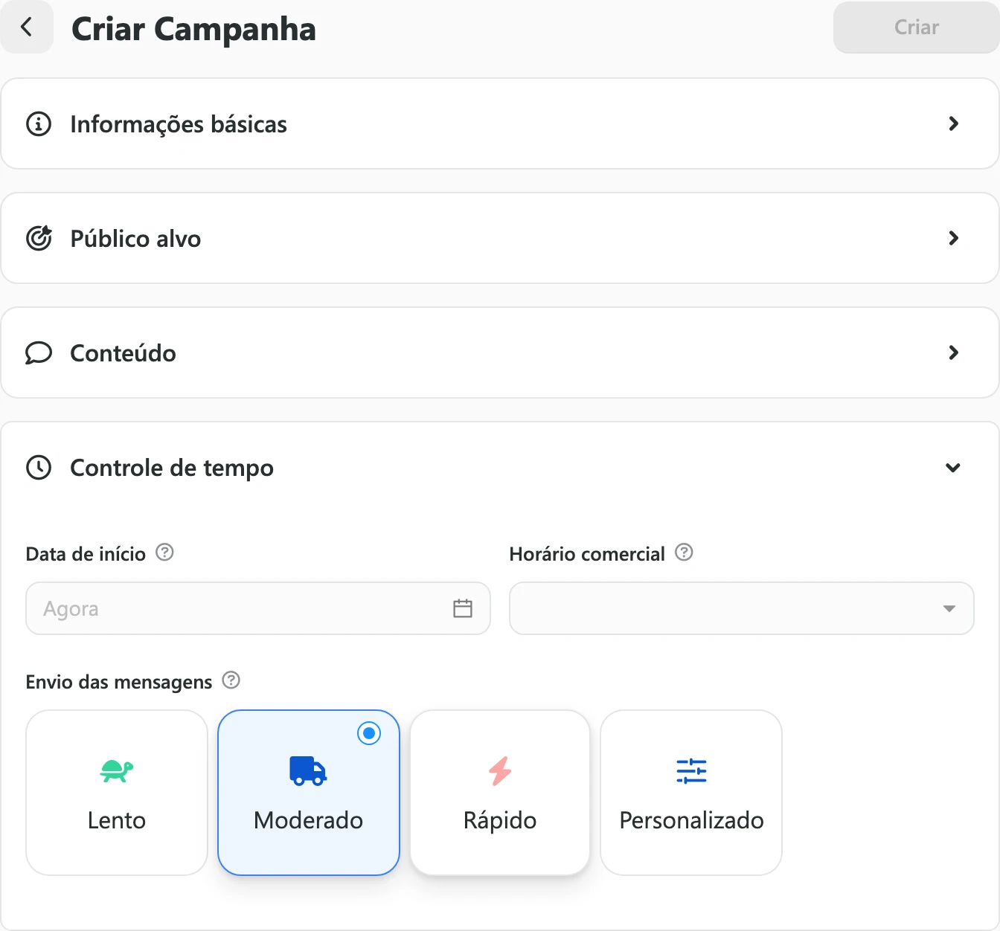
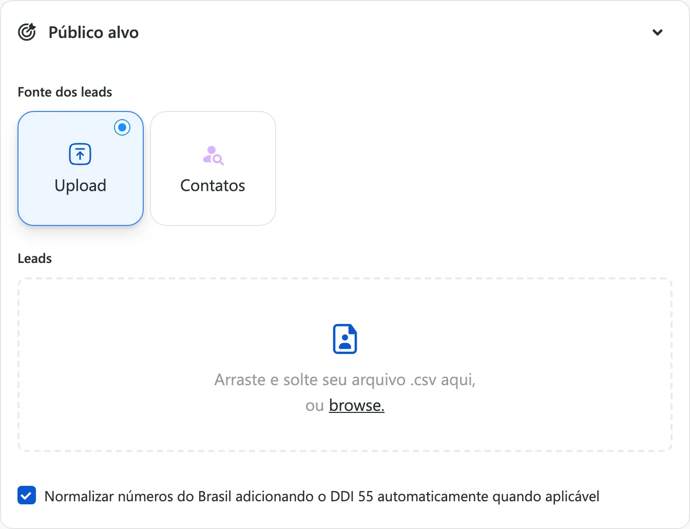
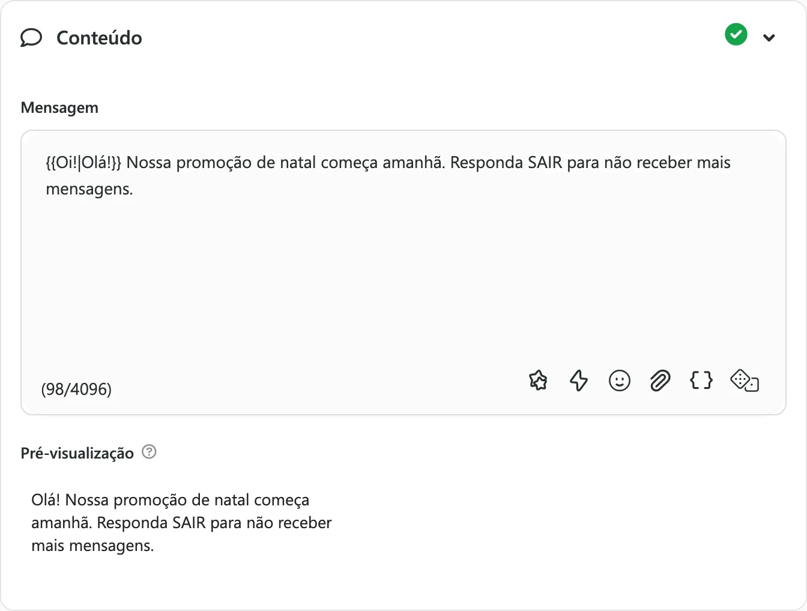

Crie uma campanha na Kinbox para enviar a mesma mensagem, com personalização por variáveis, para uma lista de contatos por WhatsApp (QR Code ou oficial) ou SMS.

<Note>
  Quem pode: membros com a permissão **Campanhas**. Com a restrição **Proibir criar campanha de WhatsApp**, é possível criar apenas campanhas de SMS (essa restrição não vale para o proprietário do workspace).
</Note>

## Antes de começar

- **Canal pronto:** um canal de WhatsApp (QR Code ou oficial) com status **Conectado**, ou um canal de SMS (o SMS não precisa estar conectado para criar a campanha). Canais marcados como **Apenas Receptivo** não aparecem.
- **Só no WhatsApp oficial:** um template de mensagem aprovado pela Meta.
- **Só no SMS:** **Créditos de SMS** disponíveis (nos canais de SMS da Kinbox, cada SMS desconta 1 crédito; veja [Criar uma campanha por SMS](/docs/campanhas/campanha-de-sms)).
- **Lista de contatos:** uma planilha `.csv`, `.xls` ou `.xlsx` (até 100 MB) ou contatos filtrados das sessões de conversa da Kinbox.

## Passo a passo

<Steps>
  <Step title="Abra a tela Criar Campanha">
    No menu lateral, clique em **Campanhas** e depois em **Nova campanha** (se o workspace ainda não tiver nenhuma campanha, clique em **Criar nova campanha**).

    A tela **Criar Campanha** abre com quatro seções: **Informações básicas**, **Público alvo**, **Conteúdo** e **Controle de tempo**. Cada seção preenchida ganha um ícone verde de concluído.

    <Frame caption="Tela Criar Campanha com as quatro seções e o Controle de tempo aberto">
      
    </Frame>
  </Step>

  <Step title="Preencha Informações básicas">
    1. Em **Nome da campanha**, digite um nome para identificar o disparo (por exemplo, `Promoção de natal`).
    2. Em **Canais de disparo**, selecione o canal de saída. As opções que continuam disponíveis dependem do **primeiro canal** escolhido:
       - **WhatsApp oficial:** apenas um canal por campanha.
       - **SMS:** apenas um canal por campanha.
       - **WhatsApp por QR Code:** você pode adicionar outros canais de QR Code **do mesmo tipo** (todos **Express** ou todos **Clássica**). Canais de outro tipo deixam de aparecer na lista. Com vários canais, os envios são distribuídos aleatoriamente entre eles.

    Canais com **Apenas Receptivo** marcado não aparecem na lista (no WhatsApp oficial, veja [Configurações do WhatsApp oficial](/docs/canais/whatsapp/whatsapp-cloud-api/configuracoes)). Canais restritos a grupos dos quais você não participa também ficam ocultos.
  </Step>

  <Step title="Defina o Público alvo">
    Em **Fonte dos leads**, escolha como montar a lista:

    - **Upload** (padrão): arraste um arquivo `.csv`, `.xls` ou `.xlsx` (até 100 MB) para a área de envio ou clique em **browse**. Coloque os números na **primeira coluna**, sem linha de título, e separe as colunas com **vírgula**. As colunas seguintes viram variáveis (`{{2}}`, `{{3}}`...; `{{1}}` é o próprio número). Escreva todos os números do mesmo jeito, por exemplo:

      ```csv
      +55 11 90000-0001,Maria,Loja Exemplo
      +55 11 90000-0003,Ana,Loja Exemplo
      ```

      Depois de ler o arquivo, a tela mostra **Erros**, **Duplicados**, **Sucesso** e **Total**. Clique nos números para abrir a lista **Leads** e revisar as linhas com **Formatação incorreta** ou **Duplicado**: linhas com erro não recebem a campanha.

    - **Contatos**: clique em **Buscar sessões** para abrir **Selecionar Sessões**, filtre em **Filtrar** (veja [Criar filtros de conversa](/docs/conversas/criar-filtros-de-conversa)) e clique em **Selecionar**. A Kinbox junta todas as sessões do filtro, tira contatos repetidos (cada contato entra uma vez) e deixa de fora contatos sem celular válido.

    A caixa **Normalizar números do Brasil adicionando o DDI 55 automaticamente quando aplicável** vem marcada: ela completa números brasileiros sem DDI ou sem o nono dígito, e não mexe em números que começam com `+`. Números de outro país precisam começar com `+`. Desmarque a caixa se a lista já estiver completa ou tiver números fixos. A Kinbox tira números repetidos escritos da mesma forma; o mesmo número escrito de formas diferentes (por exemplo, com e sem `+`) pode receber a campanha mais de uma vez, por isso padronize a lista antes de enviar.

    <Frame caption="Seção Público alvo com Upload selecionado e opção de normalização marcada">
      
    </Frame>
  </Step>

  <Step title="Monte o Conteúdo">
    O editor muda conforme o canal escolhido:

    - **WhatsApp por QR Code e SMS:** escreva no campo **Mensagem** (até 4096 caracteres no WhatsApp por QR Code; até 160 caracteres no SMS) e confira a **Pré-visualização**, que mostra como a mensagem fica usando a primeira linha do arquivo. No editor, use:
      - **Copiloto** (ícone de estrelas, se aparecer): ações de IA para reescrever o texto; aparece quando os comandos do copiloto estão ligados no workspace e usa o saldo da carteira (veja [Saldo da carteira e créditos](/docs/conceitos/saldo-e-creditos)).
      - **Frases rápidas:** insere uma frase cadastrada (veja [Criar frases rápidas](/docs/conversas/criar-frases-rapidas-para-suas-conversas)).
      - **Emojis:** disponível só no WhatsApp por QR Code (não existe no SMS).
      - **Anexar:** disponível só no WhatsApp por QR Code (permite enviar um anexo com a mensagem).
      - **Chaves reservadas** (ícone `{ }`): lista **Coluna 1** a **Coluna 5** (`{{1}}` a `{{5}}`). Você também pode digitar números acima de 5 à mão (como `{{6}}`).
      - **Frase aleatória** (ícone de dado): abre **Adicionar frase aleatória**. Cadastre variações em **Frase** e clique em **Adicionar** para inserir opções no formato `{{opção 1|opção 2}}`. A Kinbox sorteia uma das opções a cada envio (a mesma opção pode sair para mais de um contato).

    - **WhatsApp oficial:** em vez do campo de texto livre, aparece o bloco de template (**Modelo de mensagem**, variáveis, **Anexo** e **Pré-visualização**). Escolha um template aprovado pela Meta, preencha as variáveis usando as colunas da lista (`{{2}}`, `{{3}}`...) e, se o template tiver mídia no cabeçalho, selecione o arquivo. Veja os detalhes em [Enviar um template aprovado](/docs/canais/whatsapp/whatsapp-templates/enviar-template).

    <Tip>
      Não deixe células vazias nas colunas usadas na mensagem: no WhatsApp por QR Code e no SMS, uma célula vazia sai como o próprio número da coluna (por exemplo, `Olá 2`). Além disso, chaves de contato como `{{first_name}}` ou `{{email}}` não funcionam em campanhas — use sempre o número da coluna (`{{2}}`, `{{3}}`...).
    </Tip>

    <Frame caption="Seção Conteúdo no WhatsApp por QR Code com frase aleatória e pré-visualização">
      
    </Frame>
  </Step>

  <Step title="Ajuste o Controle de tempo">
    Esta seção é opcional e vem configurada com valores padrão:

    - **Data de início:** deixe vazio (**Agora**) para iniciar assim que possível ou escolha data e hora futuras.
    - **Horário comercial:** selecione um horário cadastrado no workspace para enviar apenas dentro dele.
    - **Envio das mensagens:** vem marcado como **Moderado** por padrão.

    Os tempos de cada opção (WhatsApp e SMS), a opção **Personalizado** e como os lotes funcionam estão em [Velocidade de envio e horário comercial](/docs/campanhas/velocidade-e-horario). No WhatsApp por QR Code, veja também como o ritmo afeta o risco de bloqueio em [Enviar campanhas pelo QR Code com menos risco de bloqueio](/docs/canais/whatsapp/whatsapp-app/como-fazer-numero-nao-ser-bloqueado-campanhas).
  </Step>

  <Step title="Clique em Criar">
    O botão **Criar** no topo fica ativo depois que **Nome da campanha**, **Canais de disparo**, **Público alvo** e **Conteúdo** estão preenchidos. Ao clicar, a Kinbox abre o painel da campanha com o status **Processando** enquanto prepara os lotes.

    Se a Kinbox mostrar um aviso e não criar a campanha (canal desconectado, canal a recriar, falta de permissão, limite do SMS ou anexo do template), veja o que cada aviso quer dizer em [Minha campanha não envia ou parou](/docs/campanhas/problemas-comuns).
  </Step>
</Steps>

## Depois de criar

- **Sem edição:** depois de criada, a campanha não pode ser editada. Para alterar qualquer informação, exclua a campanha e crie outra.
- **Acompanhamento:** veja entregas, leituras, falhas, respostas e ações de pausar, retomar ou excluir em [Acompanhar os resultados da campanha](/docs/campanhas/acompanhar-resultados).
- **Fila por canal:** só uma campanha envia por vez em cada canal principal; se outra já estiver rodando nele, a nova fica em **Aguardando outra campanha**.

## Problemas comuns

- **A campanha ficou em Aguardando outra campanha.** Outra campanha já está enviando pelo mesmo canal principal; a sua começa sozinha quando ela terminar.
- **O arquivo mostrou muitos Erros em Público alvo.** Tire a linha de título, separe as colunas com vírgula e comece números de outro país com `+`.

Para outros diagnósticos, consulte [Minha campanha não envia ou parou](/docs/campanhas/problemas-comuns).
