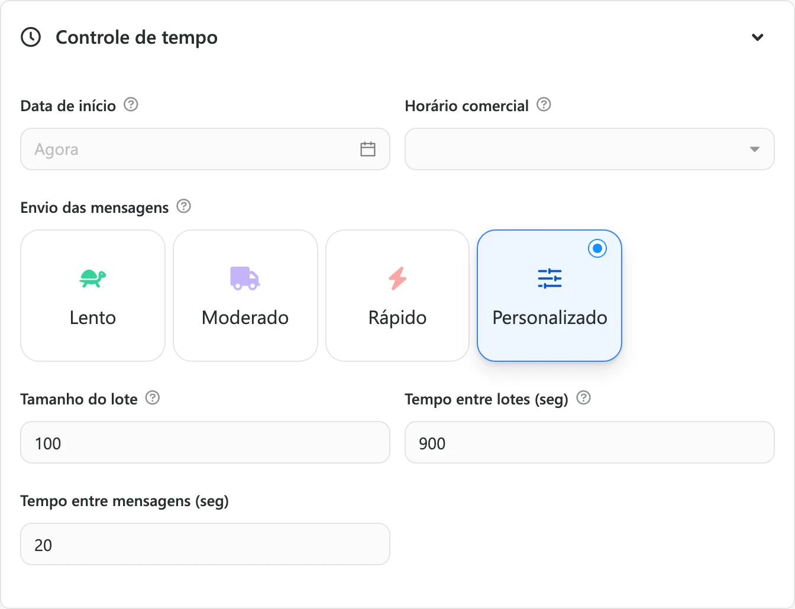

Referência dos campos da seção **Controle de tempo** em [Criar uma campanha](/docs/campanhas/campanhas-no-kinbox), dos tempos de envio por canal, dos lotes e dos status de espera.

## Campos do Controle de tempo

| Campo | O que faz | Padrão |
| --- | --- | --- |
| **Data de início** | Define quando a campanha começa. Se ficar vazio, inicia o mais breve possível, respeitando o **Horário comercial** (se selecionado). | Vazio (**Agora**) |
| **Horário comercial** | Envia mensagens somente dentro de um horário cadastrado em **Configurações** → **Ambiente** → **Horários** (veja [Definir os horários de atendimento](/docs/configuracoes-no-workspace/criar-e-gerenciar-horarios)), no fuso do workspace (na tela, **ambiente**). Fora do horário, a campanha pausa em **Aguardando horário** e retoma sozinha no próximo período, inclusive no meio de um lote (a verificação ocorre antes de cada mensagem). | Nenhum |
| **Envio das mensagens** | Define o tamanho do lote, a pausa entre lotes e o tempo entre mensagens (**Lento**, **Moderado**, **Rápido** ou **Personalizado**). Os tempos mudam conforme o canal (WhatsApp ou SMS) e são recalculados se você trocar o canal depois. | **Moderado** |

## Envio das mensagens

### WhatsApp (QR Code e oficial)

Os mesmos tempos valem para o WhatsApp por QR Code (**Express** e **Clássica**) e para o WhatsApp oficial. **Moderado** vem marcado por padrão.

| Opção | Como envia (WhatsApp) |
| --- | --- |
| **Lento** | Envia 1 mensagem a cada 60 segundos. Lote de 30 mensagens. Pausa de 30 minutos a cada lote enviado. |
| **Moderado** (padrão) | Envia 1 mensagem a cada 20 segundos. Lote de 100 mensagens. Pausa de 15 minutos a cada lote enviado. |
| **Rápido** | Envia 1 mensagem a cada 8 segundos. Lote de 200 mensagens. Pausa de 10 minutos a cada lote enviado. |

Os segundos entre mensagens são um intervalo base: na conexão **Express**, no WhatsApp oficial e no SMS, a Kinbox varia cada intervalo (veja [Como os lotes funcionam](#como-os-lotes-funcionam)).

A dica da tela vale para os dois tipos de WhatsApp: diminuir os tempos executa a campanha mais rápido, mas pode aumentar a probabilidade de bloqueio automático do número; tempos muito altos dão mais tempo para os contatos denunciarem o número como spam. No WhatsApp por QR Code, veja como reduzir esse risco em [Enviar campanhas pelo QR Code com menos risco de bloqueio](/docs/canais/whatsapp/whatsapp-app/como-fazer-numero-nao-ser-bloqueado-campanhas).

### SMS

No SMS, os tempos controlam apenas a velocidade de envio (sem risco de bloqueio do número como no WhatsApp). Veja as demais regras do canal em [Criar uma campanha por SMS](/docs/campanhas/campanha-de-sms).

| Opção | Como envia (só no SMS; segundos entre mensagens como intervalo base) |
| --- | --- |
| **Lento** | Envia 1 SMS a cada 10 segundos. Lote de 100 mensagens. Pausa de 5 minutos a cada lote enviado. |
| **Moderado** (padrão) | Envia 1 SMS a cada 3 segundos. Lote de 250 mensagens. Pausa de 2 minutos a cada lote enviado. |
| **Rápido** | Envia 1 SMS a cada segundo. Lote de 500 mensagens. Pausa de 1 minuto a cada lote enviado. |

### Personalizado

Os campos vêm preenchidos com os tempos da opção selecionada antes e permitem ajustar cada valor manualmente:

| Campo | Limite | O que faz |
| --- | --- | --- |
| **Tamanho do lote** | 1 a 500 | Quantidade de mensagens enviadas em cada lote antes da pausa. |
| **Tempo entre lotes (seg)** | Mínimo 1 | Tempo de espera, em segundos, entre o fim de um lote e o início do próximo. |
| **Tempo entre mensagens (seg)** | Mínimo 1 | Intervalo base, em segundos, entre cada mensagem dentro do lote. |

<Frame caption="Controle de tempo com Personalizado selecionado">
  
</Frame>

## Como os lotes funcionam

A Kinbox dispara a quantidade de mensagens definida em **Tamanho do lote**, pausa pelo **Tempo entre lotes (seg)** (status **Aguardando lote**) e então inicia o lote seguinte. A primeira mensagem de cada lote sai sem espera.

No WhatsApp por QR Code na conexão **Express**, no WhatsApp oficial e no SMS, o tempo entre mensagens não é fixo: a cada mensagem, a Kinbox sorteia um intervalo entre metade (50%) e uma vez e meia (150%) do valor escolhido. Por exemplo, com 20 segundos (**Moderado** no WhatsApp), cada intervalo fica entre 10 e 30 segundos.

## Duração prevista

Depois de carregar a lista em **Público alvo**, a tela mostra **Duração** como uma previsão no melhor caso, considerando tamanho do lote, pausas entre lotes, **Data de início** e **Horário comercial**. Passe o mouse sobre o campo para ver **Início** e **Fim**. A previsão não inclui variações do sorteio de intervalo nem falhas de envio.

## Status de espera

| Status | Dica na tela | O que fazer |
| --- | --- | --- |
| **Agendado** | Início de campanha agendada para `{data}` | Aguarde a data e hora definidas. |
| **Aguardando lote** | Aguardando tempo para próximo lote | Comportamento normal; o próximo lote começa sozinho ao fim da pausa. |
| **Aguardando horário** | Início de campanha agendada para `{data}` | Comportamento normal fora do **Horário comercial**; a campanha retoma sozinha no próximo período. |
| **Aguardando outra campanha** | Somente uma campanha pode ser executada por vez no mesmo canal | Aguarde a outra campanha terminar, entrar em **Aguardando horário** ou ser excluída — ou pause a campanha em andamento. |

## Uma campanha por canal

Só uma campanha envia por vez em cada canal, considerando o **primeiro canal** escolhido em **Canais de disparo** (o canal principal). Se outra campanha já está em **Enviando mensagens** no mesmo canal principal, a nova aguarda em **Aguardando outra campanha** e começa sozinha quando a anterior termina, é excluída ou entra em **Aguardando horário**.

Ao **Pausar** uma campanha que tem outra aguardando, a Kinbox pergunta se você deseja iniciar a campanha que estava na fila. Veja mais em [Boas práticas de campanha](/docs/campanhas/boas-praticas) e [Minha campanha não envia ou parou](/docs/campanhas/problemas-comuns).
