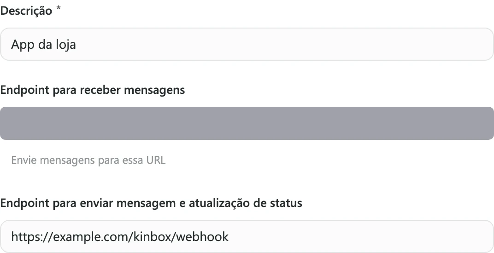

O canal customizado liga um chat próprio — de um app, site, sistema ou outra plataforma de mensagens — à [Caixa de entrada](/docs/conversas/caixa-de-entrada-do-kinbox). Quem programa a integração encontra os detalhes técnicos em [Integrar seu sistema como canal customizado (API)](/docs/desenvolvedor/criando-canal-customizado).

<Note>
  **Quem pode:** o proprietário do workspace e membros com a permissão **Gerenciar Canais** ([Criar papéis e permissões](/docs/configuracoes-no-workspace/configurar-permissoes-dos-usuarios)). A restrição **Somente pode dar manutenção simples em canais** esconde **Novo canal** e **Excluir** (o membro não cria nem exclui canais customizados). O canal customizado não entra na cobrança do plano nem tem limite de quantidade.
</Note>

## Antes de começar

- **Alguém que programe a integração:** sem essa integração entre o seu sistema e a Kinbox, o canal não recebe nem entrega mensagens.
- **Token v0:** a equipe técnica vai precisar do **Token v0** do workspace, em **Configurações** → **Integrações** → **API Tokens** → **Mostrar tokens legados** (exige a permissão **Integrações** ou ser proprietário). Não é o token de API `kb_live_` — veja [Criar um token de API](/docs/desenvolvedor/tokens-de-api).
- **Endereço de saída do seu sistema:** a URL do seu sistema que vai receber as respostas dos membros e o aviso quando uma conversa for resolvida.

## Criar o canal

1. Vá em **Configurações** → **Chat** → **Canais** e clique em **Novo canal**. Se **Novo canal** não aparecer, peça ao proprietário para verificar a permissão **Gerenciar Canais** e a restrição **Somente pode dar manutenção simples em canais**.
2. Em **Conectar novo canal**, clique no cartão **Customizado** para abrir o painel **Conectar Canal Customizado**.
3. Preencha **Descrição** (obrigatório, por exemplo "App da loja") e informe a URL do seu sistema em **Endpoint para enviar mensagem e atualização de status**. O **Endpoint para receber mensagens** já vem pronto para a equipe técnica copiar.

   <Frame caption="Painel Conectar Canal Customizado com Descrição e os endpoints de entrada e saída">
     
   </Frame>

4. Clique em **Conectar canal**. Quando aparecer "Canal customizado criado.", o canal já aparece na lista.

O passo a passo completo, com o formato das mensagens, está em [Integrar seu sistema como canal customizado (API)](/docs/desenvolvedor/criando-canal-customizado).

## No dia a dia

- **Uma conversa por cliente:** cada cliente enviado pelo seu sistema aparece como uma conversa na **Caixa de entrada**.
- **Texto e arquivos:** os membros respondem com texto e arquivos (enviados ao seu sistema como link). Não há botão para gravar áudio neste canal.
- **Notas internas:** notas internas ficam apenas no workspace e não saem para o seu sistema.
- **Conversa resolvida:** a Kinbox avisa o seu sistema quando a conversa é resolvida.
- **Atribuição:** o seu sistema pode atribuir a conversa a um membro pelo e-mail dele.
- **O contato escreve primeiro:** a Kinbox não inicia conversa neste canal; a conversa começa quando o seu sistema envia uma mensagem do cliente.

## Editar e excluir

Na lista de canais, a linha mostra a **Descrição** e, abaixo, o endereço de saída configurado. Clique na linha para abrir o painel **Canal customizado**, que exibe **Status**, **Imagem** (`JPEG/PNG - Min. 100x100px`), **Descrição**, **Endpoint para o Kinbox receber mensagens** (somente leitura) e **Endpoint para o Kinbox enviar mensagem e atualização de status**. Você pode alterar a imagem, a descrição e o endereço de saída.

No menu de três pontos ficam **Copiar ID** e, se aparecer, **Excluir** (ele não aparece para quem tem a restrição **Somente pode dar manutenção simples em canais**). **Excluir** desliga o canal e mantém as conversas gravadas; depois disso, se o seu sistema tentar enviar mensagens, receberá `Identificador inválido`.

## Problemas comuns

- **Nada chega na Caixa de entrada:** a integração do seu sistema ainda não está enviando mensagens ou está usando o token errado. Peça para a equipe técnica conferir os erros `api_token inválido` e `Identificador inválido` em [Integrar seu sistema como canal customizado (API)](/docs/desenvolvedor/criando-canal-customizado).
- **A resposta do membro não chega ao cliente:** confira o endereço preenchido em **Endpoint para o Kinbox enviar mensagem e atualização de status** e se o seu sistema está no ar. Se a entrega falhar, a Kinbox não tenta reenviar.

Veja também [Canais: conectar e gerenciar](/docs/canais/visao-geral) e [Para desenvolvedores: API, plugins, MCP e links](/docs/desenvolvedor/visao-geral).
