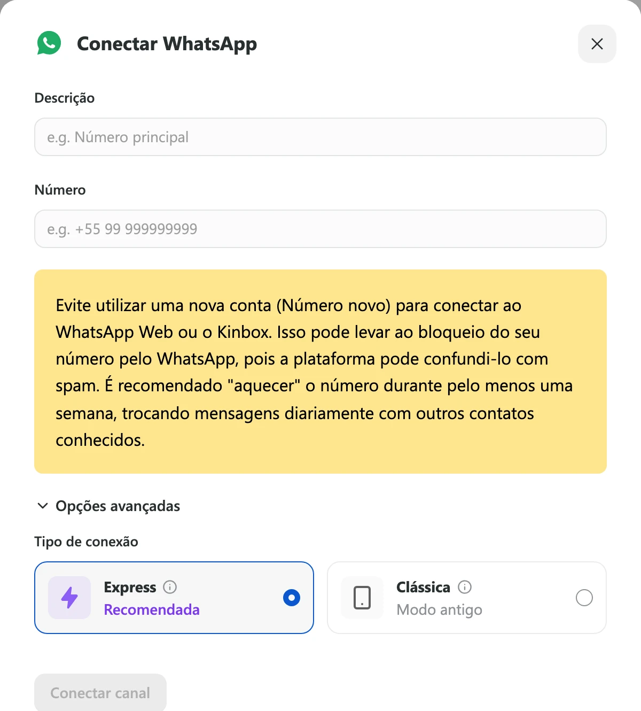
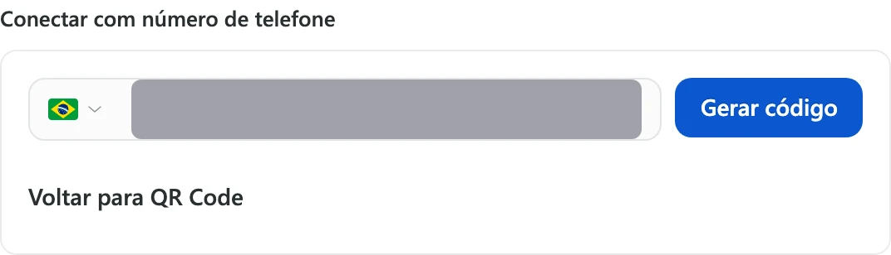

Conecte um número de WhatsApp à Kinbox lendo o QR Code no celular ou digitando um código de conexão. O canal funciona como um aparelho conectado ao WhatsApp do seu celular.

<Note>Quem pode: membros com a permissão **Gerenciar Canais** e sem a restrição **Somente pode dar manutenção simples em canais**. O dono do workspace sempre pode. O plano precisa ter um canal de WhatsApp livre.</Note>

## Antes de começar

- Confira se o QR Code é o tipo certo para você em [Qual WhatsApp usar: oficial ou QR Code](/docs/canais/whatsapp/visao-geral).
- Tenha à mão o celular com o WhatsApp (ou WhatsApp Business) do número, com internet. O celular precisa abrir o WhatsApp de tempos em tempos.
- Evite conectar um número novo. A Kinbox recomenda "aquecer" o número por pelo menos uma semana, trocando mensagens todos os dias com contatos conhecidos. Veja [Como evitar que o número seja bloqueado](/docs/canais/whatsapp/whatsapp-app/como-nao-ter-numero-bloqueado-whatsapp).

## Passo a passo

<Steps>
  <Step title="Abra a tela de canais">
    Vá em **Configurações** → **Chat** → **Canais** e clique em **Novo canal**.
  </Step>
  <Step title="Escolha o QR Code">
    Em **Conectar novo canal**, clique em **WhatsApp** e depois em **Modo QRCode**.
  </Step>
  <Step title="Preencha os dados do canal">
    No painel **Conectar WhatsApp**, preencha:

    - **Descrição**: o nome do canal na Kinbox.
    - **Número**: o número com DDI (exemplo: `+55 11 90000-0001`).

    Deixe o tipo de conexão em **Express**. Só abra **Opções avançadas** se precisar da **Clássica**. Clique em **Conectar canal**.

    <Frame caption="Painel Conectar WhatsApp com Opções avançadas aberto">
      
    </Frame>
  </Step>
  <Step title="Abra o painel do canal">
    A Kinbox mostra o aviso "Canal de WhatsApp criado.". Se o painel do canal não abrir sozinho, clique no canal na lista de canais.

    Na **Express**, o status **Necessário ler QR-Code** e o QR Code aparecem em pouco tempo. Na **Clássica**, o canal pode ficar em **Criando...** por até 10 minutos antes do QR Code.
  </Step>
  <Step title="Leia o QR Code no celular">
    Abra o WhatsApp no celular desse número, toque em **Dispositivos conectados** → **Conectar dispositivo** e aponte a câmera para o QR Code da tela. O QR Code se atualiza sozinho a cada 10 segundos.
  </Step>
</Steps>

## Conectar com um código, sem câmera

Só na conexão **Express**, com o canal em **Necessário ler QR-Code**.

<Steps>
  <Step title="Abra o código de conexão">
    Embaixo do QR Code, clique em **Conectar com número de telefone**.

    <Frame caption="Painel Conectar com número de telefone, antes de gerar o código">
      
    </Frame>
  </Step>
  <Step title="Gere o código">
    Confira o número no campo e clique em **Gerar código**. A Kinbox mostra um código no formato `XXXX-XXXX`. Clique em **Copiar** se quiser.
  </Step>
  <Step title="Digite o código no celular">
    No WhatsApp do celular, toque em **Dispositivos conectados** → **Conectar dispositivo**, depois em **Conectar com número de telefone**, e digite o código.
  </Step>
</Steps>

- **A Kinbox não gerou o código** (aparece uma mensagem de erro e o botão continua **Gerar código**): confira o número no campo e clique em **Gerar código** de novo.
- **O celular recusou o código**: clique em **Gerar novo código** e digite o código novo.
- Se não der certo, clique em **Voltar para QR Code** e conecte pelo QR Code.

## Depois de conectar

- O status muda para **Conectado**. Na **Express**, o campo **Número** passa a mostrar o número confirmado pelo WhatsApp.
- Não dá para trocar o número de um canal. Para usar outro número, crie outro canal.
- Se o número já teve um canal excluído no workspace, o canal antigo volta, com o mesmo ID e as conversas.

Ajuste as opções do canal em [Configurações do WhatsApp por QR Code](/docs/canais/whatsapp/whatsapp-app/configuracoes) e veja os tipos de mensagem em [O que funciona e o que não funciona no WhatsApp por QR Code](/docs/canais/whatsapp/whatsapp-app/o-que-funciona).

## Problemas comuns

- **O QR Code expirou.** Na **Express**, o QR Code fica disponível por cerca de 13 minutos. Depois disso, o canal fica **Desconectado** e o QR Code some. Clique em **Reiniciar canal** para gerar outro.
- **Número inválido.** Na **Express**, o número precisa ter de 10 a 15 dígitos, contando o DDI.
- **O canal já está ativo.** Já existe um canal ativo com esse número. Procure o canal na lista. Se não achar, fale com o suporte.
- **Limite do plano.** O plano chegou ao limite de canais de WhatsApp, ou a assinatura venceu.
- **O status aparece como `pending_review` ou `error` (em inglês).** A criação do canal não terminou. Fale com o suporte e informe o ID do canal.

Para outros casos, veja [Meu WhatsApp desconectou](/docs/canais/whatsapp/whatsapp-app/como-evitar-que-o-celular-desconecte).

## Próximos passos

- [Configurações do WhatsApp por QR Code](/docs/canais/whatsapp/whatsapp-app/configuracoes)
- [Como evitar que o número seja bloqueado](/docs/canais/whatsapp/whatsapp-app/como-nao-ter-numero-bloqueado-whatsapp)
