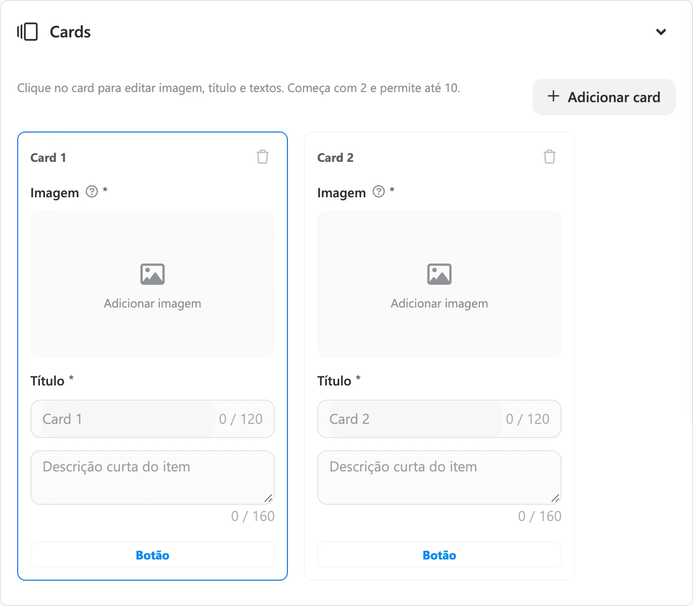

Um **carrossel** é uma mensagem com 2 a 10 cards lado a lado, cada um com imagem ou vídeo, título, descrição e botões. O processo tem duas etapas: primeiro você monta o rascunho em **Carrossel**, depois cria um **Template + Carrossel** (sempre na categoria **Marketing**) e envia para aprovação da Meta.

Carrosséis existem apenas no **WhatsApp oficial** — no WhatsApp por QR Code esse recurso não existe (veja [Qual WhatsApp usar: oficial ou QR Code](/docs/canais/whatsapp/visao-geral)).

<Note>Quem pode: membros com a permissão **Gerenciar Canais** e o proprietário do workspace. É necessário ter um canal de WhatsApp oficial conectado ([Conectar o WhatsApp oficial](/docs/canais/whatsapp-api-oficial-padrao)).</Note>

## A lista de carrosséis

Acesse **Configurações** → **Automação** → **WhatsApp API** e clique em **Abrir** no cartão **Carrossel**.

A tela **Carrossel** tem a busca **Pesquisar por nome**, o botão **Novo Carrossel** e os filtros **Tudo**, **Válidos**, **Incompletos** e **Vinculados**. A coluna **Status** mostra três estados locais na Kinbox:

- **Válido**: completo e pronto para virar template.
- **Incompleto**: falta algum campo obrigatório.
- **Vinculado a template**: já está ligado a um **Template + Carrossel**.

O menu de três pontos de cada linha traz **Editar** e **Excluir**.

## Criar o carrossel

<Steps>
  <Step title="Preencha Informações básicas">
    Clique em **Novo Carrossel**. Na tela **Novo carrossel**, abra **Informações básicas** e preencha:

    - **Canal**: canal oficial do carrossel (obrigatório).
    - **Nome do carrossel**: nome do rascunho (obrigatório, por exemplo `ofertas_da_semana`).
    - **Tipo de mídia**: **Imagem** ou **Vídeo**, usado em todos os cards.
    - **Tipo de variável**: somente **Número** (`{{1}}`, `{{2}}`).
    - **Corpo da mensagem**: texto obrigatório que aparece acima dos cards. Se inserir variáveis, preencha **Amostras de variáveis**.
  </Step>
  <Step title="Configure Estrutura de botões">
    Clique em **Adicionar botão** para incluir até 2 botões: **Resposta rápida** ou **Acessar site**, com **Texto do botão** obrigatório. O tipo, a ordem e o texto dos botões se repetem em todos os cards.
  </Step>
  <Step title="Monte os Cards">
    O carrossel começa com 2 cards e permite até 10 — use **Adicionar card** para incluir mais (não é possível ficar com menos de 2). Clique em cada card para preencher:

    - **Imagem** ou **Vídeo** (obrigatório): clique em **Adicionar imagem** ou **Adicionar vídeo** (use **Remover mídia** para trocar).
    - **Título**: obrigatório, até 120 caracteres.
    - Descrição: opcional, até 160 caracteres.
    - URL do botão **Acessar site** (quando configurado): cada card pode ter um link próprio (por exemplo, `https://www.exemplo.com.br`).

    <Frame caption="Painel Cards do carrossel com dois cards, mídia, título, descrição e botão">
      
    </Frame>
  </Step>
  <Step title="Salve o rascunho">
    Confira a prévia à direita e clique em **Salvar**. Você pode salvar um rascunho ainda **Incompleto** apenas com o nome preenchido, mas só carrosséis com status **Válido** podem ser usados em um template.
  </Step>
</Steps>

## Criar o Template + Carrossel

O carrossel só chega ao contato depois de virar um template aprovado pela Meta.

<Steps>
  <Step title="Escolha Template + Carrossel">
    Em **Configurações** → **Automação** → **WhatsApp API**, abra **Templates**, clique em **Novo Template** e selecione **Template + Carrossel**.
  </Step>
  <Step title="Vincule o carrossel em Informações básicas">
    Selecione o **Canal** e escolha o rascunho pronto em **Carrossel** (rascunhos incompletos aparecem marcados como incompletos e não podem ser selecionados). O **Nome do template** e o **Canal** são preenchidos a partir do carrossel, e a **Categoria** fica travada em **Marketing**. Escolha o **Idioma**.
  </Step>
  <Step title="Confira o Conteúdo">
    O painel **Conteúdo** exibe o resumo do carrossel e o botão **Editar rascunho**, caso precise ajustar algo. Não há painel separado de botões porque eles vêm da estrutura do carrossel.
  </Step>
  <Step title="Salve e peça aprovação">
    Clique em **Salvar** e depois em **Solicitar Aprovação**. Acompanhe a aprovação em [Criar um template e enviar para aprovação](/docs/canais/criar-templates-dentro-do-kinbox) e, depois de aprovado, envie seguindo [Enviar um template aprovado](/docs/canais/whatsapp/whatsapp-templates/enviar-template).
  </Step>
</Steps>

O template e o carrossel precisam usar o mesmo canal oficial. Cada carrossel pode ser vinculado a apenas um template; ao salvar o rascunho do template, o carrossel passa para o status **Vinculado a template**.

## Mudar um carrossel já usado

Se você editar e salvar um carrossel com status **Vinculado a template**, a alteração não vai automaticamente para a Meta. Depois de salvar o carrossel, abra o template correspondente e clique em **Enviar atualização para a Meta** para reenviar para análise.

Se você trocar o **Canal** do carrossel, o vínculo com o template é desfeito e as mídias já enviadas precisam ser enviadas novamente.

## Excluir um carrossel

No menu de três pontos da linha, clique em **Excluir** e confirme. Excluir o rascunho do carrossel não exclui nem altera o template já criado nem o modelo na Meta.
