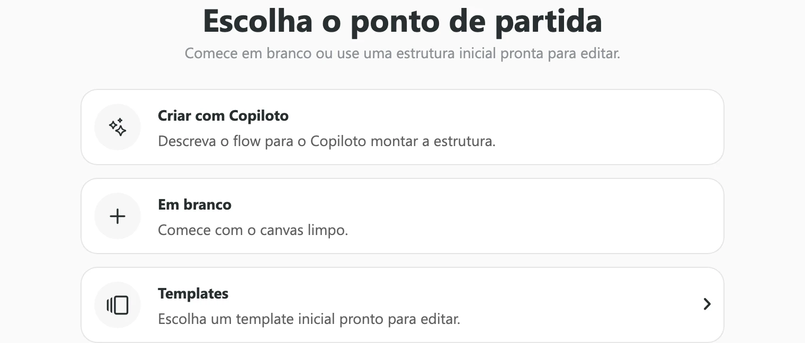
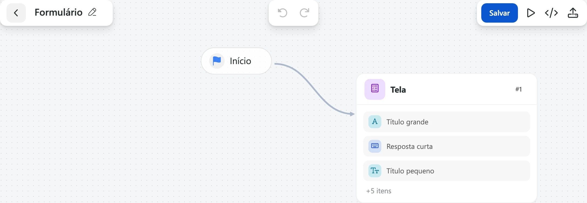

Um **WhatsApp Flow** é um formulário com uma ou mais telas que o contato preenche dentro do próprio WhatsApp. O Flow não é enviado sozinho: ele chega ao contato pelo botão de um **Template + Flow** aprovado pela Meta.

Flows existem apenas no **WhatsApp oficial** — no WhatsApp por QR Code esse recurso não existe (veja [Qual WhatsApp usar: oficial ou QR Code](/docs/canais/whatsapp/visao-geral)).

<Note>Quem pode: membros com a permissão **Gerenciar Canais** e o proprietário do workspace. É necessário ter um canal de WhatsApp oficial conectado ([Conectar o WhatsApp oficial](/docs/canais/whatsapp-api-oficial-padrao)).</Note>

## Como funciona em 4 etapas

1. Crie o Flow e vincule a um canal oficial.
2. Monte as telas no editor e teste no simulador.
3. Publique o Flow na Meta.
4. Crie um **Template + Flow**, vincule o Flow publicado e envie o template para aprovação.

## A lista de Flows

Acesse **Configurações** → **Automação** → **WhatsApp API** e clique em **Abrir** no cartão **Flows**.

A tela **Flows** traz a busca **Pesquisar por nome**, os filtros **Tudo**, **Ativos**, **Inativos** e **Publicados** (publicados na Meta), o botão **Novo Flow** e o menu de três pontos acima da tabela com **Sincronizar Meta** (que traz os Flows da conta na Meta, inclusive criados fora da Kinbox).

As colunas mostram **Nome**, **Canal**, **Status** (estado na Kinbox, como **Rascunho**, **Válido**, **Inválido** ou **Descontinuado**), **Publicação Meta** (situação na Meta, como **Não publicado**, **Publicado**, **Descontinuado**, **Limitado** ou **Bloqueado**) e **Última edição**.

Clicar na linha abre o editor. O menu de três pontos da linha varia conforme o estado: **Editar** (nome, categoria e canal), **Clonar**, **Publicar**, **Descontinuar**, **Exportar JSON** (copia o JSON para a área de transferência) e **Excluir**.

## Criar o Flow

Clique em **Novo Flow** para abrir o assistente **Criar flow**:

<Steps>
  <Step title="Comece com nome e categoria">
    Preencha **Nome do flow** (não pode repetir o nome de outro Flow da mesma conta do WhatsApp oficial) e escolha a **Categoria Meta** (**Cadastro**, **Login**, **Agendamento**, **Captura de lead**, **Contato**, **Atendimento**, **Pesquisa** ou **Outro**). Clique em **Continuar**.
  </Step>
  <Step title="Escolha o canal WhatsApp">
    Selecione o canal oficial em **Canal WhatsApp** e clique em **Continuar**.
  </Step>
  <Step title="Escolha o ponto de partida">
    Selecione uma das três opções e clique em **Criar flow**:

    - **Criar com Copiloto**: cria o Flow em branco e abre o editor com o Copiloto. Quando você aprova a estrutura sugerida, ela substitui o que havia no canvas — clique em **Salvar** depois.
    - **Em branco**: abre o editor com o canvas limpo.
    - **Templates**: abre dois modelos prontos para editar — **Formulário simples** (uma tela com nome, telefone e interesse) e **Atendimento/triagem** (duas telas de perguntas e mensagem final de texto; o Flow não transfere a conversa).

    <Frame caption="Etapa Escolha o ponto de partida na criação de um Flow">
      
    </Frame>
  </Step>
</Steps>

## Montar as telas

O editor começa com o card **Início**. Para criar uma tela, arraste a partir do ponto de saída de **Início** (ou de outra tela) até um espaço vazio, clique com o botão direito no fundo do canvas ou arraste **Tela** pelo menu de nós na barra inferior.

A ligação entre as telas define a ordem do Flow: a primeira tela é a ligada ao **Início**. Clique em uma tela para expandi-la (ou use **Expandir tela** / **Editar tela**). Dê um **Nome da tela** legível (como `Seus dados`), pois é o título que o contato vê no topo da tela no WhatsApp.

<Frame caption="Editor de Flow com o card Início ligado a uma tela e a barra superior com Salvar e simular">
  
</Frame>

Com a tela expandida, arraste itens da barra flutuante **Componentes** para dentro dela:

| Grupo | Componentes |
| --- | --- |
| **Enviar mensagem** | **Título grande**, **Título pequeno**, **Legenda**, **Corpo** e **Resposta da integração** (exibe um dado retornado por uma requisição anterior). |
| **Mídia** | **Imagem** (JPG ou PNG). |
| **Resposta em texto** | **Resposta curta** (com **Formato** e **Validação rápida**), **Parágrafo** (com **Texto de ajuda**) e **Seletor de data**. |
| **Seleção** | **Escolha única**, **Múltipla escolha**, **Lista suspensa**, **Aceitar** e **Chips** (com **Opções estáticas**, **Dado da integração** ou **Faixa numérica**, conforme o tipo). |
| **Uploads** | **Foto** e **Documento**. |
| **Avançado** | **Texto rico**, **Link** (**Abrir URL** ou **Navegar**) e **Lista de navegação**. |

Para cada campo preenchido pelo contato, preencha **Nome técnico** e **Rótulo**. Use nomes técnicos claros e sem espaço (como `nome` ou `telefone`), porque esse nome identifica as respostas na conversa. A maioria dos componentes aceita condições em **Visível quando** e **Habilitado quando**.

Toda tela tem um **Botão** no rodapé com **Texto do botão** e **Ação** (**Finalizar**, **Navegar** ou **Requisição**). A ligação no canvas define o comportamento: uma tela ligada a outra segue para ela, e uma tela sem ligação seguinte encerra o Flow.

<Warning>Sair do editor ou pressionar **Esc** descarta as alterações não salvas sem pedir confirmação. Clique em **Salvar** no topo antes de sair.</Warning>

## Buscar ou enviar dados com uma Requisição

No **Botão** da tela (ação **Requisição** → **Configurar**) ou na opção **Atualizar ao selecionar** de campos de seleção e data, você abre a janela **Requisição** para consultar ou enviar dados a um sistema externo.

Informe o **Método**, a **URL** (que precisa estar acessível pela internet) e, se precisar, a **Autenticação** e os cabeçalhos — campos marcados como **Segredo** ficam salvos de forma cifrada. Na aba **Envio**, selecione os campos enviados; na aba **Resposta**, escolha os dados recebidos para usar nas telas seguintes. Ao escolher o primeiro campo da resposta, a Kinbox cria automaticamente duas telas ligadas: **Sucesso** e **Erro**.

Clique em **Testar** antes de clicar em **Salvar configuração** (toda alteração pede um novo teste). Para enviar os dados a um cenário da Kinbox, crie o cenário com o gatilho **Webhook recebido** e use o **Endereço Url** que ele mostra como **URL** da requisição.

## Simular

Clique em **Simular flow** na barra superior (ou em **Simular tela no preview** dentro de uma tela) para testar o preenchimento em uma prévia de celular. Ao chegar ao fim, o simulador exibe **Flow enviado** com os dados preenchidos. Requisições configuradas chamam a URL real durante a simulação.

## Publicar

O editor não tem botão de publicar: clique em **Salvar**, volte para a lista de Flows e selecione **Publicar** no menu de três pontos da linha. Se você criou o Flow a partir de um template, ao fechar o editor aparece a janela **Publicar flow na Meta?** com o botão **Publicar na Meta**.

A Kinbox valida o Flow e publica na Meta. Depois de publicado, novas edições feitas no editor não vão para a Meta: para alterar um Flow publicado, use **Clonar**, associe o canal em **Editar**, faça as alterações, publique o clone e passe a usá-lo no template.

## Usar o Flow num template

Crie um template do tipo **Template + Flow** seguindo [Criar um template e enviar para aprovação](/docs/canais/criar-templates-dentro-do-kinbox).

No editor do template, o campo **Flow** lista apenas Flows publicados no canal selecionado (se não houver nenhum, aparece a opção **Criar flow**). Preencha o **Texto do botão** que o contato vai tocar para abrir o formulário e envie o template para aprovação. Depois de aprovado, envie seguindo [Enviar um template na conversa, na campanha e na automação](/docs/canais/whatsapp/whatsapp-templates/enviar-template).

## O que o atendente vê na conversa

O template enviado aparece como um cartão com o texto e o botão do Flow. Quando o contato conclui o preenchimento, chega uma mensagem do contato com o botão **Ver resposta**.

Clicar em **Ver resposta** abre a janela **Resposta do Flow**, mostrando a data e uma linha por campo com o **Nome técnico** em cima e o valor preenchido embaixo. As respostas não vão automaticamente para campos do contato, bots ou cenários; para enviar dados a outro sistema durante o preenchimento, use uma **Requisição**.

## Editar, clonar, descontinuar e excluir

- **Editar** (menu da linha): altera **Nome do flow**, **Categoria Meta** e **Canal WhatsApp**, e traz o link **Editar estrutura** para abrir o editor. Trocar o canal de um Flow que já tinha canal cria uma cópia para o novo canal.
- **Clonar**: cria uma cópia sem canal e inativa. Para publicar o clone, abra **Editar** e escolha um canal oficial.
- **Excluir**: disponível apenas para Flows não publicados e não descontinuados.
- **Descontinuar**: disponível apenas para Flows publicados.

<Warning>Descontinuar um Flow é irreversível e também o descontinua na Meta. Depois de descontinuado, ele não pode mais ser usado, editado, publicado ou ativado novamente — apenas clonado ou exportado em JSON. Confira antes os templates que usam esse Flow.</Warning>
