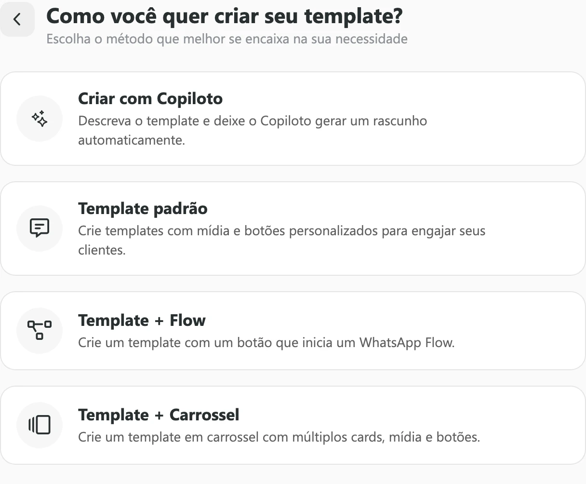
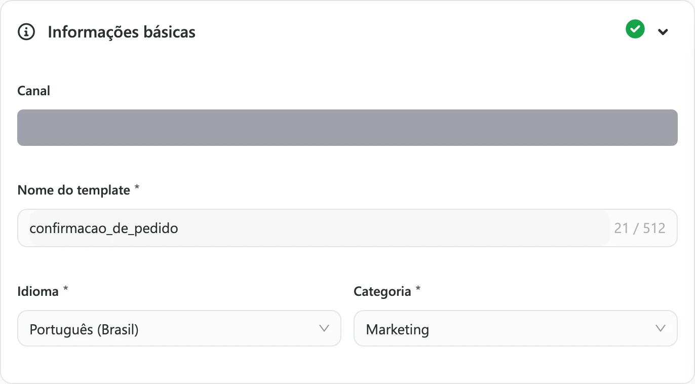
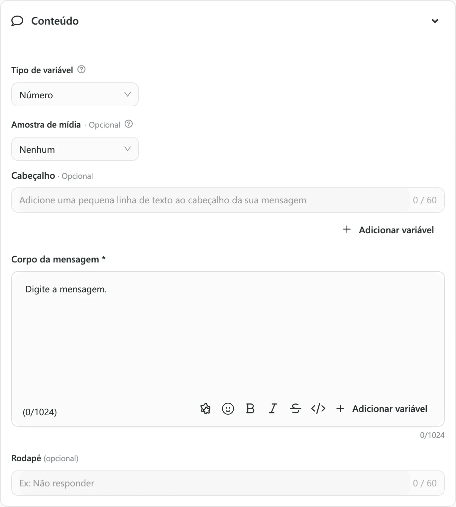

Crie templates com cabeçalho, variáveis e botões direto na Kinbox e envie para a aprovação da Meta. Templates existem apenas no **WhatsApp oficial** — no WhatsApp por QR Code esse recurso não existe (veja [Qual WhatsApp usar: oficial ou QR Code](/docs/canais/whatsapp/visao-geral)).

<Note>Quem pode: membros com a permissão **Gerenciar Canais** e o proprietário do workspace. É necessário ter um canal de WhatsApp oficial conectado.</Note>

## Antes de começar

- Tenha um canal de WhatsApp oficial ativo (veja [Conectar o WhatsApp oficial](/docs/canais/whatsapp-api-oficial-padrao) ou [Canais: conectar e gerenciar](/docs/canais/visao-geral)).
- Acesse **Configurações** → **Automação** → **WhatsApp API** e clique em **Abrir** no cartão **Templates**.

## A lista de templates

Na tela **Templates**, você encontra a busca **Pesquisar por nome**, os filtros **Tudo**, **Submetido** (que também inclui **Pendente**) e **Aprovado**, e as colunas **Nome**, **Canal**, **Categoria**, **Idioma**, **Status** e **Última edição**.

No topo ficam o botão **Novo Template** e o menu de três pontos com **Sincronizar Meta** (que atualiza os status e traz templates criados direto na Meta). Clicar em uma linha abre o template; o menu de três pontos da linha oferece **Editar**, **Solicitar Aprovação** (para rascunhos ainda não enviados à Meta) e **Excluir**.

## Passo a passo (Template padrão)

Para criar um template com Flow ou carrossel, veja [Criar WhatsApp Flows (formulários no WhatsApp)](/docs/canais/criar-flows-dentro-do-kinbox) e [Criar um carrossel](/docs/canais/criar-carrossel-dentro-do-kinbox).

<Steps>
  <Step title="Escolha o tipo do template">
    Clique em **Novo Template**. Na tela **Como você quer criar seu template?**, selecione **Template padrão**.

    <Frame caption="Tela Como você quer criar seu template? com as quatro opções">
      
    </Frame>
  </Step>
  <Step title="Preencha Informações básicas">
    A tela **Novo template** reúne três painéis — **Informações básicas**, **Conteúdo** e **Estrutura de botões** — com a prévia do WhatsApp à direita. O ícone de check verde indica que o painel está completo.

    Em **Informações básicas**, preencha:

    - **Canal**: o canal oficial ao qual o template pertence. Se o workspace tiver apenas um canal oficial, o campo vem preenchido e travado.
    - **Nome do template**: obrigatório. Enquanto você digita, a Kinbox converte o texto para minúsculas sem acento e troca espaços e símbolos por `_` (por exemplo, `confirmacao_de_pedido` ou `boas_vindas`).
    - **Idioma**: **Português (Brasil)**, **English (US)** ou **Español**.
    - **Categoria**: **Marketing**, **Utility** (utilidade) ou **Authentication** (autenticação). A categoria final é decisão da Meta. Na lista de templates, **Authentication** aparece como **Autenticação**.

    <Frame caption="Painel Informações básicas preenchido com nome, idioma e categoria">
      
    </Frame>
  </Step>
  <Step title="Monte o Conteúdo">
    No painel **Conteúdo**, configure a mensagem:

    - **Tipo de variável**: aceita apenas **Número** (`{{1}}`, `{{2}}`).
    - **Amostra de mídia**: escolha **Nenhum**, **Imagem**, **Vídeo** ou **Documento**.
      - Com **Nenhum**, aparece o campo **Cabeçalho**, opcional, para uma linha de texto (com no máximo uma variável).
      - Com **Imagem**, **Vídeo** ou **Documento**, aparece **Mídia do cabeçalho** para enviar um arquivo de exemplo. O rótulo diz "Opcional", mas a Kinbox só deixa pedir a aprovação depois que você envia esse arquivo.
      - Um template tem cabeçalho de texto ou de mídia, nunca os dois.
    - **Corpo da mensagem**: texto obrigatório da mensagem. A barra oferece formatação (negrito, itálico, tachado e monoespaçado), emoji, Copiloto e **Adicionar variável**.
    - **Amostras de variáveis**: sempre que você insere uma variável, aparece um campo de amostra abaixo. Preencha uma amostra para cada variável para ajudar a Meta a analisar o modelo.
    - **Rodapé (opcional)**: texto curto exibido abaixo do corpo.

    <Frame caption="Painel Conteúdo com tipo de variável, amostra de mídia, cabeçalho e corpo da mensagem">
      
    </Frame>
  </Step>
  <Step title="Adicione botões em Estrutura de botões (opcional)">
    Abra **Estrutura de botões** e clique em **Adicionar botão**. Você pode incluir até 10 botões; acima de 3, eles aparecem em uma lista no WhatsApp.

    Os tipos disponíveis são:

    - **Personalizado**: botão de resposta rápida.
    - **Acessar o site**: abre um link. Escolha **Tipo de URL** (**Estático** ou **Dinâmico**) e preencha **URL do site** (por exemplo, `https://www.exemplo.com.br`).
    - **Copiar código da oferta**: permite ao contato copiar um código (só em template da categoria **Marketing**). Preencha **Amostra do código da oferta** com um valor real, sem chaves.

    A opção **Pedir permissão para ligar** pode aparecer se o seu workspace tiver o recurso de ligações em teste (veja [Fazer e receber ligações pelo WhatsApp oficial (Beta)](/docs/canais/whatsapp/whatsapp-cloud-api/ligacoes-pelo-whatsapp)).
  </Step>
  <Step title="Salve como rascunho">
    Confira a prévia à direita e clique em **Salvar**. O template fica salvo como **Rascunho** apenas na Kinbox e ainda não vai para a Meta.
  </Step>
  <Step title="Envie para análise da Meta">
    Clique em **Solicitar Aprovação** (no topo do editor ou no menu de três pontos da linha) e confirme o envio. A Kinbox envia o template direto para a Meta e o status muda para **Pendente**.
  </Step>
</Steps>

## Criar com o Copiloto

Na tela **Como você quer criar seu template?**, escolher **Criar com Copiloto** abre o Copiloto ao lado do editor de template padrão. O Copiloto pergunta o que falta, monta a proposta do rascunho e, depois que você aprova, salva o rascunho e pode pedir a aprovação à Meta. Se o template tiver mídia no cabeçalho, o Copiloto não anexa o arquivo: envie a mídia no editor antes de solicitar aprovação. O painel do Copiloto usa o [saldo da carteira](/docs/conceitos/saldo-e-creditos) (veja [Copiloto: visão geral](/docs/copiloto/copiloto-atualizado)).

## Depois de enviar

A decisão e o prazo de análise são da Meta. Você acompanha o resultado na coluna **Status**, que atualiza automaticamente e envia uma notificação no sino do cabeçalho. Para forçar a atualização a qualquer momento, clique em **Sincronizar Meta** no menu de três pontos acima da tabela.

Só templates com status **Aprovado** podem ser enviados — veja [Enviar um template aprovado](/docs/canais/whatsapp/whatsapp-templates/enviar-template). Se a Meta recusar, pausar, desativar ou mudar a categoria do modelo, veja [Meu template foi rejeitado, pausado ou desativado](/docs/canais/whatsapp/whatsapp-templates/template-rejeitado).

## Editar um template

- **Template em análise**: fica bloqueado com o aviso **Template em análise pela Meta** até a Meta concluir a revisão.
- **Template que já foi para a Meta** (aprovado, rejeitado, pausado ou desativado): clique em **Editar**, faça as mudanças e clique em **Salvar**. Isso grava apenas na Kinbox e exibe o aviso **Alterações locais não enviadas**. Quando terminar, clique em **Enviar atualização para a Meta** e confirme — o template volta para análise (**Pendente**).

## Excluir um template

No menu de três pontos da linha, clique em **Excluir** e confirme.

<Warning>Se o template já foi enviado à Meta, a exclusão remove o template também na Meta e não pode ser desfeita.</Warning>

## Problemas comuns

- **Não aparece a área WhatsApp API ou aparece Conecte uma API Oficial.** Verifique se você tem a permissão **Gerenciar Canais** e um canal de WhatsApp oficial ativo em [Templates, Flows e carrossel: o que é cada um](/docs/canais/whatsapp/whatsapp-templates/visao-geral).
- **Aparece "Envie a mídia do cabeçalho antes de solicitar aprovação."** Você escolheu **Imagem**, **Vídeo** ou **Documento** em **Amostra de mídia**, mas não enviou o arquivo de exemplo em **Mídia do cabeçalho**. Envie o arquivo ou troque a opção para **Nenhum**.
- **Os campos estão bloqueados para edição.** O template está em análise pela Meta. Aguarde um status final para editar e reenviar.
- **Aparece Permissão de exclusão pendente ou erro ao excluir.** O canal oficial não tem permissão na Meta para excluir templates; veja como proceder em [Meu template foi rejeitado, pausado ou desativado](/docs/canais/whatsapp/whatsapp-templates/template-rejeitado).
