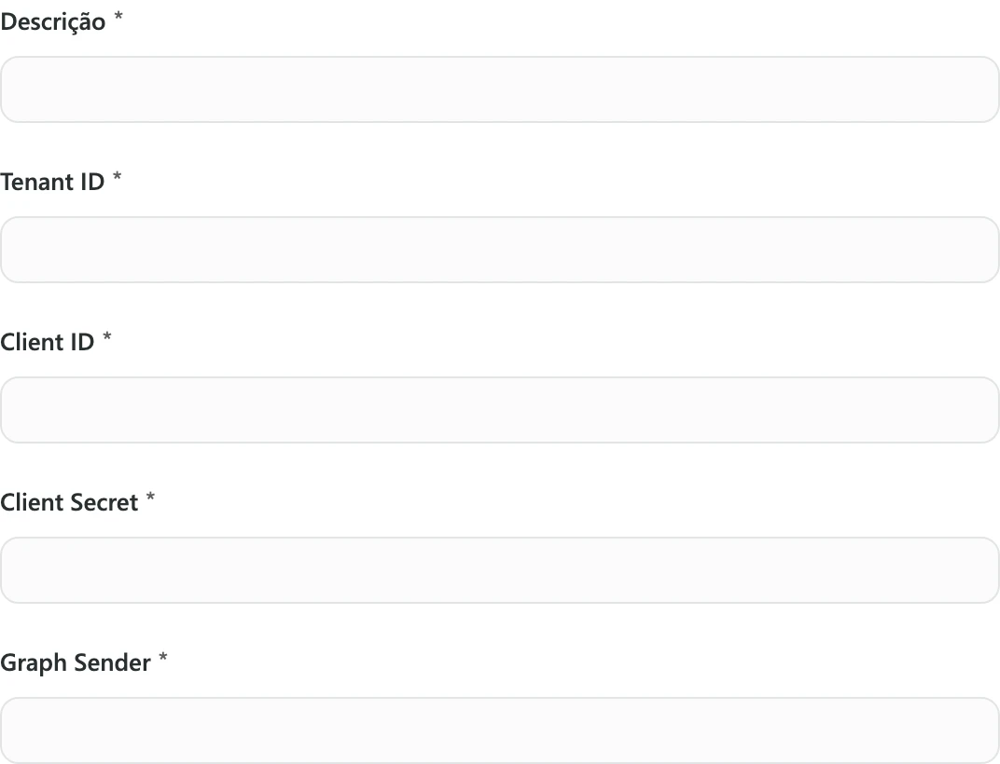

Conecte uma caixa do **Outlook** (Microsoft 365) à Kinbox usando um aplicativo registrado na conta Microsoft da empresa. Essa conexão não usa o login nem a senha pessoal de um membro: a Kinbox lê e envia e-mails da caixa usando os dados desse aplicativo.

<Note>
  Quem pode: o proprietário do workspace e membros com a permissão **Gerenciar Canais** ([Criar papéis e permissões](/docs/configuracoes-no-workspace/configurar-permissoes-dos-usuarios)), sem a restrição **Somente pode dar manutenção simples em canais**, que esconde os botões **Novo canal** e **Excluir**. Se **Novo canal** não aparecer, peça ao proprietário ou a quem administra os canais. Plano: no teste grátis, o limite é de até 3 canais de e-mail ativos (incluindo Outlook); na assinatura paga atual, não há limite de quantidade; contas mais antigas podem ter outros limites ([Canais: conectar e gerenciar](/docs/canais/visao-geral)).
</Note>

## Antes de começar

- Peça a quem administra a conta Microsoft 365 da empresa para registrar um aplicativo e dar a ele permissão para **ler** os e-mails da Caixa de Entrada (e anexos), **marcar como lido** e **enviar** e-mails pela caixa que será conectada.
- Tenha em mãos os quatro dados fornecidos por quem administra a conta Microsoft: **Tenant ID**, **Client ID**, **Client Secret** e **Graph Sender**.
- A mesma caixa (o **Graph Sender**) não pode ser canal de outro workspace.
- Se você não tiver quem administre a conta Microsoft 365 para configurar o aplicativo, veja as alternativas em [Conectar o e-mail por IMAP/SMTP](/docs/canais/e-mail/por-imap), [Conectar o e-mail por encaminhamento](/docs/canais/e-mail/por-encaminhamento) ou [Conectar o e-mail: qual opção escolher](/docs/canais/e-mail/visao-geral).

## Passo a passo

<Steps>
  <Step title="Abra o painel do Outlook">
    Vá em **Configurações** → **Chat** → **Canais** → **Novo canal** → **E-mail** e clique em **Outlook**. O painel **Conectar Outlook** abre à direita.
  </Step>
  <Step title="Preencha os cinco campos obrigatórios">
    Preencha **Descrição**, **Tenant ID**, **Client ID**, **Client Secret** e **Graph Sender** conforme a seção **Campos do formulário**, abaixo. Os rótulos aparecem em inglês na tela.

    <Frame caption="Formulário do Outlook com Descrição, Tenant ID, Client ID, Client Secret e Graph Sender">
      
    </Frame>
  </Step>
  <Step title="Conecte o canal">
    Clique em **Conectar canal**. A Kinbox testa o acesso e a leitura da Caixa de Entrada. Se der certo, aparece "Canal de Outlook criado." e o canal entra na lista de **Canais**, com status **Conectado**. Clique nele para abrir o painel. Se a Microsoft recusar o acesso ou a leitura, aparece um aviso de erro (às vezes em inglês ou sem detalhes).
  </Step>
  <Step title="Faça um teste">
    De outro endereço de e-mail, mande uma mensagem para a caixa conectada e espere até cerca de 2 minutos sem abri-la no Outlook. Confira a conversa chegando na [Caixa de entrada](/docs/conversas/caixa-de-entrada-do-kinbox) e responda pela Kinbox para confirmar o envio.
  </Step>
</Steps>

## Campos do formulário

| Campo | O que é |
| --- | --- |
| **Descrição** | Nome do canal na lista de **Canais**. |
| **Tenant ID** | Identificador do diretório (organização) da conta Microsoft da empresa. |
| **Client ID** | Identificador do aplicativo registrado na conta Microsoft. |
| **Client Secret** | Segredo (senha) do aplicativo registrado. |
| **Graph Sender** | Endereço de e-mail da caixa que será conectada; é por ela que a Kinbox lê e envia e-mails. Também identifica o canal na Kinbox. |

## O que a Kinbox lê e envia

- **Leitura a cada 2 minutos:** a Kinbox lê apenas a **Caixa de Entrada**, somente **e-mails não lidos** e somente os **recebidos hoje**, marcando cada e-mail importado como lido. Um e-mail que ficar sem ler de um dia para o outro não entra mais.
- **Começo do texto e anexos:** a conexão Outlook traz apenas o **começo do texto** de cada e-mail (não o e-mail inteiro) e os anexos de até 10 MB cada; anexos maiores ficam de fora sem aviso.
- **Respostas:** saem pela própria conta do **Graph Sender**, ficam salvas nos itens enviados da conta e enviam arquivos como anexo.
- **Status Conectado:** o selo **Conectado** não garante que os e-mails estão chegando — erros de leitura ou de envio não alteram o status do canal.

<Tip>
  Não abra o e-mail no Outlook antes de ele aparecer na Kinbox. E-mails já lidos fora da Kinbox não entram na **Caixa de entrada**, e a leitura busca apenas e-mails recebidos hoje.
</Tip>

## Depois de conectar

No painel do canal, **Configurações de Encaminhamento** mostra o endereço da caixa conectada (**Graph Sender**); o texto sobre encaminhamento exibido nesse painel não vale para o Outlook.

Pelo painel do canal você só altera a **Descrição** e eventuais [campos personalizados](/docs/configuracoes-no-workspace/campos-personalizados-no-kinbox) de canal. Para trocar o **Client Secret** ou renovar o acesso, vá em **Configurações** → **Chat** → **Canais** → **Novo canal** → **E-mail** → **Outlook** e conecte de novo com o **mesmo Graph Sender**: o mesmo canal é atualizado, mantendo as conversas. No teste grátis com 3 canais de e-mail ativos, conectar de novo esbarra no limite de 3 canais.

## Problemas comuns

- **Aviso de erro ao conectar:** confira **Tenant ID**, **Client ID**, **Client Secret**, **Graph Sender** e se o aplicativo tem permissão para ler, marcar como lido e enviar e-mails na caixa.
- **Os e-mails pararam de chegar ou as respostas ficam com erro:** conecte de novo com os mesmos dados (usando o mesmo **Graph Sender**).
- **O e-mail chegou cortado:** a conexão Outlook traz só o começo do texto de cada e-mail. Para evitar o corte da prévia do Outlook, use [IMAP/SMTP](/docs/canais/e-mail/por-imap) ou [encaminhamento](/docs/canais/e-mail/por-encaminhamento).
- **Anexo grande não chegou:** veja o limite de anexos em "O que a Kinbox lê e envia".

Para mais diagnósticos, veja [Os e-mails não chegam ou não saem](/docs/canais/e-mail/problemas-comuns).
