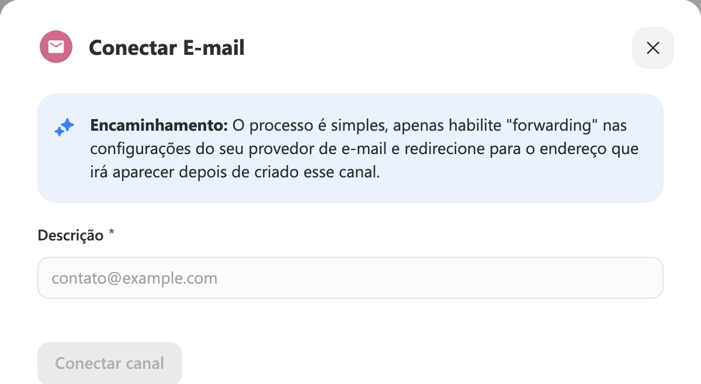

Crie um canal de e-mail **Por encaminhamento** para receber na [Caixa de entrada](/docs/conversas/caixa-de-entrada-do-kinbox) as mensagens enviadas para uma caixa que você já usa, sem informar senha do provedor na Kinbox. A Kinbox gera um endereço exclusivo para o canal e, no seu provedor, você ativa o encaminhamento de todas as mensagens para esse endereço.

<Note>
  Quem pode: o proprietário do workspace e membros com a permissão **Gerenciar Canais** ([Criar papéis e permissões](/docs/configuracoes-no-workspace/configurar-permissoes-dos-usuarios)), sem a restrição **Somente pode dar manutenção simples em canais**, que esconde os botões **Novo canal** e **Excluir**. Se **Novo canal** não aparecer, peça ao proprietário ou a quem administra os canais. Plano: no teste grátis, o limite é de até 3 canais de e-mail ativos; na assinatura paga atual, não há limite de quantidade; contas mais antigas podem ter outros limites ([Canais: conectar e gerenciar](/docs/canais/visao-geral)).
</Note>

## Antes de começar

- Tenha acesso às configurações de encaminhamento (*forwarding*) do seu provedor de e-mail.
- Saiba qual endereço de e-mail será encaminhado para a Kinbox (por exemplo, `contato@example.com`).

## Passo a passo

<Steps>
  <Step title="Abra o painel de encaminhamento">
    Vá em **Configurações** → **Chat** → **Canais** → **Novo canal** → **E-mail** e clique em **Por encaminhamento**. O painel **Conectar E-mail** abre à direita.
  </Step>
  <Step title="Preencha a Descrição com o seu endereço de e-mail">
    Em **Descrição** (obrigatório), digite o endereço de e-mail que você vai encaminhar (por exemplo, `contato@example.com`). O primeiro endereço de e-mail escrito nesse campo vira o endereço de resposta das mensagens enviadas pela Kinbox.

    <Frame caption="Painel Conectar E-mail do encaminhamento com o campo Descrição e o botão Conectar canal">
      
    </Frame>
  </Step>
  <Step title="Crie o canal">
    Clique em **Conectar canal**. A Kinbox mostra "Canal de E-mail criado." e abre o painel do canal, já com status **Conectado**.
  </Step>
  <Step title="Copie o endereço gerado pela Kinbox">
    No painel do canal criado, copie o endereço exibido em **Configurações de Encaminhamento**. O mesmo endereço também aparece embaixo do nome do canal na lista de **Canais** — se não conseguir selecionar o texto no campo do painel, copie o endereço diretamente da lista.
  </Step>
  <Step title="Ative o encaminhamento no seu provedor">
    Abra as configurações do seu provedor de e-mail, procure a opção de encaminhamento (*forwarding*) e ative o encaminhamento de **todas** as mensagens para o endereço gerado pela Kinbox. Se precisar de orientação sobre onde fica essa opção, consulte a ajuda do seu provedor ou quem administra o e-mail da empresa.
  </Step>
  <Step title="Conclua a confirmação, se o provedor pedir">
    Se o seu provedor enviar um e-mail para confirmar o novo endereço de encaminhamento, essa mensagem chega na Kinbox como uma conversa na **Caixa de entrada**. Abra a conversa, pegue o código ou o link e conclua a confirmação no provedor.
  </Step>
  <Step title="Faça um teste">
    De outro endereço de e-mail, envie uma mensagem para a caixa encaminhada e confira a conversa chegando na **Caixa de entrada**. Os e-mails entram assim que o provedor encaminha. Depois, responda pela Kinbox e confirme o recebimento da resposta.
  </Step>
</Steps>

## Como as respostas saem

Quando você responde em um canal **Por encaminhamento**, a mensagem sai de um endereço da Kinbox, com o nome `<domínio do seu e-mail> via Kinbox` (por exemplo, `example.com via Kinbox`). O primeiro endereço de e-mail escrito na **Descrição** aparece como endereço de resposta ("responder para"): quando o contato responde, o e-mail vai para a sua caixa e, com o encaminhamento ligado, volta para a Kinbox. Como o envio sai pela Kinbox, a resposta não passa pelo seu servidor de e-mail nem fica na pasta de enviados do seu provedor.

Se você prefere que as respostas saiam pelo seu próprio servidor e endereço, veja [Conectar o e-mail por IMAP/SMTP](/docs/canais/e-mail/por-imap) (ou compare as opções em [Conectar o e-mail: qual opção escolher](/docs/canais/e-mail/visao-geral)).

## Depois de conectar

- **Editar a Descrição:** clique no canal na lista de **Canais** para mudar a **Descrição** (o que altera o endereço de resposta) e eventuais [campos personalizados](/docs/configuracoes-no-workspace/campos-personalizados-no-kinbox) de canal.
- **Uma caixa por canal:** para atender várias caixas, crie um canal para cada endereço; cada canal recebe um endereço de encaminhamento próprio.
- **Novos e-mails:** entram na Kinbox os e-mails encaminhados depois que o encaminhamento é ativado no provedor.
- **Excluir o canal:** no menu de três pontos da linha do canal, **Excluir** para de receber mensagens pelo endereço gerado sem apagar as conversas. Desligue também o encaminhamento no seu provedor. Se criar o canal novamente depois, a Kinbox gera outro endereço e será preciso atualizar o encaminhamento no provedor.
- **Status Conectado:** o selo **Conectado** não garante que o encaminhamento no provedor continua ativo nem que os e-mails estão chegando.

## Problemas comuns

- **Os e-mails não chegam:** confira se o encaminhamento de todas as mensagens está ligado no provedor para o endereço exato do canal (em **Configurações de Encaminhamento** ou na lista de **Canais**), se a confirmação do provedor foi concluída e se o canal não foi excluído.
- **O contato respondeu e a resposta não voltou para a Kinbox:** confirme que a **Descrição** tem o endereço de e-mail certo e que o encaminhamento continua ativo no provedor.
- **Apareceu "Seu plano atual não permite adicionar o novo canal" ou "Sua assinatura expirou":** no teste grátis, o limite é de 3 canais de e-mail ativos; se a assinatura estiver vencida, regularize antes de criar o canal.

Para mais diagnósticos, veja [Os e-mails não chegam ou não saem](/docs/canais/e-mail/problemas-comuns).
