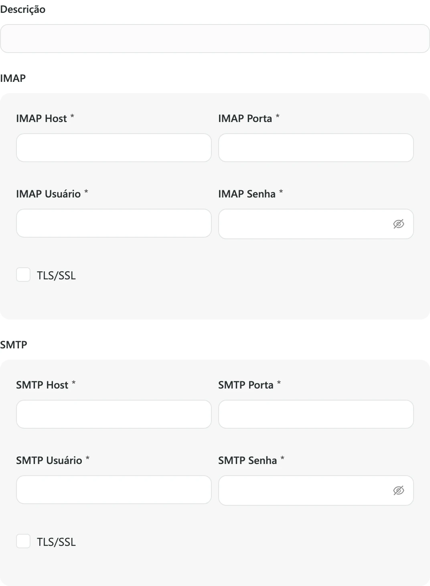

Conecte sua caixa de e-mail por **IMAP/SMTP** para receber mensagens na [Caixa de entrada](/docs/conversas/caixa-de-entrada-do-kinbox) e enviar respostas pelo seu próprio servidor de e-mail. A Kinbox usa o **IMAP** para ler os e-mails novos da caixa e o **SMTP** para enviar as respostas com o seu endereço.

<Note>
  Quem pode: o proprietário do workspace e membros com a permissão **Gerenciar Canais** ([Criar papéis e permissões](/docs/configuracoes-no-workspace/configurar-permissoes-dos-usuarios)), sem a restrição **Somente pode dar manutenção simples em canais**, que esconde os botões **Novo canal** e **Excluir**. Se **Novo canal** não aparecer, peça ao proprietário ou a quem administra os canais. Plano: no teste grátis, o limite é de até 3 canais de e-mail ativos; na assinatura paga atual, não há limite de quantidade; contas mais antigas podem ter outros limites ([Canais: conectar e gerenciar](/docs/canais/visao-geral)).
</Note>

## Antes de começar

- Pegue na ajuda do seu provedor de e-mail (ou com quem administra o e-mail da empresa) o endereço do servidor (host) e a porta do **IMAP** e do **SMTP**, se cada um usa **TLS/SSL**, além do usuário e da senha da caixa.
- Se o seu provedor exigir uma senha específica para aplicativos (senha de app) em vez da senha normal, use essa senha.
- A mesma senha precisa servir para receber (IMAP) e para enviar (SMTP): a Kinbox usa a senha informada em **IMAP Senha** também para enviar.
- Confirme que a mesma caixa não está ativa em outro workspace.

## Passo a passo

<Steps>
  <Step title="Abra o painel de IMAP/SMTP">
    Vá em **Configurações** → **Chat** → **Canais** → **Novo canal** → **E-mail** e clique em **IMAP/SMTP**. O painel **Conectar E-mail** abre à direita.
  </Step>
  <Step title="Preencha a Descrição">
    Em **Descrição**, informe o nome que vai identificar o canal na lista de **Canais**. Preencha esse campo: sem ele o canal não é criado.
  </Step>
  <Step title="Preencha o bloco IMAP">
    Preencha **IMAP Host**, **IMAP Porta** (apenas números), **IMAP Usuário**, **IMAP Senha** e marque **TLS/SSL** conforme informado pelo seu provedor. Em **IMAP Usuário**, informe normalmente o endereço completo da caixa: é ele que identifica o canal na Kinbox.

    <Frame caption="Formulário do IMAP/SMTP com Descrição e os blocos IMAP e SMTP">
      
    </Frame>
  </Step>
  <Step title="Preencha o bloco SMTP">
    Preencha **SMTP Host**, **SMTP Porta** (apenas números), **SMTP Usuário**, **SMTP Senha** e marque **TLS/SSL** conforme informado pelo seu provedor.
  </Step>
  <Step title="Conecte o canal">
    Clique em **Conectar canal**. A Kinbox testa a entrada na caixa pelo IMAP. Se der certo, aparece "Canal de E-mail criado." e o canal abre com status **Conectado**. O **SMTP** não é testado ao conectar.
  </Step>
  <Step title="Faça um teste">
    De outro endereço de e-mail, envie uma mensagem para a caixa conectada e espere até cerca de 2 minutos sem abrir o e-mail no seu programa de e-mail. Confira a conversa na **Caixa de entrada**, responda pela Kinbox e confirme que a resposta chegou ao destinatário.
  </Step>
</Steps>

## Campos do formulário

| Campo | O que preencher |
| --- | --- |
| **Descrição** | Nome do canal na lista de **Canais**. Sem ela, o canal não é criado. |
| **IMAP Host** | Endereço do servidor IMAP informado pelo seu provedor. |
| **IMAP Porta** | Número da porta IMAP informada pelo seu provedor. |
| **IMAP Usuário** | Usuário de entrada no IMAP (em geral o endereço completo da caixa). Identifica o canal na Kinbox. |
| **IMAP Senha** | Senha da caixa (ou senha de app, se o provedor exigir). A Kinbox usa essa senha também para enviar. |
| **TLS/SSL** (IMAP) | Marque conforme orientado pelo seu provedor para o servidor IMAP. |
| **SMTP Host** | Endereço do servidor SMTP informado pelo seu provedor. |
| **SMTP Porta** | Número da porta SMTP informada pelo seu provedor. |
| **SMTP Usuário** | Usuário de envio no SMTP informado pelo seu provedor. |
| **SMTP Senha** | Campo obrigatório do formulário (para enviar, a Kinbox usa a senha de **IMAP Senha**). |
| **TLS/SSL** (SMTP) | Marque conforme orientado pelo seu provedor para o servidor SMTP. |

## Como a Kinbox lê a sua caixa

- A Kinbox confere a caixa **a cada 2 minutos**.
- Lê apenas a **pasta de entrada (INBOX)**; mensagens em spam ou outras pastas não entram.
- Lê somente **e-mails não lidos** recebidos a partir do **dia** em que o canal foi conectado (ou conectado de novo).
- Depois de importar cada mensagem, a Kinbox **marca o e-mail como lido** na caixa e não lê o mesmo e-mail novamente.
- O selo **Conectado** não garante que a leitura continua funcionando: se a senha mudar ou o provedor recusar o acesso, a leitura para sem mudar o status do canal.

<Tip>
  Não abra o e-mail em outro programa (webmail, celular ou cliente de e-mail) antes de ele aparecer na Kinbox. Se o e-mail ficar marcado como lido fora da Kinbox, ele não entra na **Caixa de entrada**.
</Tip>

## Como as respostas saem

As respostas saem pelo seu servidor **SMTP**, com o seu endereço como remetente, em texto simples (arquivos enviados pela Kinbox vão como link no corpo do e-mail). A Kinbox não grava cópia da resposta na pasta de enviados pela conexão IMAP.

A Kinbox usa a senha informada em **IMAP Senha** também para enviar. Se o seu provedor usa senhas diferentes para receber e para enviar, as respostas ficam com erro.

## Trocar a senha ou os dados

Ao abrir o canal na lista de **Canais**, os blocos **IMAP** e **SMTP** aparecem apenas para leitura (sem a senha) — pelo painel do canal você só edita a **Descrição** e eventuais [campos personalizados](/docs/configuracoes-no-workspace/campos-personalizados-no-kinbox) de canal.

Para trocar a senha ou qualquer dado da conexão, vá em **Configurações** → **Chat** → **Canais** → **Novo canal** → **E-mail** → **IMAP/SMTP** e conecte de novo usando o **mesmo IMAP Usuário**: a Kinbox atualiza o mesmo canal, mantendo as conversas, e a leitura passa a contar a partir do dia da nova conexão. No teste grátis com 3 canais de e-mail ativos, conectar de novo esbarra no limite de 3 canais.

## Problemas comuns

- **Apareceu "Erro ao testar conexão com o IMAP/SMTP. Verifique os dados da conexão e tente novamente.":** confira **IMAP Host**, **IMAP Porta**, **IMAP Usuário**, **IMAP Senha** e **TLS/SSL**; se o provedor exigir senha de app, use essa senha.
- **O e-mail não aparece na Kinbox:** espere a leitura (a cada 2 minutos) e veja se o e-mail não foi aberto antes em outro programa nem caiu em spam ou outra pasta.
- **A resposta ficou com erro:** o SMTP não é testado ao conectar; confira os dados do bloco **SMTP** e se a senha informada em **IMAP Senha** também serve para enviar.
- **Trocou a senha do e-mail:** conecte de novo com o mesmo **IMAP Usuário** e a senha nova.

Para mais diagnósticos, veja [Os e-mails não chegam ou não saem](/docs/canais/e-mail/problemas-comuns). Para comparar com encaminhamento e Outlook, veja [Conectar o e-mail: qual opção escolher](/docs/canais/e-mail/visao-geral).
