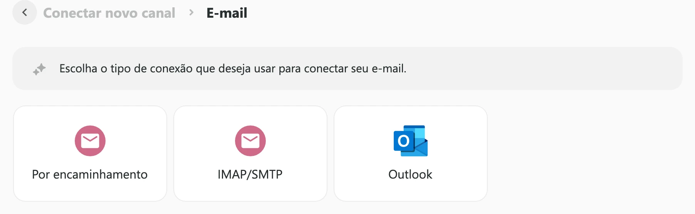

Um canal de e-mail traz para a [Caixa de entrada](/docs/conversas/caixa-de-entrada-do-kinbox) da Kinbox os e-mails enviados para uma caixa que a sua equipe já usa (por exemplo, `contato@example.com`), para que os membros leiam e respondam por lá.

Para escolher o tipo de conexão, vá em **Configurações** → **Chat** → **Canais** → **Novo canal** e clique em **E-mail**.

<Note>
  Quem pode: o proprietário do workspace e membros com a permissão **Gerenciar Canais** ([Criar papéis e permissões](/docs/configuracoes-no-workspace/configurar-permissoes-dos-usuarios)), sem a restrição **Somente pode dar manutenção simples em canais**, que esconde os botões **Novo canal** e **Excluir**. Se **Novo canal** não aparecer, peça ao proprietário ou a quem administra os canais.
</Note>

<Frame caption="Tela para escolher o tipo de conexão do canal de e-mail">
  
</Frame>

## As três formas

| | [**Por encaminhamento**](/docs/canais/e-mail/por-encaminhamento) | [**IMAP/SMTP**](/docs/canais/e-mail/por-imap) | [**Outlook**](/docs/canais/e-mail/outlook) |
| --- | --- | --- | --- |
| **Como o e-mail chega** | Você liga, no seu provedor, o encaminhamento de todas as mensagens para um endereço gerado pela Kinbox. O e-mail entra assim que o provedor encaminha. | A Kinbox entra na sua caixa (com host, porta, usuário e senha) e lê os e-mails novos **a cada 2 minutos**. | A Kinbox lê a Caixa de Entrada da conta Microsoft 365 **a cada 2 minutos**, usando um aplicativo registrado na conta Microsoft da empresa. |
| **De onde sai a resposta** | De um endereço da Kinbox, com o nome `<domínio do seu e-mail> via Kinbox`; o seu e-mail aparece como endereço de resposta. | Do seu próprio servidor de e-mail (SMTP), com o seu endereço. | Da própria conta do Outlook; a resposta fica nos itens enviados. |
| **O que você precisa** | Acesso às configurações de encaminhamento do seu provedor de e-mail. | Os dados de IMAP e SMTP do seu provedor de e-mail. | Quem administre a conta Microsoft 365 da empresa para registrar o aplicativo e passar os dados. |
| **Limites a saber** | Recebe apenas o que o provedor encaminha depois que o encaminhamento é ligado. | Lê só a pasta de entrada e só e-mails não lidos a partir do dia da conexão; a Kinbox marca cada e-mail como lido. | Lê só a Caixa de Entrada, só não lidos recebidos no mesmo dia e marca como lido; traz só o começo do texto de cada e-mail. |

## Como escolher

- **Por encaminhamento:** escolha se você quer receber e responder sem informar senha de e-mail na Kinbox e pode ativar o encaminhamento no seu provedor. As respostas saem por um endereço da Kinbox.
- **IMAP/SMTP:** escolha se você quer que as respostas saiam pelo seu próprio servidor de e-mail e com o seu endereço.
- **Outlook:** escolha se a empresa usa Microsoft 365 / Outlook e tem alguém que administre a conta Microsoft para registrar o aplicativo. Sem isso, **IMAP/SMTP** ou **Por encaminhamento** também podem ser usados em provedores que ofereçam esses recursos.

## O que vale para as três

- **Uma caixa por canal e limite do plano:** você pode conectar várias caixas criando um canal para cada uma. No teste grátis, o limite é de até 3 canais de e-mail ativos; na assinatura paga atual, não há limite de quantidade; contas mais antigas podem ter outros limites. Veja [Canais: conectar e gerenciar](/docs/canais/visao-geral) e [Assinar ou mudar o plano](/docs/assinatura/assinar-ou-mudar-plano).
- **Mesma caixa em dois workspaces:** o mesmo endereço de e-mail não pode ficar ativo em dois workspaces ao mesmo tempo.
- **Como o e-mail aparece na conversa:** cada e-mail recebido vira mensagem na conversa do contato naquele canal, e o contato é identificado pelo endereço do remetente. Na conversa, o balão mostra **Para:**, **De:** e **Assunto:**.
- **Iniciar uma conversa por e-mail:** você também pode mandar a primeira mensagem para um contato por e-mail pela Kinbox; veja [Iniciar uma conversa com um contato](/docs/conversas/iniciar-conversa).
- **Respostas e arquivos:** por encaminhamento e IMAP/SMTP, as respostas saem em texto simples e arquivos enviados vão como link; no Outlook, o arquivo vai como anexo.

<CardGroup cols={2}>
  <Card title="Conectar o e-mail por encaminhamento" href="/docs/canais/e-mail/por-encaminhamento">
    Crie o canal, pegue o endereço gerado pela Kinbox e ative o encaminhamento no seu provedor.
  </Card>
  <Card title="Conectar o e-mail por IMAP/SMTP" href="/docs/canais/e-mail/por-imap">
    Informe host, porta, usuário e senha para ler a caixa e responder pelo seu servidor.
  </Card>
  <Card title="Conectar o Outlook (Microsoft 365)" href="/docs/canais/e-mail/outlook">
    Configure a conexão com os dados de um aplicativo registrado na conta Microsoft da empresa.
  </Card>
  <Card title="Os e-mails não chegam ou não saem" href="/docs/canais/e-mail/problemas-comuns">
    Diagnóstico para erros ao conectar, e-mails que não entram, respostas com erro e troca de senha.
  </Card>
</CardGroup>
