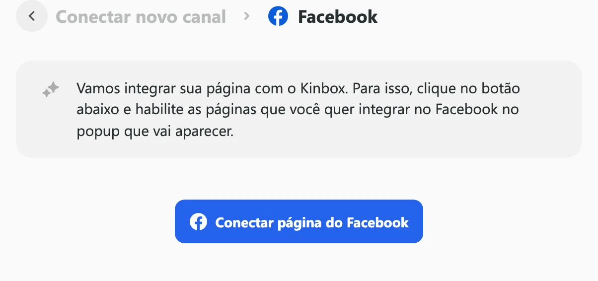

O canal de Facebook traz para a [Caixa de entrada](/docs/conversas/caixa-de-entrada-do-kinbox) as mensagens que as pessoas mandam para uma página do Facebook pelo Messenger. A conexão é feita numa janela da Meta. Comentários nos posts da página não entram na Kinbox.

<Note>Quem pode: o proprietário do workspace e membros com a permissão **Gerenciar Canais** ([Referência de permissões](/docs/administracao/referencia-de-permissoes)). Plano: o Facebook não usa unidade do plano pago; no teste grátis, dá para conectar uma página do Facebook por workspace.</Note>

## Antes de começar

- Use na janela da Meta uma conta do Facebook com acesso à página que você quer conectar. A lista mostra as páginas liberadas por essa conta.
- Libere pop-ups do navegador para a Kinbox, porque a conexão abre uma janela da Meta.

## Passo a passo

<Steps>
  <Step title="Abra a tela do Facebook">
    Vá em **Configurações** → **Chat** → **Canais** → **Novo canal** e clique em **Facebook**.
  </Step>
  <Step title="Clique em Conectar página do Facebook">
    Clique no botão **Conectar página do Facebook** para abrir a janela da Meta.

    <Frame caption="Tela para conectar o Facebook com o botão Conectar página do Facebook">
      
    </Frame>
  </Step>
  <Step title="Libere a página na janela da Meta">
    Na janela da Meta, entre com o Facebook e libere a página que você quer conectar.

    As telas e exigências dessa janela são da Meta e podem mudar.
  </Step>
  <Step title="Escolha a página na Kinbox">
    De volta à Kinbox, em "Selecione a página que você deseja conectar abaixo", clique no cartão da página do Facebook. A conexão acontece na hora.
  </Step>
  <Step title="Confirme a conexão">
    A Kinbox mostra "Conectado ao canal de Facebook" com o nome da página e volta para a lista de **Canais**.
  </Step>
</Steps>

## Depois de conectar

- Na lista de **Canais**, o canal aparece com o nome da página, "Página do Facebook" logo abaixo e o selo verde **Conectado**.
- Faça um teste: mande uma mensagem para a página pelo Messenger a partir de outra conta e confira a conversa chegando na **Caixa de entrada**.
- Não dá para iniciar uma conversa nova pelo Messenger na Kinbox: a conversa começa quando o contato escreve (veja [Iniciar uma conversa com um contato](/docs/conversas/iniciar-conversa)).
- A Kinbox não mostra contador nem bloqueia o campo de resposta. Quem aceita ou recusa a mensagem é a Meta.

## Problemas comuns

- **A página não aparece ou surgiu "Não encontramos nenhuma página com as permissões necessárias.":** a conta do Facebook usada não liberou a página na janela da Meta.
- **A página aparece desativada e não dá para clicar:** ela já é um canal ativo deste workspace, mesmo que esteja **Desconectado**.
- **Apareceu "Esse canal já está ativado em outro ambiente":** a página já está conectada como canal ativo em outro workspace.
- **Apareceu "Seu plano atual não permite adicionar o novo canal":** no teste grátis, o workspace já tem uma página do Facebook conectada.
- **O canal ficou Desconectado:** não existe botão de reconectar. Siga o passo a passo de reconexão em **O canal está Desconectado**, na página de problemas comuns.

<CardGroup cols={2}>
  <Card title="Configurações do Instagram e do Facebook" href="/docs/canais/instagram/configuracoes">
    Cada campo do painel do canal, as opções de stories e as ações da lista de canais.
  </Card>
  <Card title="O Instagram ou o Facebook não conecta ou desconectou" href="/docs/canais/instagram/problemas-comuns">
    Páginas que não aparecem, erros de plano, reconexão e mensagens com erro.
  </Card>
</CardGroup>
