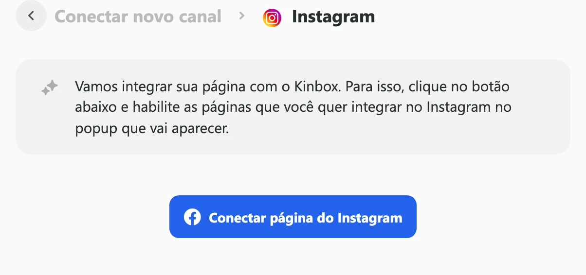

O canal de Instagram traz as mensagens do Direct de uma conta profissional do Instagram para a [Caixa de entrada](/docs/conversas/caixa-de-entrada-do-kinbox). A conexão é feita pela página do Facebook vinculada à conta, numa janela da Meta. Para atender as mensagens de uma página do Facebook pelo Messenger, veja [Conectar o Facebook Messenger](/docs/canais/facebook/conectar).

<Note>Quem pode: o proprietário do workspace e membros com a permissão **Gerenciar Canais** ([Referência de permissões](/docs/administracao/referencia-de-permissoes)). Plano: é preciso ter uma unidade livre de **Instagram Direct**, e o Instagram não pode ser conectado no teste grátis ([Assinar ou mudar o plano](/docs/assinatura/assinar-ou-mudar-plano)).</Note>

## Antes de começar

- Tenha uma conta do Instagram profissional vinculada a uma página do Facebook. Só as páginas com conta profissional vinculada aparecem na lista da Kinbox.
- Use na janela da Meta uma conta do Facebook com acesso a essa página. A lista mostra as páginas que essa conta liberar.
- Libere pop-ups do navegador para a Kinbox, porque a conexão abre uma janela da Meta.

## Passo a passo

<Steps>
  <Step title="Abra a tela do Instagram">
    Vá em **Configurações** → **Chat** → **Canais** → **Novo canal** e clique em **Instagram**.
  </Step>
  <Step title="Clique em Conectar página do Instagram">
    Clique no botão **Conectar página do Instagram** para abrir a janela da Meta. O botão fala em "página" porque a conexão é feita pela página do Facebook ligada à conta do Instagram.

    <Frame caption="Tela para conectar o Instagram com o botão Conectar página do Instagram">
      
    </Frame>
  </Step>
  <Step title="Libere a página na janela da Meta">
    Na janela da Meta, entre com o Facebook e libere a página ligada à conta do Instagram.

    As telas e exigências dessa janela são da Meta e podem mudar.
  </Step>
  <Step title="Escolha a conta na Kinbox">
    De volta à Kinbox, em "Selecione a página que você deseja conectar abaixo", clique no cartão da conta do Instagram (com o `@usuário` e a foto do perfil). A conexão acontece na hora.
  </Step>
  <Step title="Confirme a conexão">
    A Kinbox mostra "Conectado ao canal de Instagram" com o nome da conta e volta para a lista de **Canais**.
  </Step>
</Steps>

## Depois de conectar

- Na lista de **Canais**, o canal aparece com o `@usuário`, "Instagram Direct" logo abaixo e o selo verde **Conectado**.
- Faça um teste: mande uma mensagem no Direct a partir de outra conta do Instagram e confira a conversa chegando na **Caixa de entrada**.
- Não dá para iniciar uma conversa nova pelo Instagram na Kinbox: a conversa começa quando o contato escreve (veja [Iniciar uma conversa com um contato](/docs/conversas/iniciar-conversa)).
- A Kinbox não mostra contador nem bloqueia o campo de resposta. Quem aceita ou recusa a mensagem é a Meta.

## O que entra na Kinbox

- **Mensagens do Direct:** textos, fotos, vídeos e áudios viram conversa na **Caixa de entrada**.
- **Respostas aos seus stories:** entram com o story junto da mensagem.
- **Menções em stories:** entram como "Você foi mencionado em um Story".
- **Comentários:** não entram. Comentários em posts, reels e anúncios não viram conversa na Kinbox.

Para não criar conversa com respostas ou menções em stories, use **Ignorar resposta de story** e **Ignorar menções**, opções que só o canal de Instagram tem. Elas valem para o que chegar depois de ligadas.

## Problemas comuns

- **Apareceu "Não encontramos nenhuma página com as permissões necessárias.":** a conta do Facebook usada não liberou nenhuma página, ou nenhuma das páginas liberadas tem conta do Instagram profissional vinculada.
- **Erro de teste grátis ou de limite do plano:** no teste grátis aparece "Você não pode adicionar canais de Instagram em plano trial". Sem unidade livre de **Instagram Direct**, aparece "Você precisa remover canais de Instagram para prosseguir com a contratação".
- **O canal ficou Desconectado:** não existe botão de reconectar. Siga o passo a passo de reconexão em **O canal está Desconectado**, na página de problemas comuns.

<CardGroup cols={2}>
  <Card title="Configurações do Instagram e do Facebook" href="/docs/canais/instagram/configuracoes">
    Cada campo do painel do canal, as opções de stories e as ações da lista de canais.
  </Card>
  <Card title="O Instagram ou o Facebook não conecta ou desconectou" href="/docs/canais/instagram/problemas-comuns">
    Páginas que não aparecem, erros de plano, reconexão e mensagens com erro.
  </Card>
</CardGroup>
