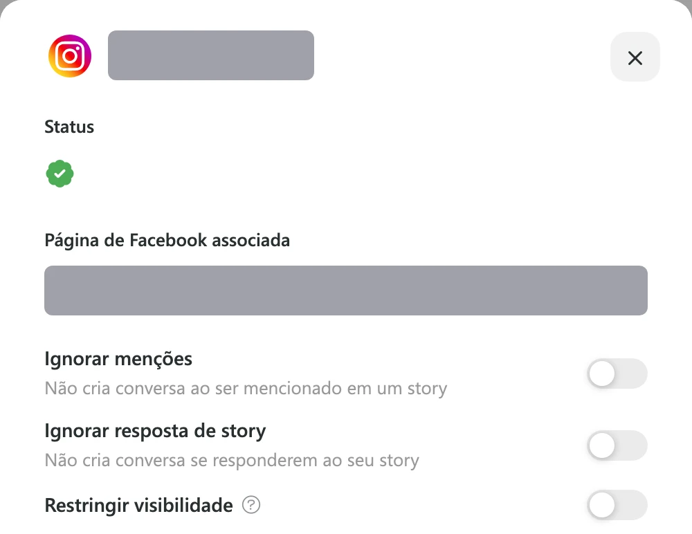
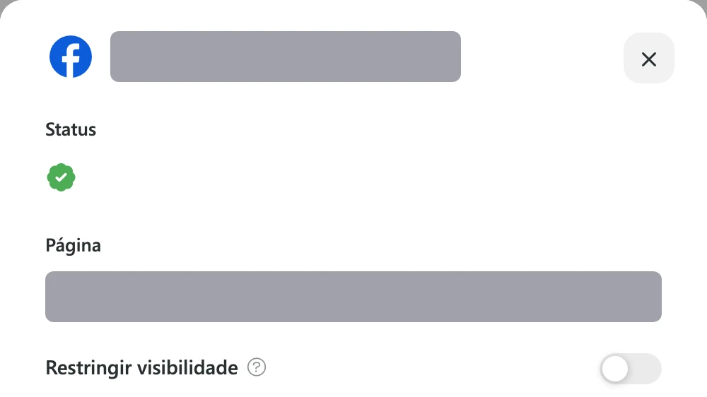

Abra **Configurações** → **Chat** → **Canais** e clique no canal (ou escolha **Editar** no menu de três pontos) para abrir o painel lateral.

Quando você altera uma opção, o botão **Salvar** aparece no rodapé do painel. Ao clicar em **Salvar**, a Kinbox mostra "Canal atualizado." e volta para a lista.

Para conectar um canal, veja [Conectar o Instagram](/docs/canais/instagram) ou [Conectar o Facebook Messenger](/docs/canais/facebook/conectar).

## Instagram

<Frame caption="Painel de configurações de um canal de Instagram">
  
</Frame>

| Campo | O que faz |
| --- | --- |
| **Status** | Mostra o selo do canal (verde = **Conectado**). Se aparecer **Desconectado**, veja [O Instagram ou o Facebook não conecta ou desconectou](/docs/canais/instagram/problemas-comuns). |
| **Página de Facebook associada** | Somente leitura. Exibe o nome do canal — nos canais conectados hoje é o `@usuário` do Instagram (canais antigos podem mostrar o nome da página). |
| **Ignorar menções** | "Não cria conversa ao ser mencionado em um story". Quando ligado, menções da conta em stories de outras pessoas são descartadas sem aviso e não viram conversa. |
| **Ignorar resposta de story** | "Não cria conversa se responderem ao seu story". Quando ligado, respostas aos seus stories são descartadas sem aviso e não viram conversa. |
| **Restringir visibilidade** | Escolhe os grupos de membros da Kinbox que podem ver o canal. |
| Campos personalizados de canal | Aparecem no fim do painel quando o workspace tem campos personalizados de canal cadastrados. |

As opções **Ignorar menções** e **Ignorar resposta de story** existem só no Instagram e vêm desligadas. Para ligar, ative a opção e clique em **Salvar**. Elas valem apenas para o que chegar depois (o que foi descartado não volta). Cada opção afeta só o seu tipo, e uma mensagem normal no Direct sempre entra.

## Facebook

<Frame caption="Painel de configurações de um canal de Facebook">
  
</Frame>

| Campo | O que faz |
| --- | --- |
| **Status** | Mostra o selo do canal (verde = **Conectado**). Se aparecer **Desconectado**, veja [O Instagram ou o Facebook não conecta ou desconectou](/docs/canais/instagram/problemas-comuns). |
| **Página** | Mostra o nome da página do Facebook, somente leitura. |
| **Restringir visibilidade** | Escolhe os grupos de membros da Kinbox que podem ver o canal. |
| Campos personalizados de canal | Aparecem no fim do painel quando o workspace tem campos personalizados de canal cadastrados. |

O canal de Facebook não tem opções de stories nem de menções.

## Ações na lista de canais

No menu de três pontos do canal em **Configurações** → **Chat** → **Canais**:

| Ação | O que faz |
| --- | --- |
| **Editar** | Abre o painel lateral de configurações do canal. |
| **Copiar ID** | Copia o ID do canal e mostra "ID do canal (...) copiado para clipboard.". |
| **Excluir** | Pede confirmação ("Tem certeza que deseja excluir esse canal?"), tira o canal da lista e mantém as conversas guardadas. Se você conectar a mesma página de novo, o canal volta com as conversas, mas a lista de grupos de **Restringir visibilidade** volta vazia. |

As ações **Desconectar**, **Reiniciar**, **Recriar**, **Migrar conversas** e um botão de reconectar não existem nos canais de Instagram e de Facebook. Para reconectar um canal desconectado, veja [O Instagram ou o Facebook não conecta ou desconectou](/docs/canais/instagram/problemas-comuns).

## Quem pode

Gerenciar canais exige a permissão **Gerenciar Canais** ou ser o proprietário do workspace (veja [Referência de permissões](/docs/administracao/referencia-de-permissoes)). Com a restrição **Somente pode dar manutenção simples em canais**, não aparecem **Novo canal** nem **Excluir**.

## O que não dá para configurar aqui

- **Nome, foto e dados da conta do Instagram ou da página do Facebook:** são alterados na Meta; a Kinbox só exibe essas informações em modo somente leitura.
- **Comentários:** comentários em posts, reels e anúncios do Instagram ou da página do Facebook não entram na Kinbox.
- **Mensagens automáticas de boas-vindas e perguntas frequentes do Instagram:** não existem neste painel.
