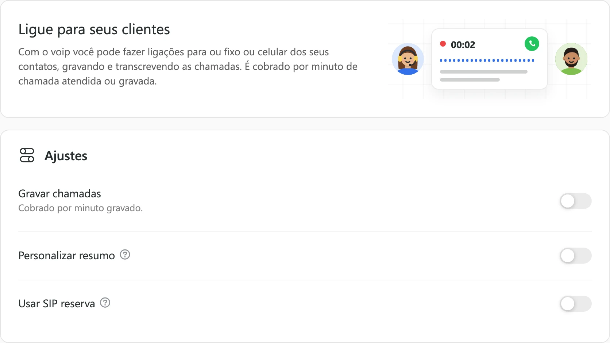

Os ajustes das ligações por telefone (VoIP) ficam em **Configurações** → **Chat** → **Voip** e valem para o **workspace inteiro** (todos os membros que fazem ligações VoIP).

<Note>
Quem pode: proprietário do workspace ou membro com a permissão **Gerenciar Canais** ([Referência de permissões](/docs/administracao/referencia-de-permissoes)). Sem essa permissão, o item **Voip** não aparece no menu.
</Note>

<Frame caption="Cartão Ajustes da tela Voip. A descrição de Gravar chamadas está oculta.">
  
</Frame>

## Opções

| Opção | O que aparece e o que faz | Padrão |
| --- | --- | --- |
| **Gravar chamadas** | Grava as ligações VoIP feitas depois de ativar a opção. A gravação fica na mensagem **Ligação de voz** da conversa e em **Relatórios** → [**Ligações**](/docs/relatorios/ligacoes) (para quem tem a permissão **Gerenciar relatórios**). | Desligado |
| **Personalizar resumo** | Opção para escrever instruções para o resumo das ligações transcritas. Ligada, mostra o campo **Instruções para a IA** (até 10.000 caracteres). A dica da tela lembra que depende da gravação ligada. | Desligado |
| **Usar SIP reserva** | Enquanto estiver ligada, todas as ligações VoIP do workspace saem pela rota reserva, sem gravação. Ligue só quando o VoIP estiver fora do ar e desligue depois. | Desligado |

Ao alterar qualquer opção, aparecem os botões **Cancelar** e **Salvar mudanças**. Ao salvar, a tela mostra "Configurações de Voip salvas". Se você tentar sair com alterações pendentes, a Kinbox pergunta "Você tem mudanças não salvas, tem certeza que deseja sair?".

## Gravação, transcrição e resumo

- A transcrição no VoIP **não** é automática. Em uma ligação gravada, clique na mensagem **Ligação de voz** na conversa e clique em **Transcrever**.
- Depois de transcrever, o painel **Ligação de voz** exibe o player com **Baixar áudio**, a **Transcrição** (falas separadas por pessoa com horário; clicar numa fala leva o áudio até aquele momento) e o **Resumo** com o sentimento (**Positivo**, **Negativo** ou **Neutro**).
- A ligação atendida, a transcrição e o resumo gastam [saldo da carteira](/docs/conceitos/saldo-e-creditos) (veja [Adicionar saldo e créditos de SMS](/docs/assinatura/adicionar-saldo)).
- Quando não há gravação, o painel mostra "Não há gravação disponível" e "Verifique se a gravação está habilitada no canal de voip." (a opção é **Gravar chamadas**, nesta tela).
- Quem tem a permissão **Gerenciar relatórios** também encontra as gravações em **Relatórios** → **Ligações**, com as opções **Baixar** e **Ver**.

## O que não fica aqui

- **Ligações pelo WhatsApp:** são configuradas na aba **Ligações** de cada canal oficial — veja [Fazer e receber ligações pelo WhatsApp oficial (Beta)](/docs/canais/whatsapp/whatsapp-cloud-api/ligacoes-pelo-whatsapp).
- **Permissão para ligar por VoIP:** é ativada no papel de cada membro em **Pode ligar para o contato** — veja [Referência de permissões](/docs/administracao/referencia-de-permissoes) e [Ligar para um contato por telefone (VoIP)](/docs/canais/ligacoes/ligar-por-telefone).
- **Número de saída, ramais, identificação de quem liga e horários:** não existem nesta tela. O VoIP também não recebe ligações — veja [Ligações na Kinbox: WhatsApp oficial e telefone](/docs/canais/ligacoes/visao-geral). Se algo falhar nas ligações, veja [Não consigo ligar ou a ligação caiu](/docs/canais/ligacoes/problemas-comuns).
