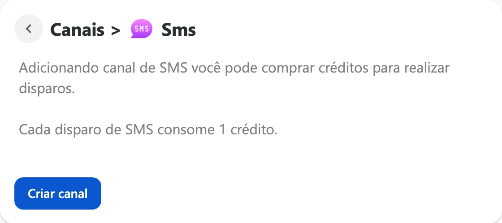
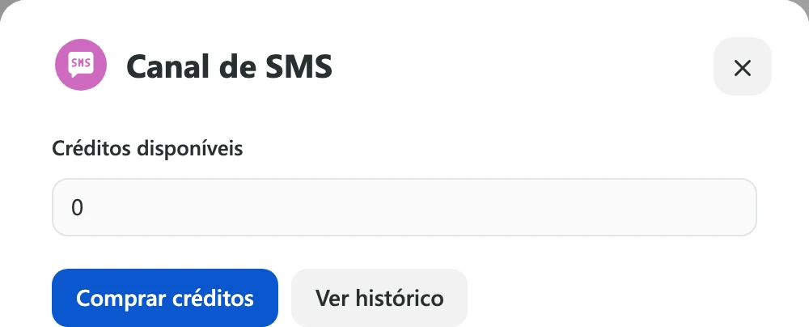
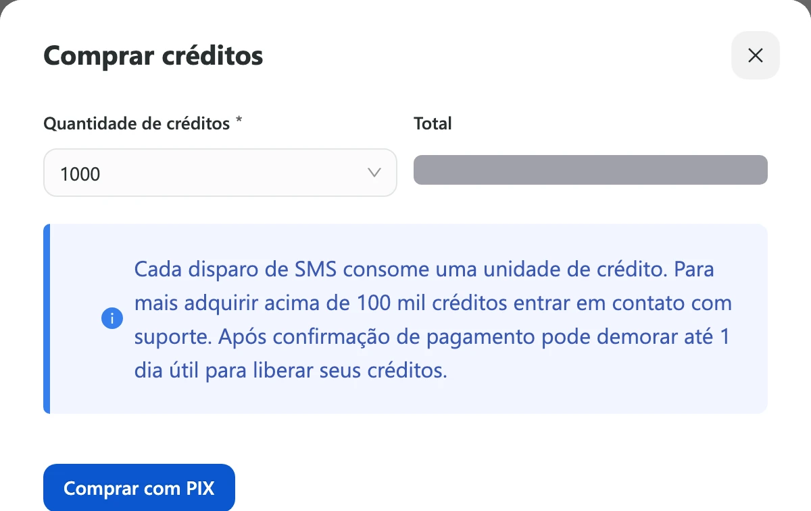

O canal de SMS envia mensagens de texto para o celular do contato, pela conversa e por campanha, e recebe as respostas dele na [Caixa de entrada](/docs/conversas/caixa-de-entrada-do-kinbox). Cada SMS enviado gasta 1 crédito de SMS (**Créditos de SMS**), que é separado do [saldo da carteira](/docs/conceitos/saldo-e-creditos) em reais. O SMS é independente e não usa o seu número de WhatsApp.

<Note>
  **Quem pode:** o proprietário do workspace e membros com a permissão **Gerenciar Canais** ([Criar papéis e permissões](/docs/configuracoes-no-workspace/configurar-permissoes-dos-usuarios)). A restrição **Somente pode dar manutenção simples em canais** esconde **Novo canal** e **Excluir** (o membro não cria nem exclui o canal). Cada workspace pode ter apenas **1 canal de SMS**.
</Note>

## Criar o canal

Não é preciso ter créditos de SMS para criar o canal.

<Steps>
  <Step title="Abra a tela de canais">
    Vá em **Configurações** → **Chat** → **Canais** e clique em **Novo canal**.

    Se **Novo canal** não aparecer, peça ao proprietário do workspace para verificar se você tem a permissão **Gerenciar Canais** e está sem a restrição **Somente pode dar manutenção simples em canais**.
  </Step>
  <Step title="Escolha SMS">
    Na tela **Conectar novo canal**, clique no cartão **SMS**.

    Se o cartão **SMS** estiver desativado, o workspace já tem um canal de SMS: volte e abra o canal na lista.
  </Step>
  <Step title="Crie o canal">
    Na tela do SMS, clique em **Criar canal**. Não há campos para preencher.

    <Frame caption="Tela para criar o canal de SMS com o botão Criar canal">
      
    </Frame>

    Quando aparecer "Canal de SMS criado.", a Kinbox volta para a lista com o canal **SMS** **Conectado** e a quantidade de créditos abaixo.
  </Step>
</Steps>

## Comprar créditos de SMS

<Steps>
  <Step title="Abra o canal de SMS">
    Em **Configurações** → **Chat** → **Canais**, clique na linha **SMS** para abrir o painel **Canal de SMS**. Ele mostra **Créditos disponíveis**, o botão **Ver histórico** e, se aparecer, o botão **Comprar créditos**.

    <Frame caption="Painel Canal de SMS com os créditos disponíveis e os botões de compra e histórico">
      
    </Frame>
  </Step>
  <Step title="Escolha o pacote">
    Clique em **Comprar créditos**. Se o botão **Comprar créditos** não aparecer, fale com quem gerencia o seu plano (ou, se a opção estiver disponível para você, compre pela **Assinatura**).

    No painel **Comprar créditos**, selecione o pacote em **Quantidade de créditos** e confira o **Total**.

    <Frame caption="Painel Comprar créditos com o pacote de 1000 créditos selecionado">
      
    </Frame>
  </Step>
  <Step title="Pague com Pix">
    Clique em **Comprar com PIX** e leia o QR Code no app do seu banco. Com o painel aberto, a Kinbox confere o pagamento automaticamente e mostra **Pago** sobre o QR Code quando ele é confirmado.
  </Step>
</Steps>

A lista vai até 1 milhão, mas o aviso do painel pede falar com o suporte em compras acima de 100 mil. Depois da confirmação do pagamento, os créditos podem levar até **1 dia útil** para liberar.

Em **Ver histórico**, você confere as compras e reabre o Pix de uma compra.

Quem tem a permissão **Assinatura** também pode comprar os mesmos créditos de SMS pela **Carteira**, dentro de **Assinatura**: veja [Adicionar saldo e créditos de SMS](/docs/assinatura/adicionar-saldo). O plano também pode incluir créditos de SMS mensais: veja [Assinar ou mudar o plano](/docs/assinatura/assinar-ou-mudar-plano).

## Enviar SMS

- **Para um contato:** enviar a primeira mensagem por SMS exige a permissão **Iniciar chat ativo** (ou ser proprietário). Se o contato tiver telefone, clique no botão com o ícone de SMS no painel do contato dentro da conversa (ao passar o mouse, aparece a dica **Enviar SMS**), ou abra a janela **Enviar mensagem** na **Caixa de entrada** e escolha o canal de SMS ([Iniciar uma conversa com um contato](/docs/conversas/iniciar-conversa)).
- **Editor e contador:** no SMS, o editor aceita apenas texto (sem **Anexar** e sem gravar áudio). O contador mostra o tamanho da mensagem e o limite muda conforme os caracteres usados; o número fica vermelho ao passar do limite. Na conversa, a Kinbox não corta nem bloqueia o envio, mas prefira textos curtos.
- **Consumo e respostas:** cada SMS enviado gasta 1 crédito de SMS, descontado antes do envio. Sem créditos, a mensagem não sai. As respostas do contato chegam na mesma conversa de SMS na **Caixa de entrada**.
- **Campanhas por SMS:** para enviar para uma lista de contatos (até 160 caracteres, sem emoji e sem anexo, gastando 1 crédito por mensagem), veja [Criar uma campanha por SMS](/docs/campanhas/campanha-de-sms).

## Excluir o canal

No menu de três pontos da linha **SMS** ficam **Copiar ID** e, se aparecer, **Excluir** (ele não aparece para quem tem a restrição **Somente pode dar manutenção simples em canais**). **Excluir** desliga o canal; as conversas não são apagadas.

## Problemas comuns

- **A mensagem fica com erro ("Sem créditos disponíveis"):** o workspace não tem **Créditos de SMS** disponíveis. Compre créditos pelo painel **Canal de SMS** ou pela **Assinatura** e tente novamente.
- **"Você precisa configurar um canal de SMS para enviar mensagens.":** o workspace ainda não tem um canal de SMS ativo. Crie o canal seguindo os passos de **Criar o canal**.
- **O cartão SMS está desativado em Conectar novo canal:** o workspace já tem um canal de SMS ativo (o limite é de um por workspace). Volte para a lista de canais e abra o canal **SMS**.
- **Os créditos não entraram depois do pagamento:** depois da confirmação do Pix, os créditos podem levar até 1 dia útil para liberar. Se passar desse prazo, fale com o suporte.

Para ver os outros canais e ações comuns, veja [Canais: conectar e gerenciar](/docs/canais/visao-geral).
