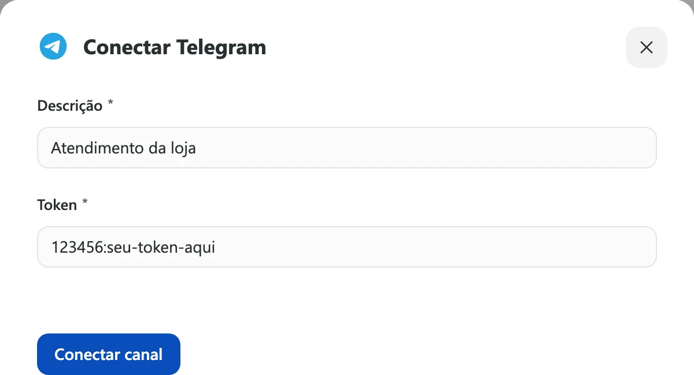

O canal de Telegram liga um bot do Telegram à Kinbox: as mensagens que os contatos enviam para o bot chegam na [Caixa de entrada](/docs/conversas/caixa-de-entrada-do-kinbox), onde os membros respondem. Ele conecta um bot do Telegram, e não a conta pessoal de alguém.

<Note>
  **Quem pode:** o proprietário do workspace e membros com a permissão **Gerenciar Canais** ([Criar papéis e permissões](/docs/configuracoes-no-workspace/configurar-permissoes-dos-usuarios)). A restrição **Somente pode dar manutenção simples em canais** esconde **Novo canal** e **Excluir** (o membro não cria nem exclui canais de Telegram). No teste grátis, o limite é de 1 canal de Telegram.
</Note>

## Antes de começar

- Crie um bot no Telegram pelo **@BotFather** (o bot oficial do Telegram para criar bots) e copie o token dele. A Kinbox não cria o bot.
- O token tem o formato `número:letras`, por exemplo `123456789:AAExemploDeTokenFicticio`. Guarde o token em um lugar seguro, pois ele dá acesso ao bot.

## Passo a passo

<Steps>
  <Step title="Abra a tela de canais">
    Vá em **Configurações** → **Chat** → **Canais** e clique em **Novo canal**.

    Se **Novo canal** não aparecer, peça ao proprietário do workspace para verificar se você tem a permissão **Gerenciar Canais** e está sem a restrição **Somente pode dar manutenção simples em canais**.
  </Step>
  <Step title="Escolha Telegram">
    Na tela **Conectar novo canal**, clique no cartão **Telegram**.
  </Step>
  <Step title="Preencha a descrição e o token">
    No painel **Conectar Telegram**, preencha **Descrição** (obrigatório, por exemplo "Atendimento da loja") e cole o token do bot em **Token** (obrigatório).

    <Frame caption="Painel Conectar Telegram preenchido com Descrição e um token fictício">
      
    </Frame>

    Clique em **Conectar canal**. Quando aparecer o aviso "Canal de Telegram criado.", a Kinbox volta para a lista com o canal **Conectado**.
  </Step>
  <Step title="Teste o canal">
    A Kinbox confere apenas se o token contém `:`; um token errado ou revogado no formato certo ainda cria um canal **Conectado**, mas que não recebe nem envia mensagens.

    Para confirmar que está funcionando, abra o bot no Telegram pelo nome de usuário dele, envie uma mensagem de teste, veja a conversa chegar na **Caixa de entrada** e responda pela Kinbox.
  </Step>
</Steps>

## Como funciona no dia a dia

- **O contato escreve primeiro:** a Kinbox não inicia conversa no Telegram ([Iniciar uma conversa com um contato](/docs/conversas/iniciar-conversa)). Divulgue o link ou o nome de usuário do bot para os contatos mandarem a primeira mensagem.
- **Dados do contato:** o contato entra com o nome, o sobrenome e a foto de perfil do Telegram, quando disponíveis. O telefone só entra no contato se a pessoa compartilhar o contato dela no Telegram.
- **Mensagens e arquivos:** os contatos podem enviar texto, foto, vídeo, áudio de voz e documento; os membros respondem com texto, arquivos e gravação de áudio.
- **Excluir mensagem:** no Telegram, você pode excluir mensagens que enviou pela Kinbox, e elas também são apagadas no Telegram.

<Tip>
  Use o bot do Telegram apenas na Kinbox. Se o mesmo bot for conectado depois em outra ferramenta ou em outro workspace, as mensagens passam a ir para lá.
</Tip>

## Editar e excluir

Na lista de canais, o canal aparece com a **Descrição** e "Bot do telegram" abaixo. Clique na linha para abrir o painel **Canal de Telegram**, que mostra **Status**, **Descrição** e **Token**.

- **Alterar o nome ou o token:** ao salvar, apenas a **Descrição** muda. O token não pode ser trocado pelo painel: para usar outro bot ou um token novo do mesmo bot, conecte um canal novo.
- **Copiar ID e excluir:** no menu de três pontos da linha ficam **Copiar ID** e, se aparecer, **Excluir** (ele não aparece para quem tem a restrição **Somente pode dar manutenção simples em canais**). **Excluir** desliga o canal e a Kinbox para de receber as mensagens do bot, mas as conversas não são apagadas. Se você conectar o mesmo token novamente no mesmo workspace, o canal volta com as conversas.

## Problemas comuns

- **"Token inválido" ao conectar:** o token está sem `:`. Copie o token completo do bot e tente novamente.
- **Canal Conectado, mas nenhuma mensagem chega:** o token está errado ou revogado, ou o bot foi conectado em outro lugar depois. Exclua o canal e conecte de novo com o token correto.
- **O contato diz que mandou mensagem, mas ela não chega:** confirme se ele escreveu para o bot certo, já que a conversa só começa quando o contato manda a primeira mensagem para o bot conectado.
- **A mensagem enviada fica com erro:** o Telegram recusou o envio (por exemplo, o contato bloqueou o bot).

Para ver outros tipos de canal, ações comuns e limites do plano, veja [Canais: conectar e gerenciar](/docs/canais/visao-geral).
