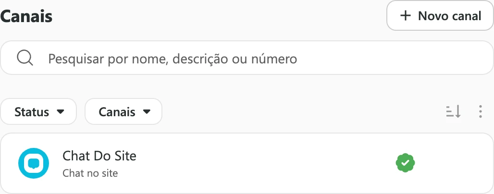

Um canal é uma conta de mensagem ligada ao seu workspace. As conversas dos canais chegam na [Caixa de entrada](/docs/conversas/caixa-de-entrada-do-kinbox), onde a equipe responde.

## Tipos de canal

Em **Conectar novo canal**, você pode conectar:

- **WhatsApp**
- **Facebook** ([Conectar o Facebook Messenger](/docs/canais/facebook/conectar))
- **Telegram**
- **E-mail**
- **Instagram** ([Conectar o Instagram](/docs/canais/instagram))
- **SMS**
- **Widget** (chat no site)
- **Customizado**

O **Voip** fica separado, em **Configurações** → **Chat** → **Voip**.

## Onde ficam os canais

Os canais ficam em **Configurações** → **Chat** → **Canais**. Clique em **Novo canal** para abrir a tela **Conectar novo canal**.

<Frame caption="Lista de canais com o botão Novo canal, a busca e os filtros">
  
</Frame>

Cada linha mostra o tipo do canal, o nome (a descrição), o número ou um detalhe, e o status à direita. Os canais de WhatsApp **Express** mostram o selo **v5**.

Para achar um canal:

- Pesquise por nome, descrição ou número.
- Filtre por **Status** ou por **Canais** (tipo de canal).
- Ordene por **Canal**, **A a Z** ou **Status**.

## Status dos canais de WhatsApp

| Status | O que significa | O que fazer |
| --- | --- | --- |
| **Conectado** | O canal está funcionando. Na lista, aparece como um selo verde. | Nada. |
| **Desconectado** | O canal está fora do ar. | Veja [Meu WhatsApp desconectou](/docs/canais/whatsapp/whatsapp-app/como-evitar-que-o-celular-desconecte). |
| **Necessário ler QR-Code** | O canal espera a leitura do QR Code no celular. | Abra o canal e leia o QR Code. Veja [Conectar o WhatsApp pelo QR Code](/docs/canais/conectar-whatsapp-app). |
| **Necessário reiniciar canal** | O canal precisa ser reiniciado. | Abra o canal e clique em **Reiniciar canal**. |
| **Criando...** / **Reiniciando...** | A Kinbox está criando o canal (até 10 minutos) ou reiniciando (até 5 minutos). | Espere. |
| **Recomendado recriar canal** | Canal de conexão **Clássica** desatualizado. | Recrie o canal, de preferência passando para a **Express**. Veja [Migrar da conexão Clássica para a Express](/docs/canais/whatsapp/whatsapp-app/migracao-tipo-classico-para-alternativo). |

Outros canais podem mostrar **Necessário relogar**, **Credenciais inválidos**, **Código inválido** ou **Código requerido**. Eles pedem para conectar a conta de novo.

A linha do canal também pode mostrar:

- um alerta de que o número possivelmente foi bloqueado pelo WhatsApp: veja [Meu número foi bloqueado](/docs/canais/whatsapp/whatsapp-app/o-que-fazer-se-meu-numero-foi-bloqueado);
- um ícone de carregamento enquanto as conversas são migradas para outro canal.

Quando um canal de WhatsApp cai, a lista de conversas mostra a faixa **Telefone desconectado** no topo.

## Ações nos canais de WhatsApp

No menu de três pontos da linha de um canal de WhatsApp:

- **Copiar ID**: copia o identificador do canal.
- **Excluir**: desliga o canal. As conversas não são apagadas. Se você conectar de novo o mesmo número no mesmo workspace, o canal antigo pode voltar, com as conversas.
- **Migrar conversas**: leva as conversas para outro canal de WhatsApp do workspace. Veja abaixo.

Nos canais por QR Code, o menu também tem **Desconectar**, **Reiniciar** e **Recriar** (e **Sincronizar histórico** na **Clássica**). Veja [Configurações do WhatsApp por QR Code](/docs/canais/whatsapp/whatsapp-app/configuracoes).

Nos canais oficiais, o menu também tem **Atualizar registro**, que pede de novo à Meta o registro do número. Você normalmente não precisa dela: use só quando o suporte pedir, e não use em canais de coexistência. Veja [Configurações do WhatsApp oficial](/docs/canais/whatsapp/whatsapp-cloud-api/configuracoes).

Para abrir as configurações, clique no canal.

### Migrar conversas

**Migrar conversas** move as conversas do canal para outro canal de WhatsApp. Escolha o canal em **Migrar para:** e clique em **Migrar**. Use, por exemplo, quando um número foi bloqueado e você passou a atender por outro.

- O processo pode levar algumas horas.
- As conversas migradas parecem ter sido sempre do canal de destino.
- Se o contato já tem conversa no canal de destino, a conversa dele não é migrada e fica no canal de origem.
- Se o destino for um WhatsApp oficial, as conversas migradas só aceitam template até o contato escrever de novo, e as conversas de grupo não continuam como grupo.

Confira o histórico nos dois canais antes de excluir o canal de origem.

## Quem pode gerenciar canais

- Para abrir a tela de canais, o membro precisa da permissão **Gerenciar Canais**. O proprietário do workspace sempre pode. Veja [Criar papéis e permissões](/docs/configuracoes-no-workspace/configurar-permissoes-dos-usuarios).
- Com a restrição **Somente pode dar manutenção simples em canais**, o membro só desconecta, reinicia, sincroniza o histórico e recria canais. Nos canais por QR Code, ele também não migra conversas.
- Outras restrições da seção **Canais** limitam quais canais o membro vê e se ele vê os alertas de desconexão.

## Limite de canais do plano

O plano define quantos canais de WhatsApp você pode ter, somando os oficiais e os por QR Code. [O Instagram](/docs/canais/instagram) tem limite próprio e não pode ser conectado no teste grátis. Na assinatura paga atual, os outros tipos não têm limite de quantidade, menos o **SMS**: um por workspace. No teste grátis, o workspace pode ter até 1 página do Facebook, 1 canal de Telegram e 3 canais de e-mail. Workspaces com a assinatura antiga têm outros tetos (até 50 páginas do Facebook, 10 canais de Telegram e 10 de e-mail). Para aumentar a quantidade, veja [Assinar ou mudar o plano](/docs/assinatura/assinar-ou-mudar-plano).

## Próximos passos

- [Qual WhatsApp usar: oficial ou QR Code](/docs/canais/whatsapp/visao-geral)
- [Conectar o WhatsApp oficial](/docs/canais/whatsapp-api-oficial-padrao)
- [Conectar o WhatsApp pelo QR Code](/docs/canais/conectar-whatsapp-app)
- [Conectar o Instagram](/docs/canais/instagram)
- [Conectar o Facebook Messenger](/docs/canais/facebook/conectar)
