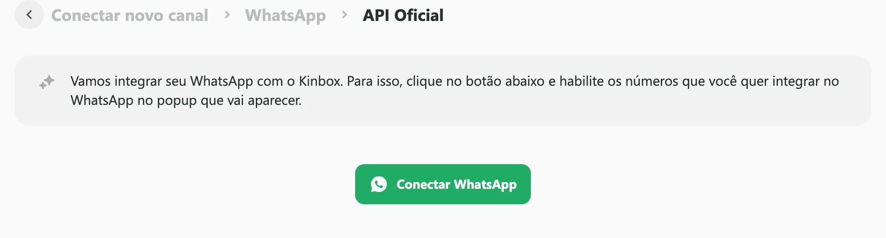

Conecte um número de telefone à Kinbox pelo WhatsApp oficial para usar esse número só na Kinbox. A conexão acontece em uma janela da Meta aberta dentro da própria Kinbox.

<Note>Quem pode: o dono do workspace e membros com a permissão **Gerenciar Canais**, sem a restrição **Somente pode dar manutenção simples em canais**. O plano precisa ter uma linha de WhatsApp livre — todos os canais de WhatsApp ativos entram na mesma contagem (veja [Canais](/docs/canais/visao-geral)).</Note>

## Antes de começar

- Leia [Antes de conectar o WhatsApp oficial](/docs/canais/requisitos-para-se-ter-uma-api-oficial) para conferir os requisitos e o que muda no atendimento.
- Esta página é para usar o número só na Kinbox. Se você quer manter o mesmo número no app WhatsApp Business do celular ao mesmo tempo, siga [Usar o mesmo número no app WhatsApp Business e na Kinbox (coexistência)](/docs/canais/whatsapp-api-oficial-coexistente). As duas opções começam no mesmo botão; o que define o modo é a escolha feita na janela da Meta.
- Libere pop-ups do navegador para o site da Kinbox, porque a conexão abre uma janela da Meta.

## Passo a passo

<Steps>
  <Step title="Abra a tela da API Oficial">
    Vá em **Configurações** → **Chat** → **Canais** → **Novo canal** → **WhatsApp** → **API Oficial**.

    Se você abrir **Configurações** → **Automação** → **WhatsApp API** sem nenhum canal oficial conectado, também pode clicar em **Conectar WhatsApp** na janela **Conecte uma API Oficial** para ir direto à mesma tela.
  </Step>
  <Step title="Clique em Conectar WhatsApp">
    Na tela **API Oficial**, clique em **Conectar WhatsApp** para abrir a janela da Meta.

    <Frame caption="Tela API Oficial com o botão Conectar WhatsApp">
      
    </Frame>
  </Step>
  <Step title="Complete o cadastro na janela da Meta">
    Na janela da Meta (em português), entre com sua conta do Facebook, escolha ou crie a empresa, a conta do WhatsApp Business e o número, e autorize o acesso da Kinbox.

    As telas e exigências dessa janela são da Meta e podem mudar.
  </Step>
  <Step title="Aguarde a conclusão na Kinbox">
    Não feche a aba da Kinbox enquanto a conexão termina. A tela mostra "Conectando canal de WhatsApp..." e, quando conclui, exibe "Canal de WhatsApp conectado." e volta para a lista de canais.
  </Step>
</Steps>

## Depois de conectar

- O canal aparece na lista com o status **Conectado**, o ícone "WhatsApp Oficial" e o nome verificado do número na Meta no campo **Descrição**. Você pode editar a **Descrição** na Kinbox sem mudar o nome exibido no WhatsApp.
- Faça um teste: envie uma mensagem de outro celular para o número conectado e responda pela **Caixa de entrada**.
- Próximos passos: revise as opções em [Configurações do WhatsApp oficial](/docs/canais/whatsapp/whatsapp-cloud-api/configuracoes), entenda a [Janela de 24 horas: quando é preciso usar um template](/docs/canais/whatsapp/whatsapp-cloud-api/janela-de-24-horas) e crie seus templates na **Central WhatsApp API**.

## Problemas comuns

- **Nada acontece ao clicar em Conectar WhatsApp:** o navegador pode estar bloqueando pop-ups. Libere pop-ups para a Kinbox e tente novamente.
- **Você fechou a janela da Meta antes do fim:** nenhum canal é criado e nenhum aviso aparece na Kinbox. Clique em **Conectar WhatsApp** de novo.
- **Apareceu "Erro ao conectar canal de WhatsApp.":** leia a mensagem que aparece junto para ver o motivo devolvido pela Meta ou pela Kinbox.
- **Apareceu "Você precisa remover canais de Whatsapp para prosseguir com a contratação":** o plano chegou ao limite de canais de WhatsApp ativos.
- **Você conectou de novo um número que o workspace já teve:** a Kinbox reaproveita o canal antigo, com o mesmo ID e as conversas, mesmo que ele tenha sido excluído. Se o canal ainda está ativo e o plano está no limite, a conexão é recusada: exclua o canal antes e conecte de novo.

Para outros avisos e erros, veja [Problemas ao conectar ou enviar pelo WhatsApp oficial](/docs/canais/whatsapp/whatsapp-cloud-api/problemas-comuns).
